+++
title = "Useful commands for macOS"
date = 2023-01-01T11:17:53Z
lastmod = 2023-01-01T11:17:53Z
author = "Kayte Studio"
categories = ["macOS"]
tags = ["codermag archive"]
originalUrl = "https://codermag.gleentech.com/2023/01/01/10-useful-commands-for-macos/"
+++

Hello readers and followers,

Today we are going to learn useful commands for a daily purpose. These commands are the basics to learn UNIX/POSIX. We will learn how to manage our terminal application. You can test them on Linux too.

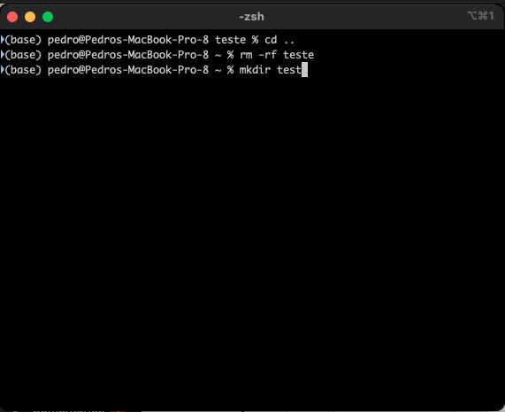 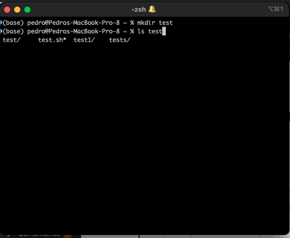 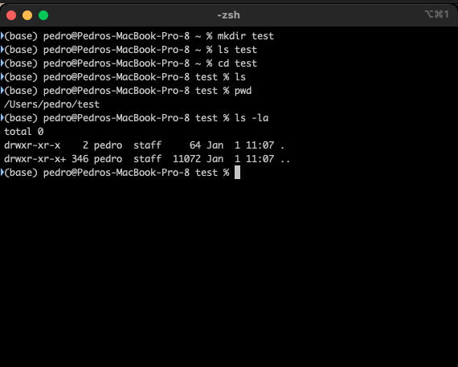 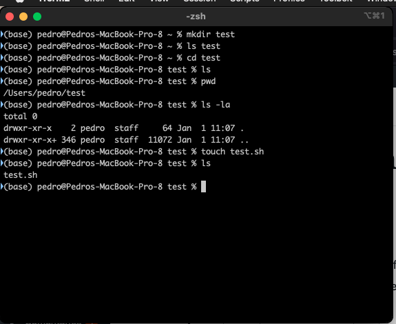 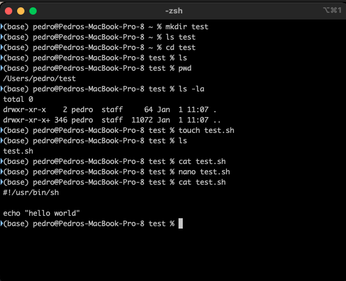

For the cat filename.sh, you need to edit the file on a text editor and type:

\#!/usr/bin/sh

echo "hello world"

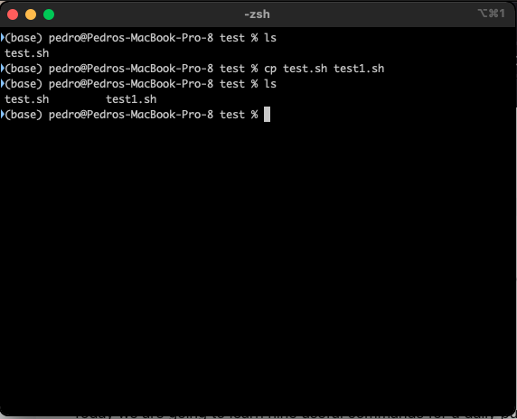

We done here a copy file, to explain how to remove a folder and a file.

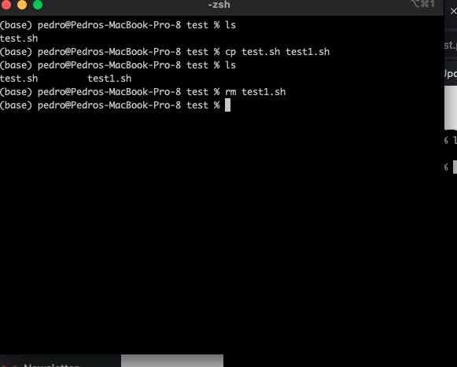 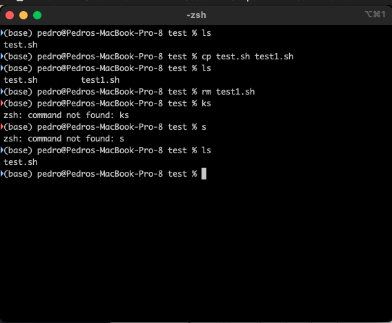

Now, we are going to learn rm -rf. This purpose command is to remove a folder. Before we learn how to remove a file from the hard disk drive.

We are going to see how we can remove a folder.

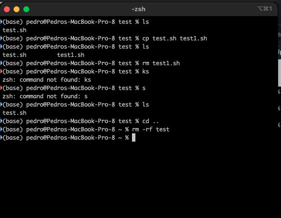 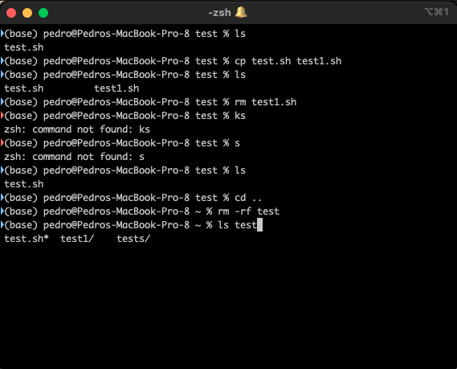

As we see here, you don't have the folder anymore, it has been erased.

Now, we are going to see more command.

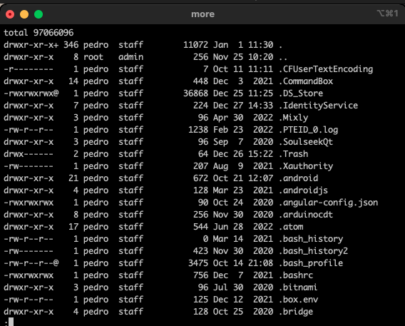

With more, you must type enter to see more files and folders. When it ends you should type q.
