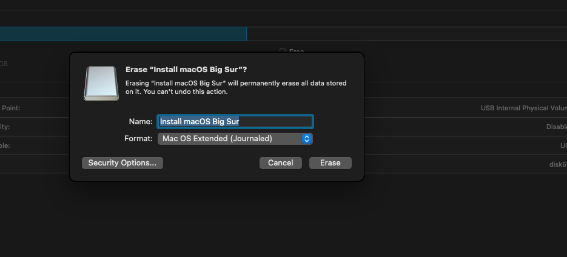
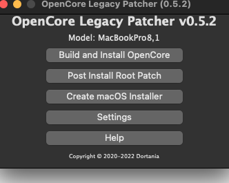

+++
title = "big sur on a unsupported Mac"
date = 2022-12-13T08:37:58Z
lastmod = 2022-12-13T08:37:58Z
author = "Kayte Studio"
categories = ["macOS"]
tags = ["codermag archive"]
originalUrl = "https://codermag.gleentech.com/2022/12/13/big-sur-on-a-unsupported-mac/"
+++

Hello readers,

Today I am going to teach how to make a USB drive for big sure under an unsupported Mac like mine, MBP 2011.

First of all, you must download or git clone the big sur patch.

1\)

- git clone https://github.com/barrykn/big-sur-micropatcher

2\) Flash a pen with Apple GUID partition.

Then you must download the opencore dmg for installation.

3\) https://github.com/dortania/OpenCore-Legacy-Patcher/releases, choose the latest version.

4\) Open the opencore patcher. You will see several options.

5\) Choose now, the first option. you will see several options for doing its task. You must in the end choose the hard disk, the right one, For me, I have two drives inside. I removed the SuperDrive and did the upgrades to wifi and Bluetooth devices.

6\) Now, you need to create macOS Installer. This option will download and build your USB.

7\) In the end, you will get a USB drive. Remember to disable FileVault first. With that, we cannot upgrade. I did the same to myself.

8\) In the end boot the pen derive and all set. We just need an upgrade to the kexts for the system. We must on the pen terminal, do this command:

- sudo /Volumes/name_of_the_drive/Downloads/name_of_the_patcher/payloads/patch_kexts.sh /Volume/name_of_the_drive

If is there any questions, I can explain.
