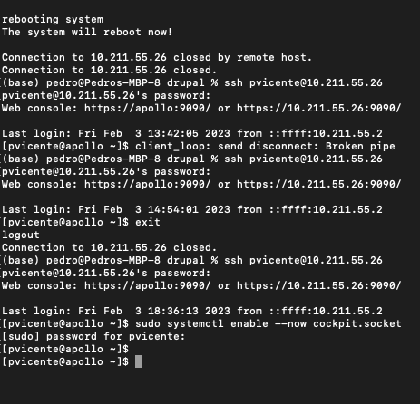
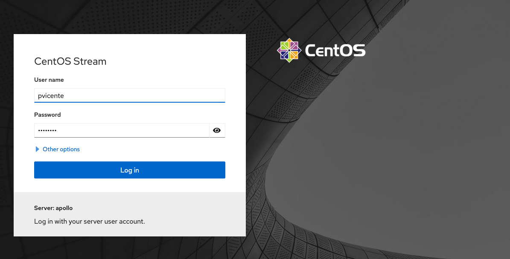
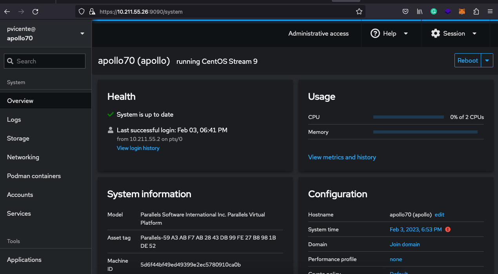

+++
title = "CentOS 9 stream web"
date = 2023-02-04T11:03:18Z
lastmod = 2023-02-04T11:03:18Z
author = "Kayte Studio"
categories = ["Unix / Linux"]
tags = ["codermag archive"]
originalUrl = "https://codermag.gleentech.com/2023/02/04/centos-9-stream-web/"
+++

Hello readers,

Today, we came to deliver one more article about POSIX. We are going to teach how to enable web dashboard on CentOS 9 stream.

sudo systemctl enable --now cockpit.socket

  

In the end, we will have the same dash on every address. You must see the IP address of your machine. For us, it's a 10.xx.xx.xx.

You must go to your browser at https://10.xx.xx.xx:9090. If you have 192.xx.xx.xx:9090, use it. You can find mine in the example above.
