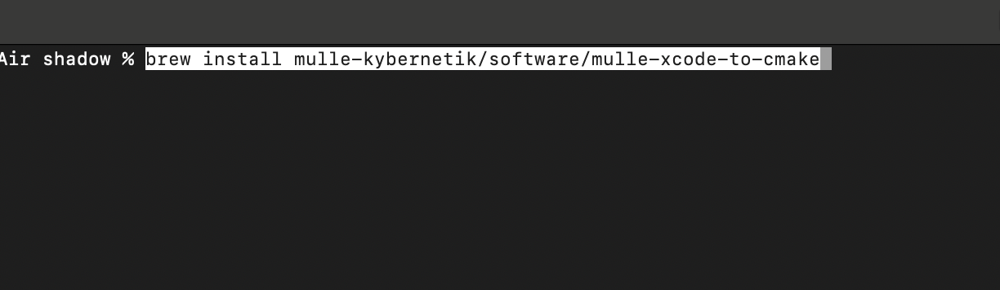
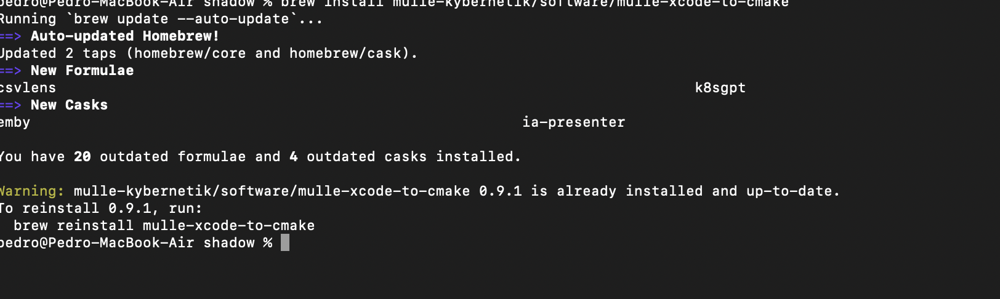
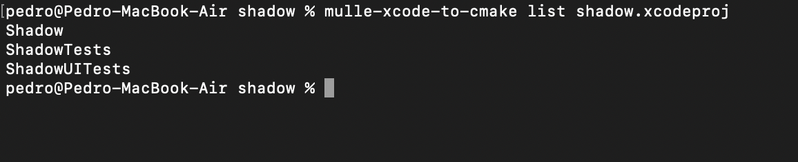
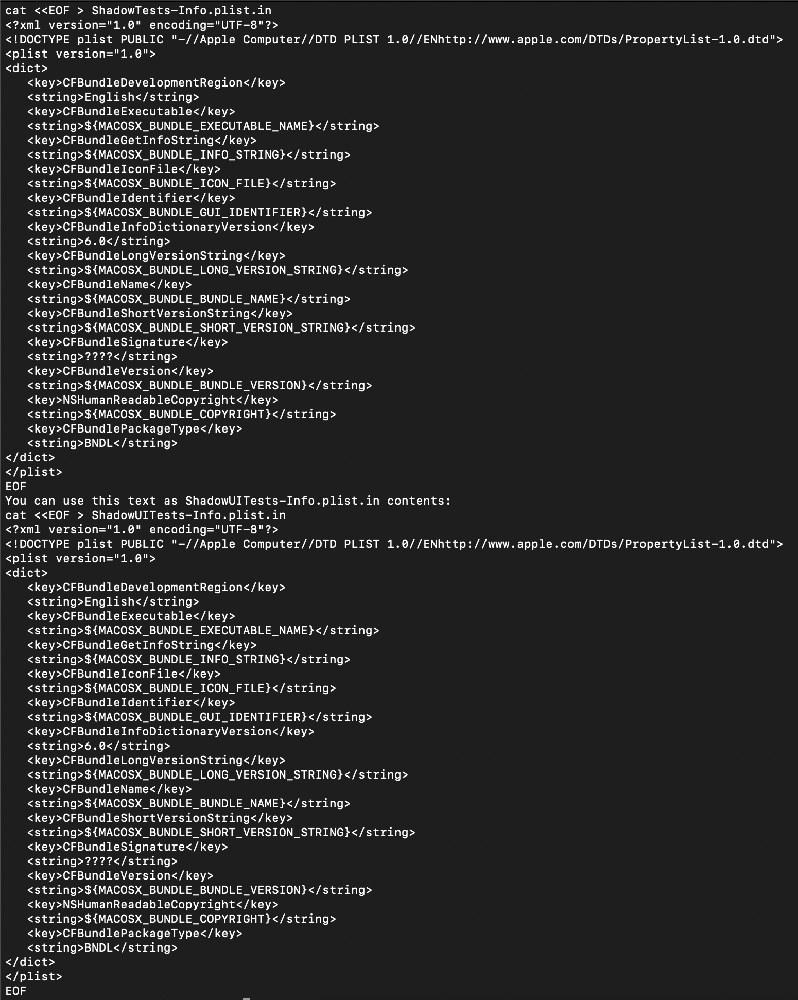
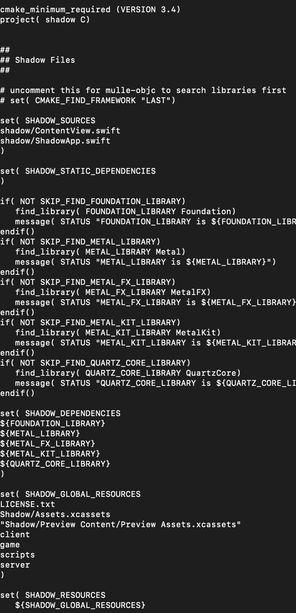

+++
title = "cmake con XCode"
date = 2024-01-08T10:39:33Z
lastmod = 2024-01-08T10:39:34Z
author = "Kayte Studio"
categories = ["macOS"]
tags = ["codermag archive"]
originalUrl = "https://codermag.gleentech.com/2024/01/08/cmake-con-xcode/"
+++

Hola Lectores,

Hoy, tenemos una lección sobre cmake fichero con XCode. Ha sido testeado con un m2 "motherboard".



Para nosotros, tenemos la instalación. Para tí tienes que hacer la instalación.



Ahora:



``` text
mulle-xcode-to-cmake -b export shadow.xcodeproj > CMakeLists.txt
```

 

Ahora es un "boilerplate", que necesita de hacer cambios.

``` bash
mkdir build && cd build
cmake ../
make
```

Cada vez que hacemos de cambio, tenemos que actualizar el CMakeLists.txt para cada "build", tenemos que hacer siempre

``` bash
cd .. 
rm -rf build
mkdir build && cd build
cmake ../
make 
```
