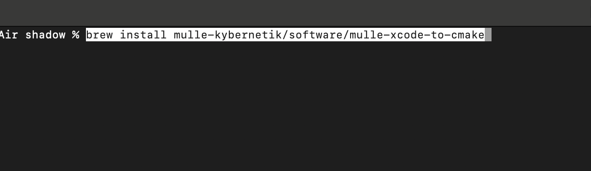
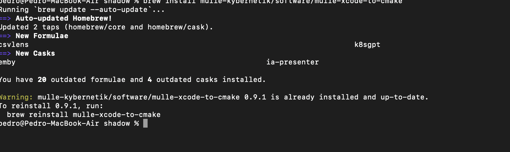
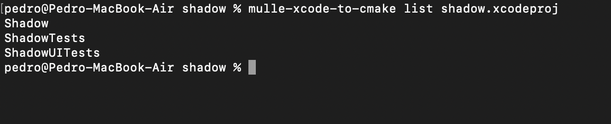
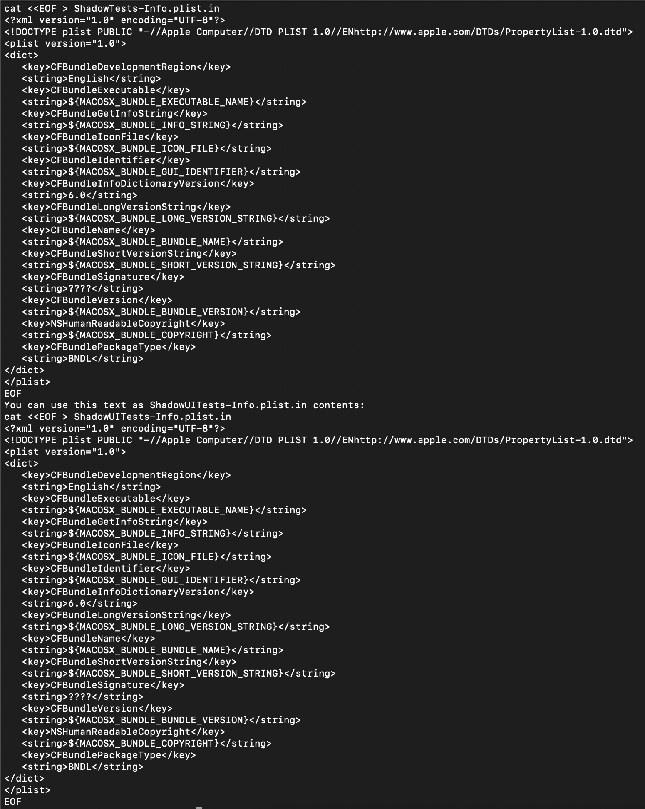
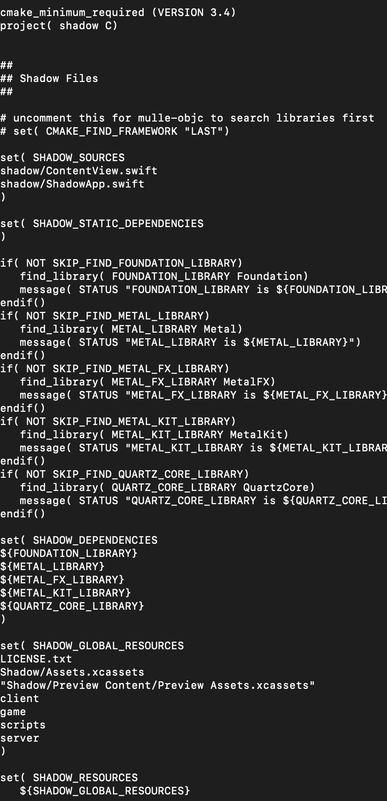

+++
title = "cmake with XCode"
date = 2024-01-08T09:51:05Z
lastmod = 2024-01-08T09:51:06Z
author = "Kayte Studio"
categories = ["macOS"]
tags = ["codermag archive"]
originalUrl = "https://codermag.gleentech.com/2024/01/08/cmake-with-xcode/"
+++

Hello readers,

Today, we are going to learn how to make a cmake file from XCode. We done this on a m2 motherboard.



For us, its' already installed. For all of you it will install.



Now:



``` text
mulle-xcode-to-cmake -b export shadow.xcodeproj > CMakeLists.txt
```

 

It's now a boilerplate for your needs, you must now add source code to the build.

``` bash
mkdir build && cd build
cmake ../
make
```

Every time you do changes, don't forget to update CMakeLists.txt for your build, everytime you change do this

``` bash
cd .. 
rm -rf build
mkdir build && cd build
cmake ../
make 
```
