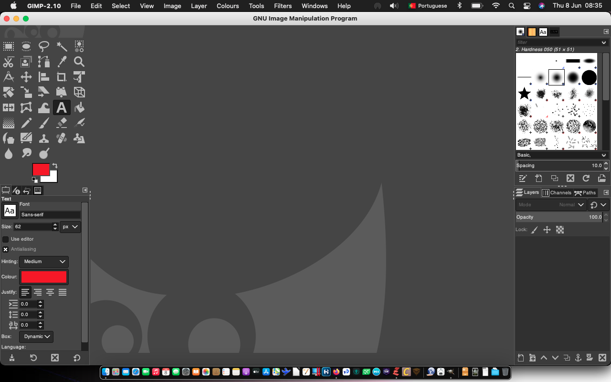
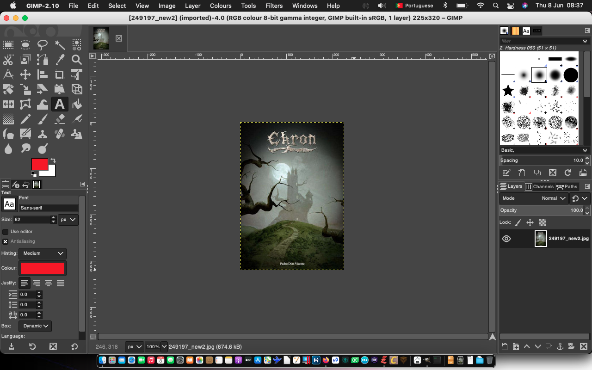
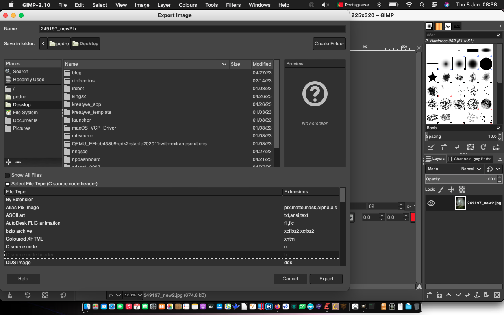
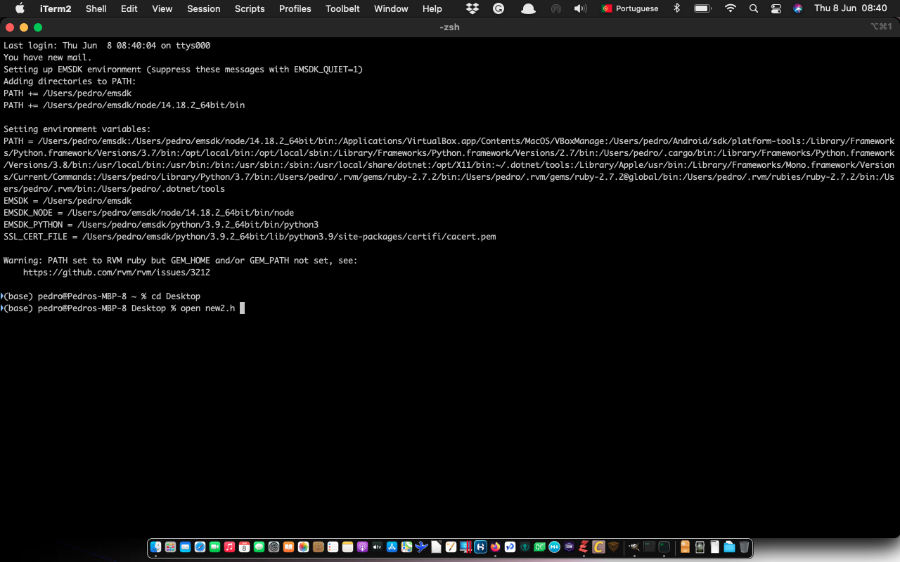
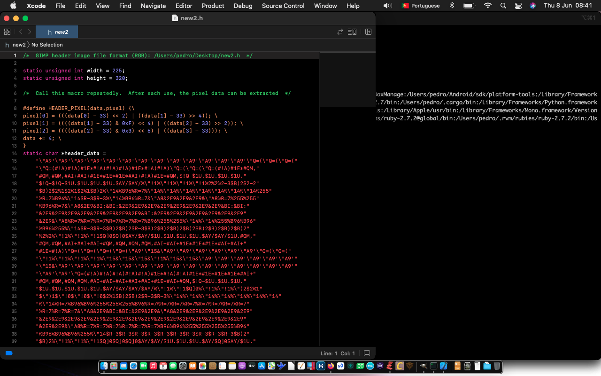

+++
title = "Cómo hacer un c header con una imagen de foto"
date = 2023-06-08T07:58:33Z
lastmod = 2023-06-08T07:58:33Z
author = "Kayte Studio"
categories = ["Labs", "macOS"]
tags = ["codermag archive"]
originalUrl = "https://codermag.gleentech.com/2023/06/08/como-hacer-un-c-header-con-una-imagen-de-foto/"
+++

Hola Lectores,

Hoy,

vamos a aprender cómo hacer un c header a partir de un archivo de imagen jpeg.

.

