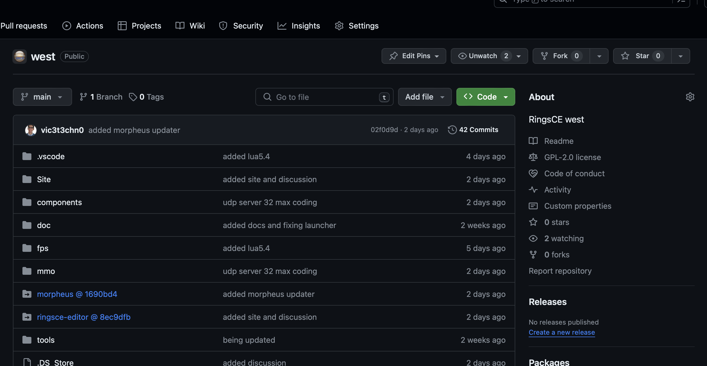
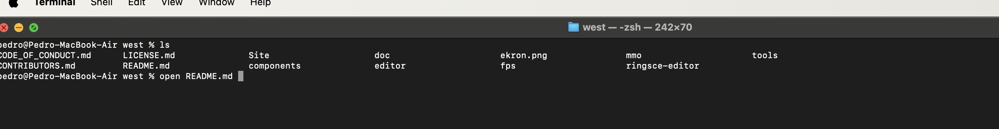
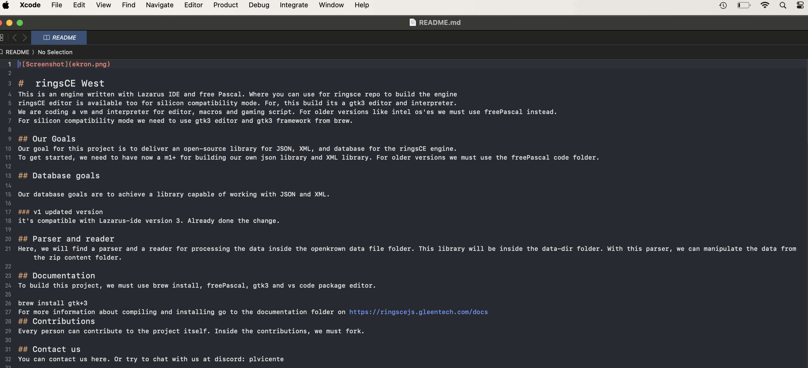
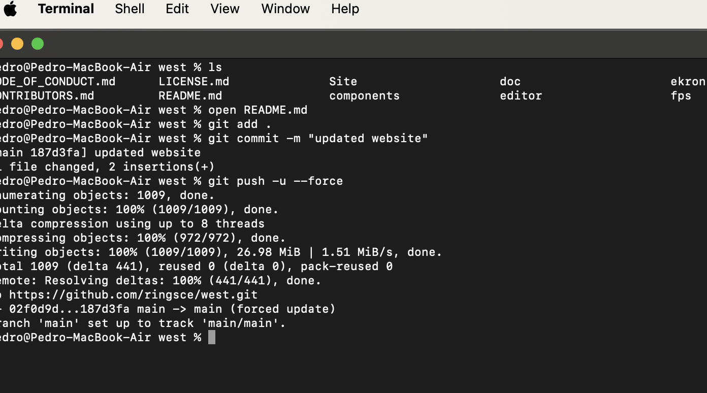
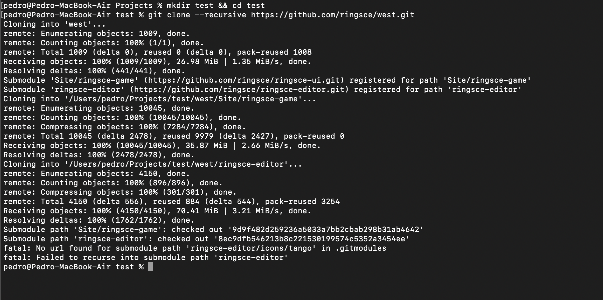

+++
title = "Cómo usar git"
date = 2024-01-18T08:55:22Z
lastmod = 2024-01-18T08:55:23Z
author = "Kayte Studio"
categories = ["macOS"]
tags = ["codermag archive"]
originalUrl = "https://codermag.gleentech.com/2024/01/18/como-usar-git/"
+++

Hoy, tenemos un tutorial sobre git submodules.

En este tutorial tenemos 4 comandos como ejemplo.

Para hacerlo, tenemos que hacer un clone o fork de un repo que kreatyve designs tiene en github.

``` bash
git clone https://github.com/ringsce/west.git
```



Ahora tenemos que que abrir el fichero README.md

 

``` bash
poner este codigo en README.md
## Site
MMO sign up website
```

``` bash
git add .
git commit -m "added website for sign up"
git push -u --force
```

Después tenemos el fork



``` bash
mkdir test && cd test
git clone --recursive https://github.com/ringsce/west.git
```


