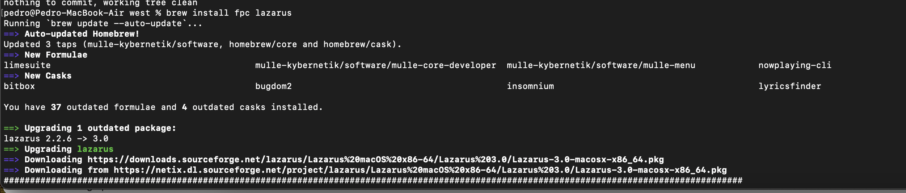
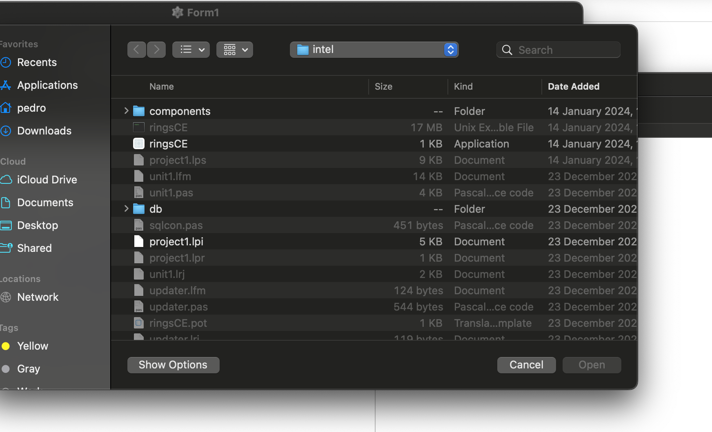
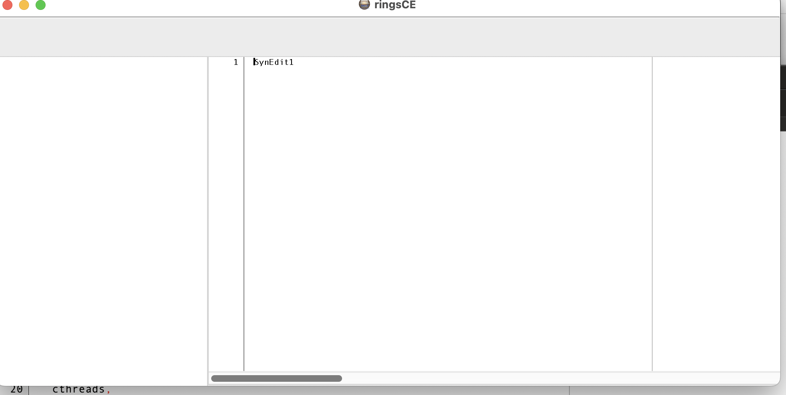

+++
title = "Cómo usar lazarus ide en macOS"
date = 2024-01-25T10:02:56Z
lastmod = 2024-01-25T10:02:56Z
author = "Kayte Studio"
categories = ["macOS"]
tags = ["codermag archive"]
originalUrl = "https://codermag.gleentech.com/2024/01/25/como-usar-lazarus-ide-en-macos/"
+++

Hola lectores,

Primero vamos hacer la instalación de brew.sh

``` wp-block-code
/bin/bash -c "$(curl -fsSL https://raw.githubusercontent.com/Homebrew/install/HEAD/install.sh)"
```

Después hacer la instalación de freepascal y lazarus.



Para nosotros es una actualización.

Ahora tenemos que abrir la carpeta del proyecto.

``` wp-block-code
git clone --recursive https://github.com/ringsce/west.git
```

Abrir el proyecto en la carpeta ringsce-editor y abrir el project1.lpi



Para terminar, pulsar compile y debugging.

``` wp-block-code
compile
run without debugging
```



En proximo artículo tenemos una explicación como hacer "modulos" para la plataforma ringsCE.
