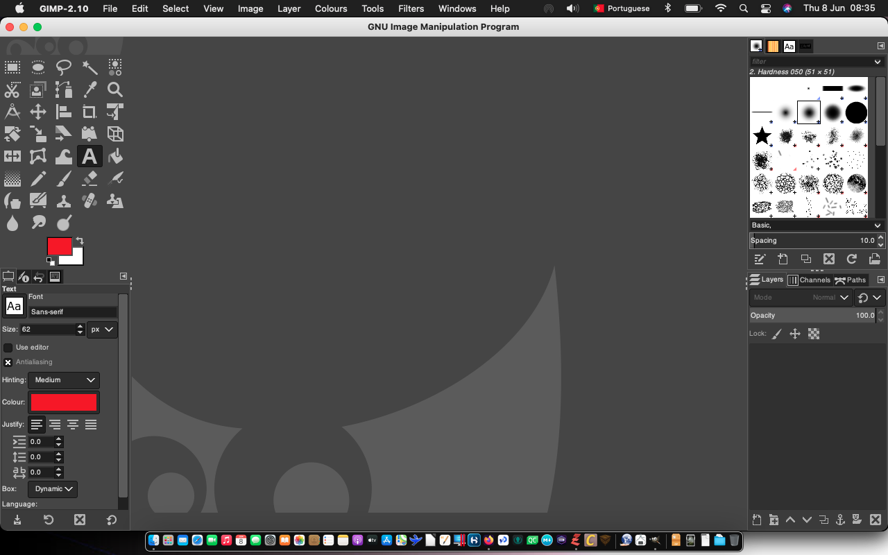
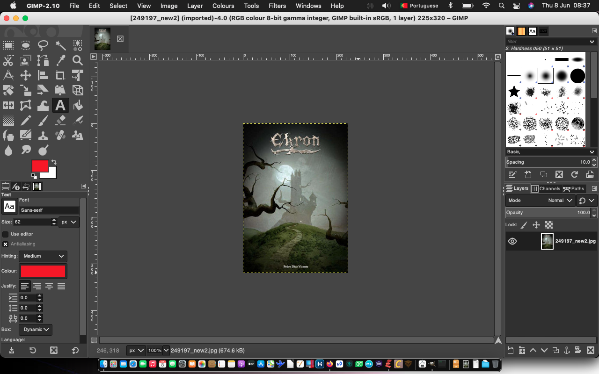
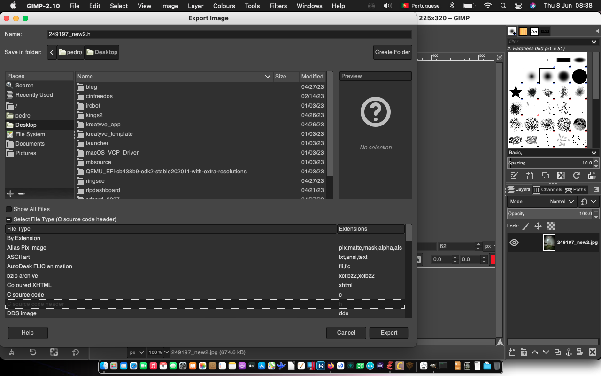
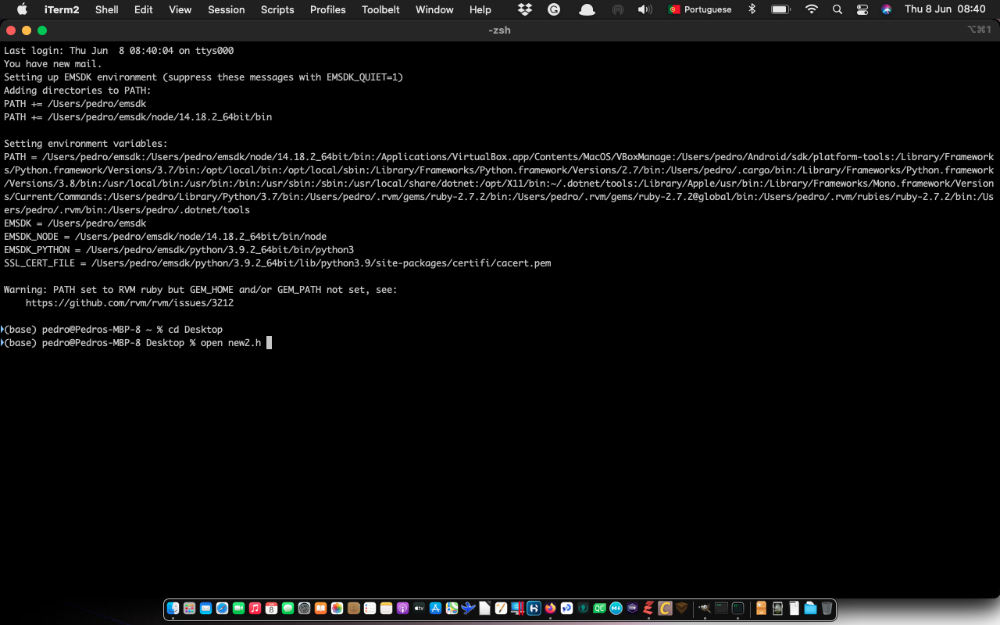
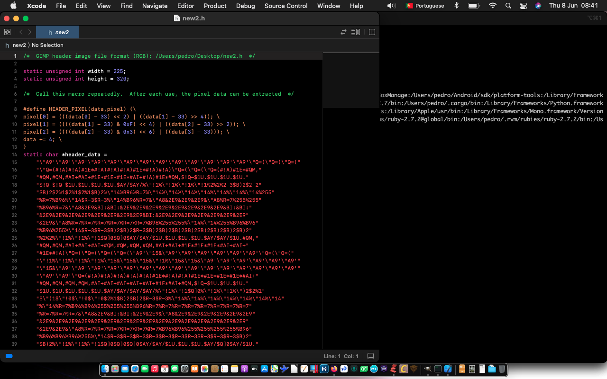

+++
title = "Create a header file from a photo file"
date = 2023-06-08T07:51:50Z
lastmod = 2023-06-08T07:51:50Z
author = "Kayte Studio"
categories = ["Labs", "macOS"]
tags = ["codermag archive"]
originalUrl = "https://codermag.gleentech.com/2023/06/08/create-a-header-file-from-a-photo-file/"
+++

Hello readers,

Today, we are going to learn how to make a c header from a jpg image file.

 

