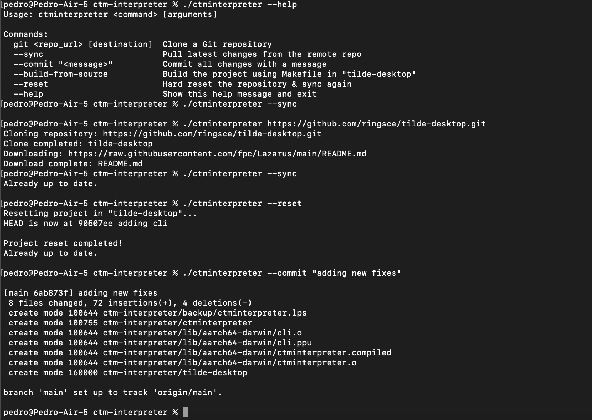

+++
title = "ctm interpreter"
date = 2025-03-30T12:55:31Z
lastmod = 2025-03-30T12:55:31Z
author = "Kayte Studio"
categories = ["macOS"]
tags = ["codermag archive"]
originalUrl = "https://codermag.gleentech.com/2025/03/30/ctm-interpreter/"
+++

### **Introducing the CTM Interpreter CLI for Ringsce SDK**

🚀 **A powerful CLI tool for macOS and Linux (ARM64) to manage, update, and sync the Ringsce SDK**

------------------------------------------------------------------------

### **🔹 What is the CTM Interpreter CLI?**

The **CTM Interpreter CLI** is a command-line utility designed to automate the synchronization and build processes for the **Ringsce SDK**. It is optimized for **macOS and Linux (ARM64)** and serves as the primary tool for maintaining and updating the **Ringsce SDK** from its main project repository, [`tilde-desktop`](https://github.com/ringsce/tilde-desktop).

------------------------------------------------------------------------

### **🌍 Key Features**

✅ **Sync the SDK with the latest updates** (`--sync`)\
✅ **Clone and update repositories from GitHub**\
✅ **Commit and push changes seamlessly** (`--commit "<message>"`)\
✅ **Build the SDK from source using `make`** (`--build-from-source`)\
✅ **Reset the project repository and resync** (`--reset`)\
✅ **Fully compatible with macOS and Linux ARM64 systems**

------------------------------------------------------------------------

### **⚙️ How It Works**

1️⃣ **Clone the Ringsce SDK Repo**

``` sh
./ctminterpreter https://github.com/ringsce/tilde-desktop.git
```

2️⃣ **Sync the Latest Changes**

``` sh
./ctminterpreter --sync
```

3️⃣ **Commit & Push Code Updates**

``` sh
./ctminterpreter --commit "Updated SDK with latest features"
```

4️⃣ **Build the SDK from Source**

``` sh
./ctminterpreter --build-from-source
```

5️⃣ **Reset & Resync the SDK Repository**

``` sh
./ctminterpreter --reset
```

------------------------------------------------------------------------



### **🔗 Official Resources**

🌐 **Website:** [ringscejs.gleentech.com](https://ringscejs.gleentech.com)\
📂 **GitHub:** [github.com/ringsce](https://github.com/ringsce)\
🚀 **Main Repository:** [tilde-desktop](https://github.com/ringsce/tilde-desktop)

Stay updated with the latest developments and contribute to **Ringsce SDK** today! 🎯
