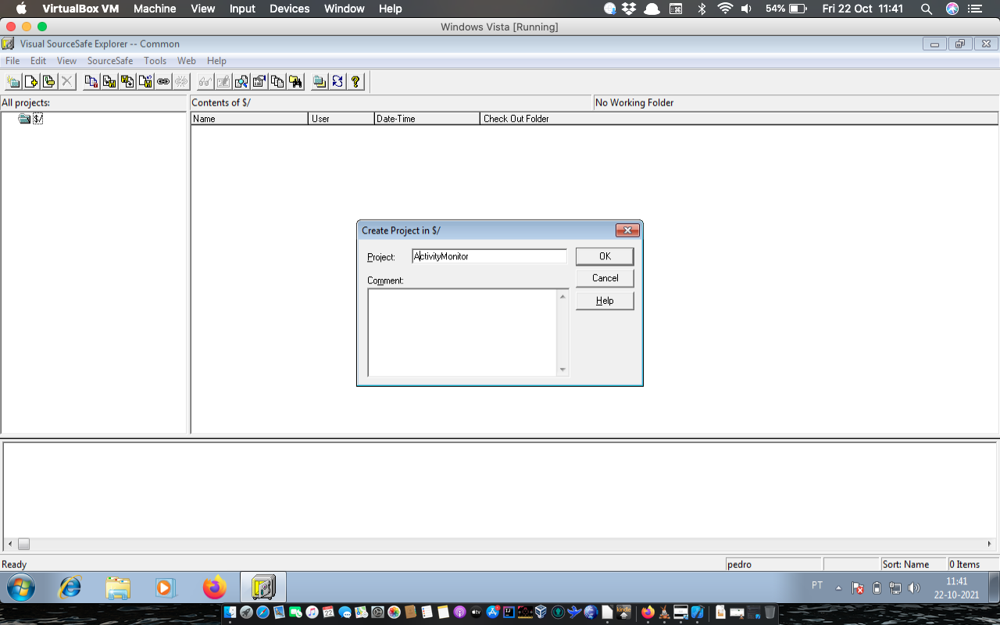
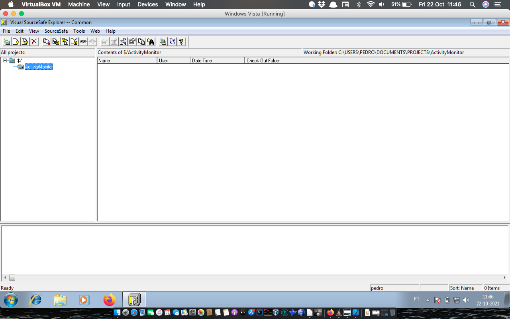

+++
title = "Devlogs of Today – Win32"
date = 2021-10-22T11:02:53Z
lastmod = 2021-10-22T11:02:53Z
author = "Kayte Studio"
categories = []
tags = ["win32", "winapi", "windows", "codermag archive"]
originalUrl = "https://codermag.gleentech.com/2021/10/22/devlogs-of-today-win32/"
+++

The devlogs of today are back. Back again. Today we will talk about stdafx and windows API. These two options can be useful for windows development besides reactos.

With these two options, we can code and have control over our application for windows 7+ and ReactOS. ReactOS is also types everything with windows API. The win32 API. What is Win32? This core came from windows 95 and beyond. This demystification source can be used with VS SourceSafe. Even this software is offline now but it’s good for our needs.

The stdafx is a Windows native library. With this option, the software will be fully compliant with the windows versions out there even compliant with reactos.

Stdafx.cpp:

``` c
// stdafx.cpp : source file that includes just the standard includes
// Demo.pch will be the pre-compiled header
// stdafx.obj will contain the pre-compiled type information
#include "stdafx.h"
// TODO: reference any additional headers you need in STDAFX.H
// and not in this file
```

stdafx.h:

``` c
// stdafx.h : include file for standard system include files,
// or project specific include files that are used frequently, but
// are changed infrequently
//
#pragma once
// Modify the following defines if you have to target a platform prior to the ones specified below.
// Refer to MSDN for the latest info on corresponding values for different platforms.
#ifndef WINVER // Allow use of features specific to Windows XP or later.
#define WINVER 0x0501 // Change this to the appropriate value to target other versions of Windows.
#endif
#ifndef _WIN32_WINNT // Allow use of features specific to Windows XP or later.
#define _WIN32_WINNT 0x0501 // Change this to the appropriate value to target other versions of Windows.
#endif
#ifndef _WIN32_WINDOWS // Allow use of features specific to Windows 98 or later.
#define _WIN32_WINDOWS 0x0410 // Change this to the appropriate value to target Windows Me or later.
#endif
#ifndef _WIN32_IE // Allow use of features specific to IE 6.0 or later.
#define _WIN32_IE 0x0600 // Change this to the appropriate value to target other versions of IE.
#endif
#define WIN32_LEAN_AND_MEAN // Exclude rarely-used stuff from Windows headers
// Windows Header Files:
#include <windows.h>
#include <shellapi.h>
// C RunTime Header Files
#include <stdlib.h>
#include <malloc.h>
#include <memory.h>
#include <tchar.h>
// TODO: reference additional headers your program requires here
```

With these two files, the source code will be more compliant. These two compliant codes will save you more time to code for windows 7+ to reactos.

Main.cpp

``` c
#include <windows.h>
/* This is where all the input to the window goes to */
LRESULT CALLBACK WndProc(HWND hwnd, UINT Message, WPARAM wParam, LPARAM lParam) {
switch(Message) {
/* Upon destruction, tell the main thread to stop */
case WM_DESTROY: {
PostQuitMessage(0);
break;
}
/* All other messages (a lot of them) are processed using default procedures */
default:
return DefWindowProc(hwnd, Message, wParam, lParam);
}
return 0;
}
/* The 'main' function of Win32 GUI programs: this is where execution starts */
int WINAPI WinMain(HINSTANCE hInstance, HINSTANCE hPrevInstance, LPSTR lpCmdLine, int nCmdShow) {
WNDCLASSEX wc; /* A properties struct of our window */
HWND hwnd; /* A 'HANDLE', hence the H, or a pointer to our window */
MSG msg; /* A temporary location for all messages */
/* zero out the struct and set the stuff we want to modify */
memset(&wc,0,sizeof(wc));
wc.cbSize = sizeof(WNDCLASSEX);
wc.lpfnWndProc = WndProc; /* This is where we will send messages to */
wc.hInstance = hInstance;
wc.hCursor = LoadCursor(NULL, IDC_ARROW);
/* White, COLOR_WINDOW is just a #define for a system color, try Ctrl+Clicking it */
wc.hbrBackground = (HBRUSH)(COLOR_WINDOW+1);
wc.lpszClassName = "WindowClass";
wc.hIcon = LoadIcon(NULL, IDI_APPLICATION); /* Load a standard icon */
wc.hIconSm = LoadIcon(NULL, IDI_APPLICATION); /* use the name "A" to use the project icon */
if(!RegisterClassEx(&wc)) {
MessageBox(NULL, "Window Registration Failed!","Error!",MB_ICONEXCLAMATION|MB_OK);
return 0;
}
hwnd = CreateWindowEx(WS_EX_CLIENTEDGE,"WindowClass","Caption",WS_VISIBLE|WS_OVERLAPPEDWINDOW,
```

CW_USEDEFAULT, /\* x \*/

CW_USEDEFAULT, /\* y \*/

``` c
640, /* width */
480, /* height */
NULL,NULL,hInstance,NULL);
if(hwnd == NULL) {
MessageBox(NULL, "Window Creation Failed!","Error!",MB_ICONEXCLAMATION|MB_OK);
return 0;
}
/*
This is the heart of our program where all input is processed and sent to WndProc. Note that GetMessage blocks code flow until it receives something, so
this loop will not produce unreasonably high CPU usage
*/
while(GetMessage(&msg, NULL, 0, 0) > 0) { /* If no error is received... */
TranslateMessage(&msg); /* Translate key codes to chars if present */
DispatchMessage(&msg); /* Send it to WndProc */
}
return; msg.wParam;
}
```

This file main.cpp presents a core main window. For the next time, we code the demo application, the time spent will be less.

The include windows.h will help us to code natively the applications.

We declare a window to draw everything. With LRESULT CALLBACK WndProc;

We create our window or windows before the int WinMain.

The WinMain is our main function.

The VS Sourcesafe 6.0 we must run as Administrator to run the application. Then create a folder project repository and create our own projects sync.

 

We used Embarcadero c++ for the compliant source code.

They use the system already for makefile structure. The system is already to boost on our systems built on our company, these systems are windows 7 and windows 10 besides reactos.
