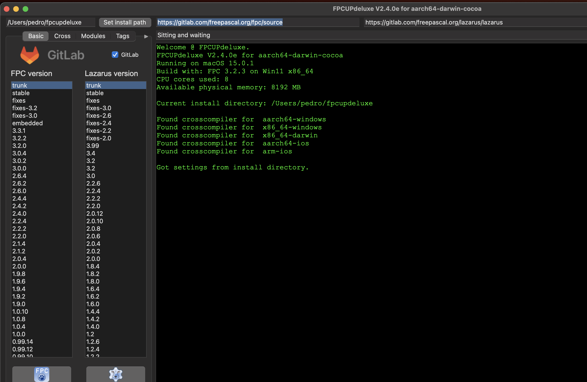
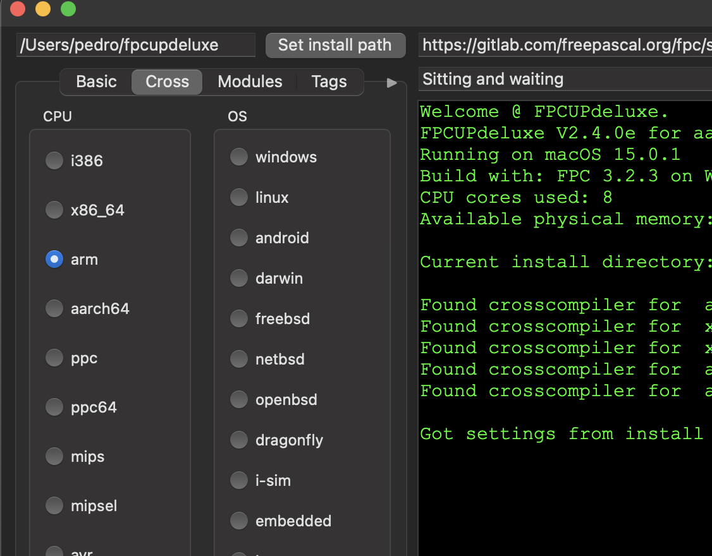

+++
title = "Ekron Realms tooclchain"
date = 2024-10-24T09:06:07Z
lastmod = 2024-10-24T09:06:07Z
author = "Kayte Studio"
categories = ["macOS"]
tags = ["codermag archive"]
originalUrl = "https://codermag.gleentech.com/2024/10/24/ekron-realms-tooclchain/"
+++

To use Ekron Realms with Freepascal and Lazarus use this tool to update your compiler. If you update the cross for arm64 ios and arm (32 bit) you will be able to compile for iOS. I will teach how to use Android also. For now iOS.

In the next tutorials we will learn how to build Ekron Realms for macOS silicon and iOS, Android for your needs. We are going to learn how to use rings Engine for the games.

See you soon...
