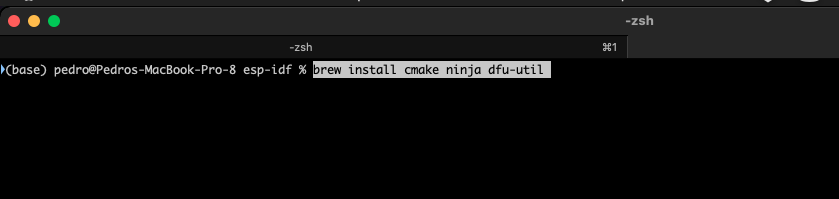
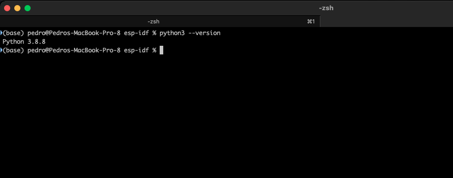
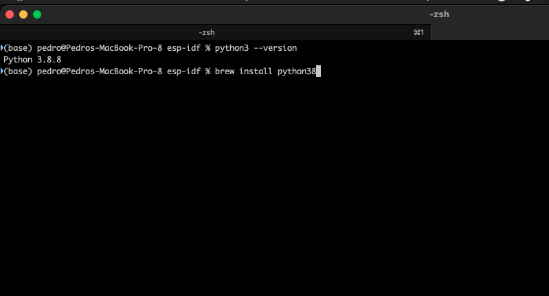
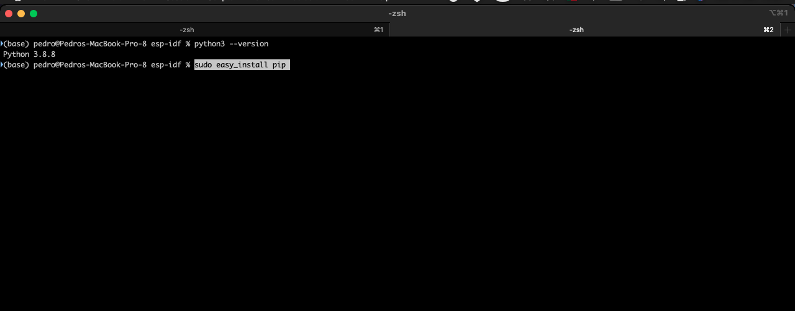
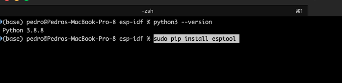

+++
title = "esp-idf macos (en Castellano)"
date = 2023-05-10T14:49:53Z
lastmod = 2023-05-10T14:49:53Z
author = "Kayte Studio"
categories = ["macOS"]
tags = ["codermag archive"]
originalUrl = "https://codermag.gleentech.com/2023/05/10/esp-idf-macos-en-castellano/"
+++

Hoy, tenemos un tutorial sobre requisitos para odroid y esp32 en macOS ordenadora. Para eso tenemos que obtener estes paquetes.

https://www.silabs.com/documents/public/software/Mac_OSX_VCP_Driver.zip

Después de terminar la instalación del driver zip tenemos que hacer "reboot" en macos, ahora sigue el artículo.

brew install cmake ninja dfu-util

En big sur necesitamos de obtener el python3. Primero escribe esto en el terminal:

brew install python38

sudo easy_install pip

sudo pip install esptool

Ahora con las tareas hechas tenemos todo para empezar .
