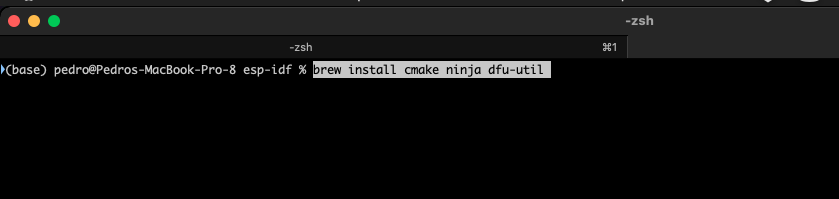
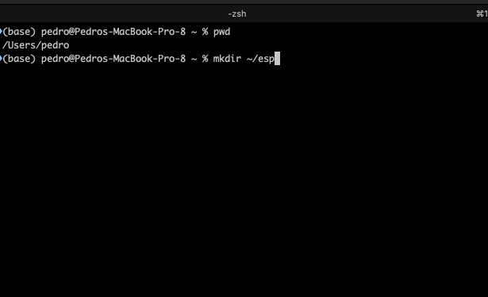
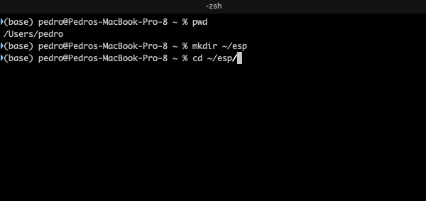
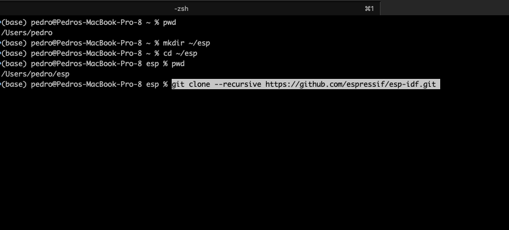
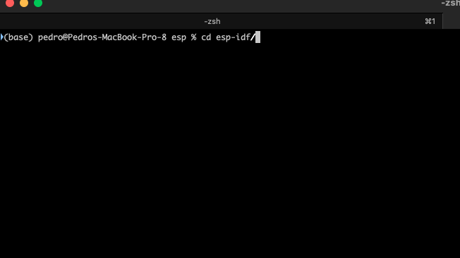
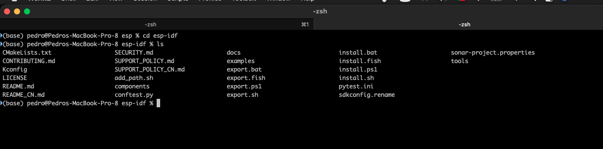
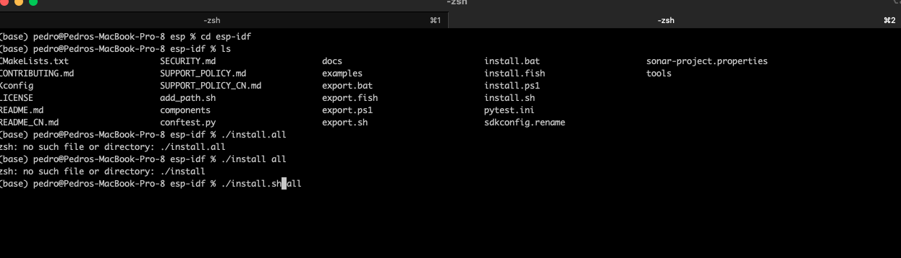
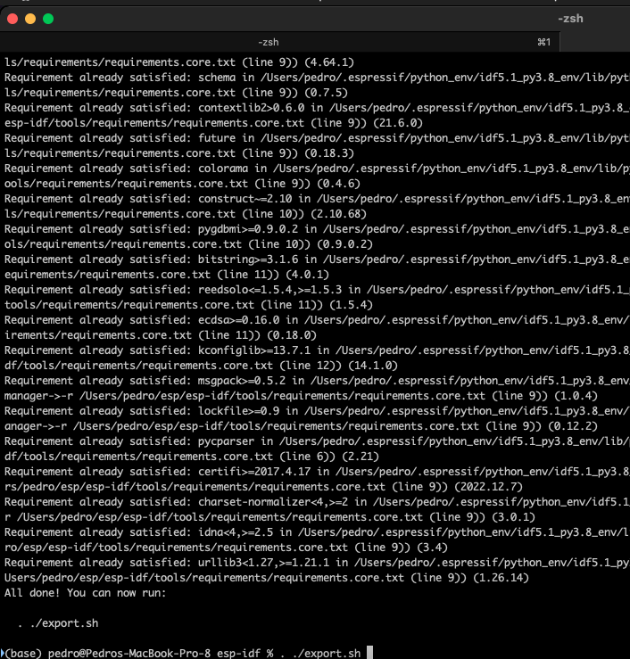

+++
title = "esp-idf on macOS"
date = 2023-01-17T12:00:10Z
lastmod = 2023-01-17T12:00:10Z
author = "Kayte Studio"
categories = ["macOS"]
tags = ["codermag archive"]
originalUrl = "https://codermag.gleentech.com/2023/01/17/esp-idf-on-macos/"
+++

Hello readers,

Today, we are going to learn how to install esp-idf on macOS.

But first to compile the toolchain before that, we must install by brewing the following items on terminal or iTerm2

``` bash
brew install cmake ninja dfu-util
```



We don't have apple m1 or m2 so, we couldn't test it with rosetta2. We tested on a big sur machine, MacBook pro. We have the toolchain running on a MBP dev machine.

  

After cloning the repos follow the next steps.

   
