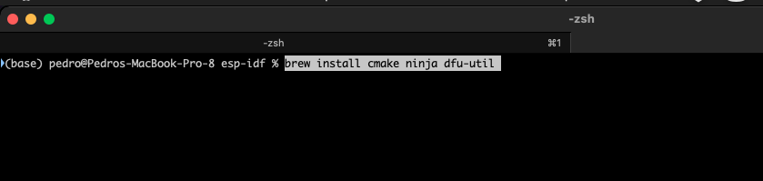
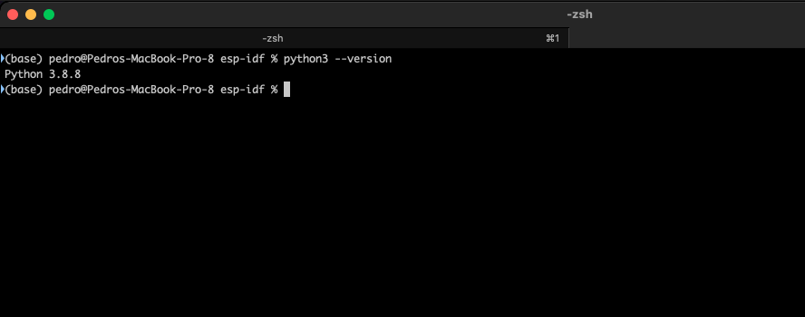
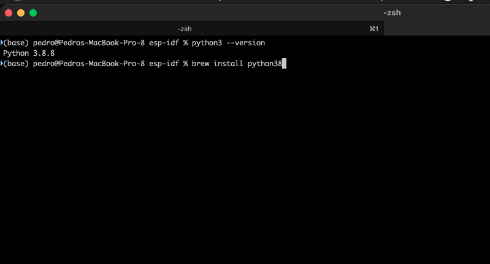
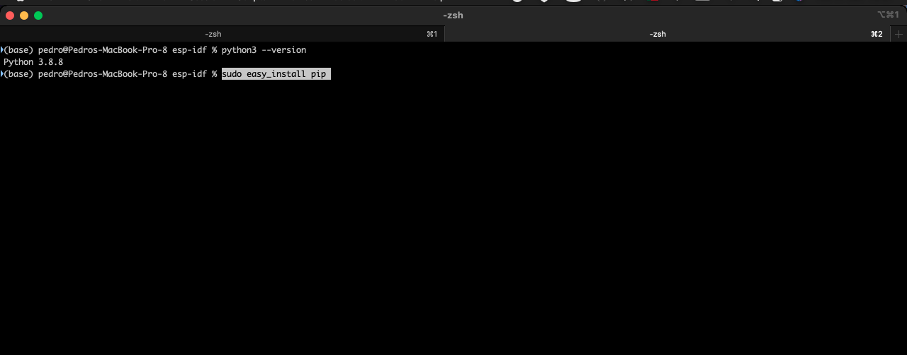
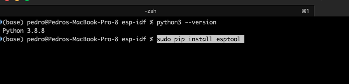

+++
title = "esp-idf requirements for macOS"
date = 2023-01-17T13:42:14Z
lastmod = 2023-01-17T13:42:14Z
author = "Kayte Studio"
categories = ["macOS"]
tags = ["codermag archive"]
originalUrl = "https://codermag.gleentech.com/2023/01/17/esp-idf-requirements-for-macos/"
+++

Today, we will see how to install the requirements for odroid and esp32 on a macOS machine. But you must install

https://www.silabs.com/documents/public/software/Mac_OSX_VCP_Driver.zip

After installation of that zip driver and reboot macos, you can follow the article.

``` bash
brew install cmake ninja dfu-util
```



On big sur you must have python3. But first type this on terminal:



``` bash
brew install python38
```



``` bash
sudo easy_install pip
```



``` bash
sudo pip install esptool
```



I have done these steps already. You must type them on terminal or iTerm2.

These procedures must be done before flashing or coding any kind of source code.
