+++
title = "Fedora 37 instalación"
date = 2023-04-13T09:19:28Z
lastmod = 2023-04-13T09:19:28Z
author = "Kayte Studio"
categories = ["macOS"]
tags = ["codermag archive"]
originalUrl = "https://codermag.gleentech.com/2023/04/13/fedora-37-instalacion/"
+++

Hola lectores.

Hoy, vamos a instalar Fedora 37 beta bajo Parallels. Uso Parallels desde 2015. Ahora construyo mis máquinas virtuales debajo de él.

Primero, debe obtener la iso netinstall de getfedora.

<https://getfedora.org/en/workstation/download/>

Después, abrir Parallels Y crear una nueva VM.

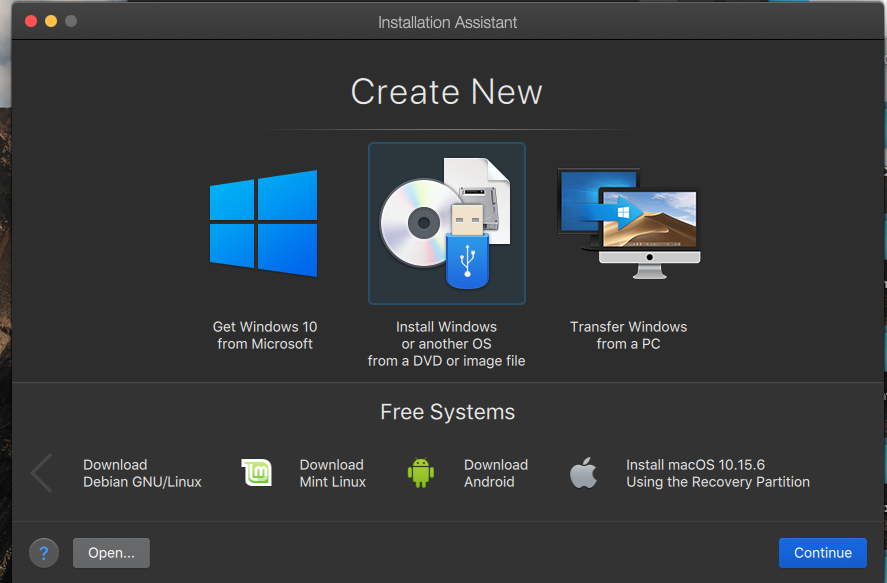 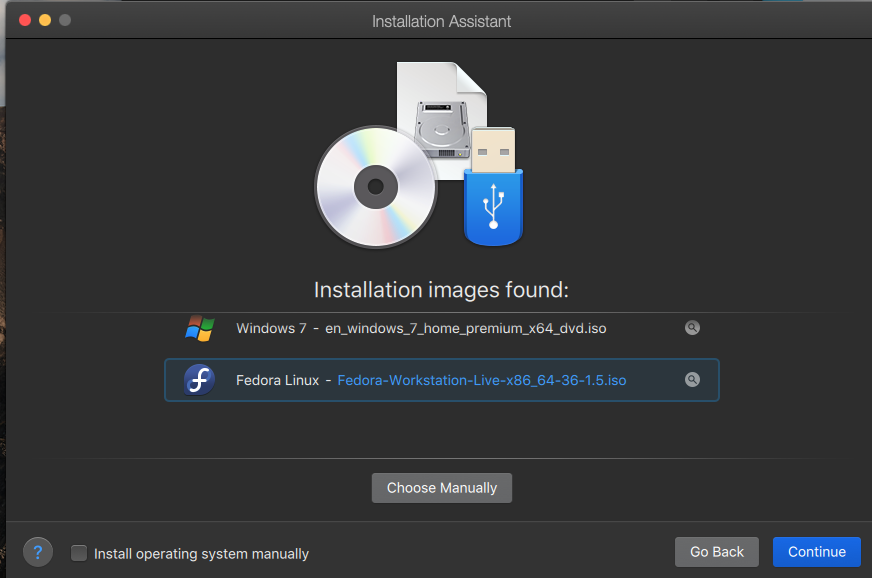 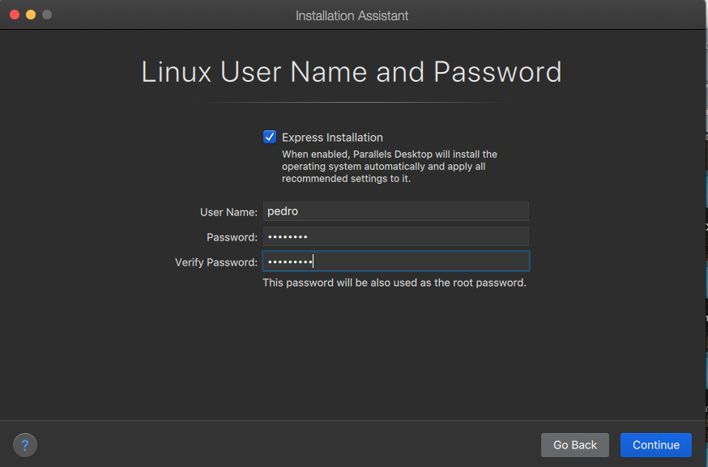 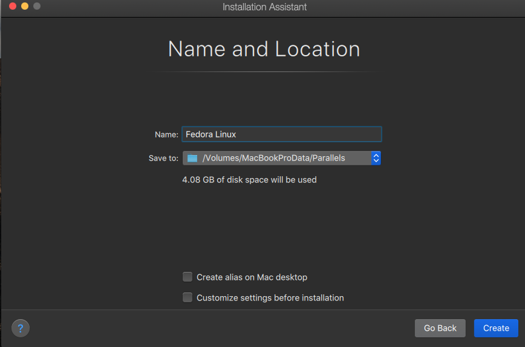 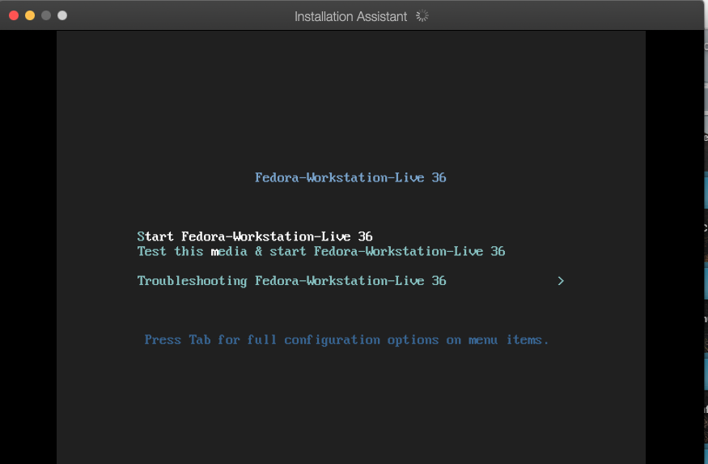 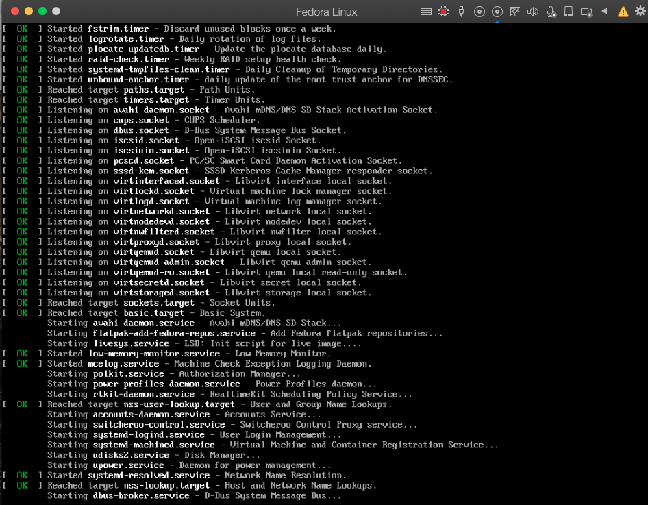 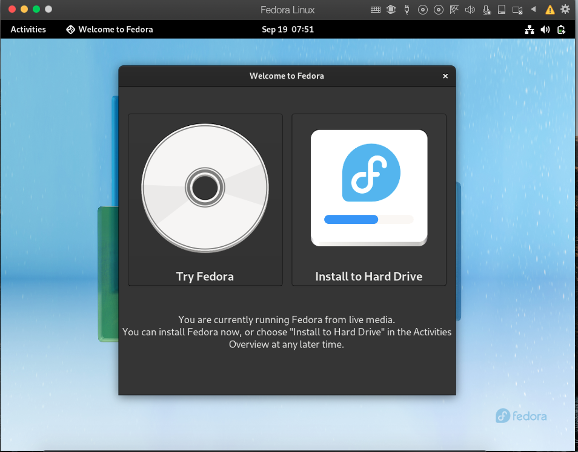

After testing the live iso I needed to redo the netinstall from 37 Beta

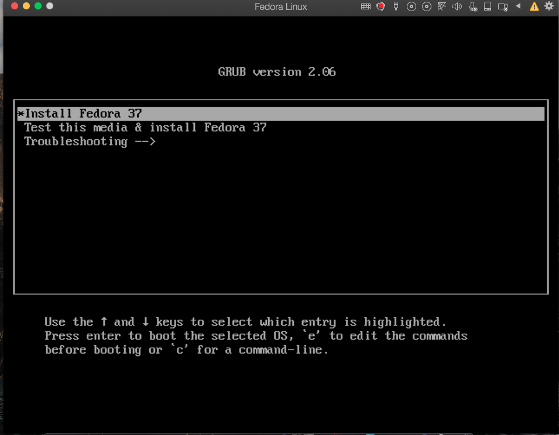 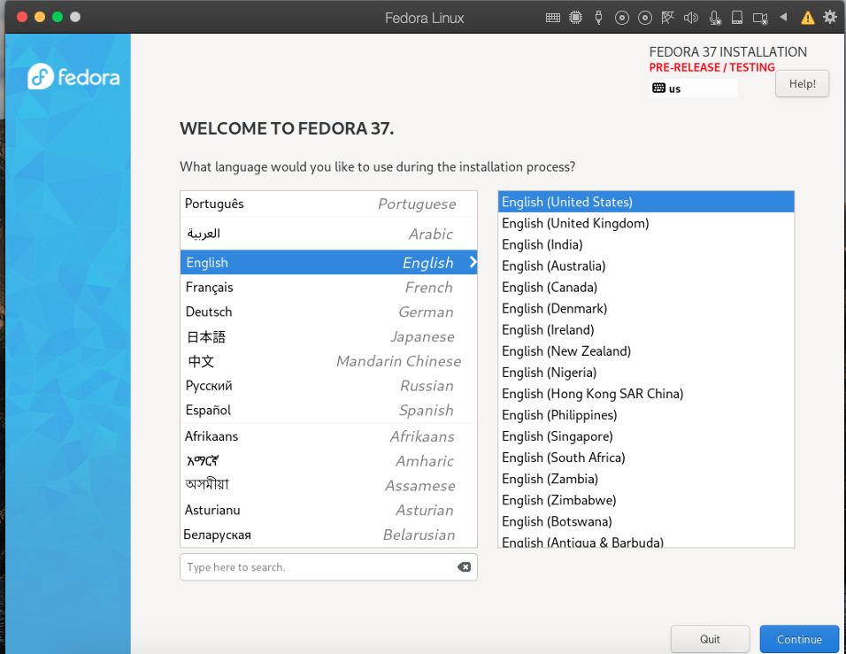 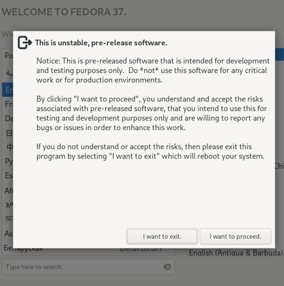 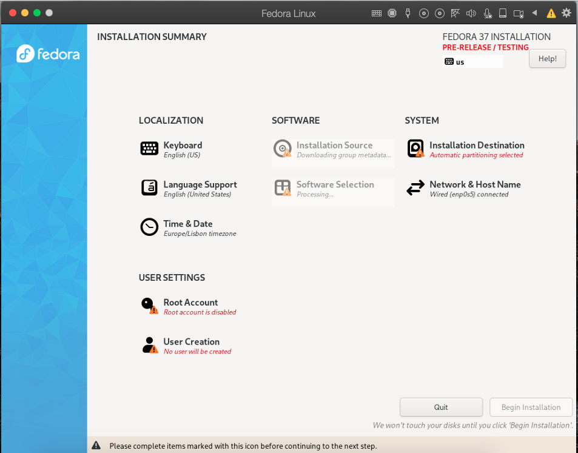 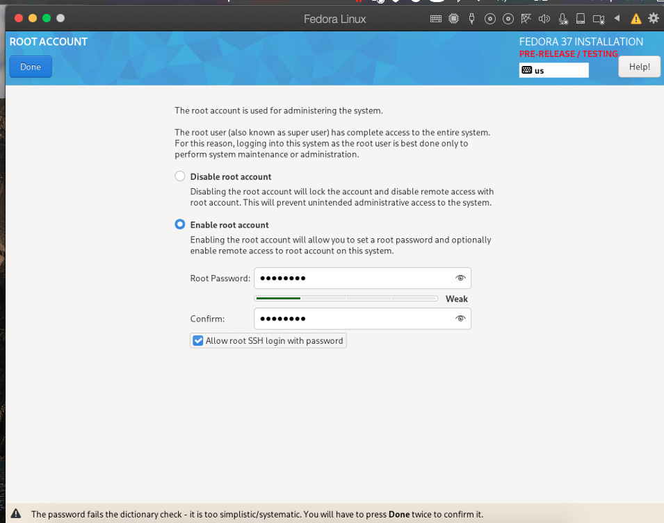 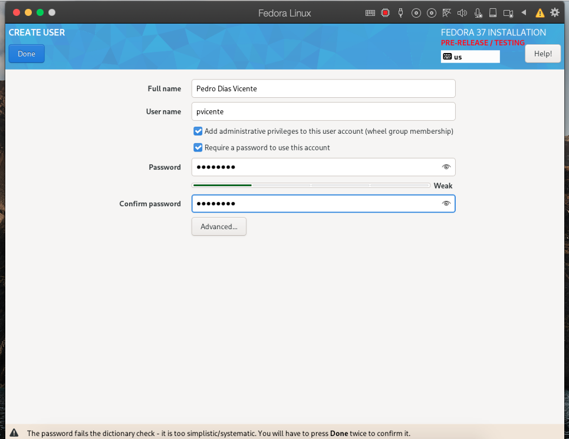 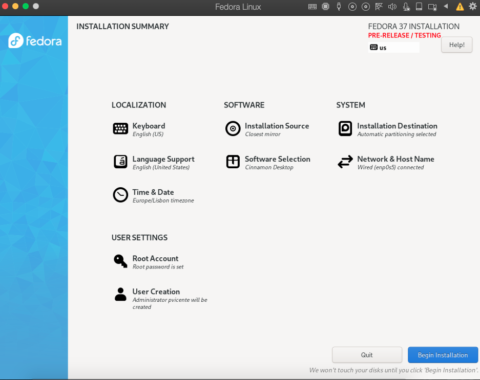

Click Begin

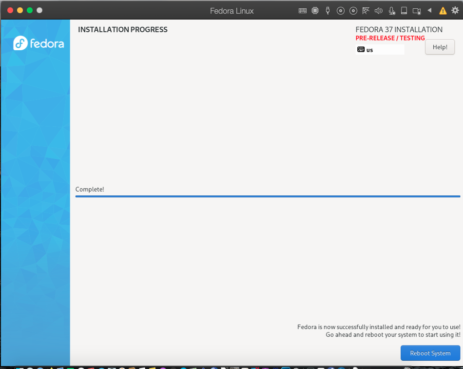 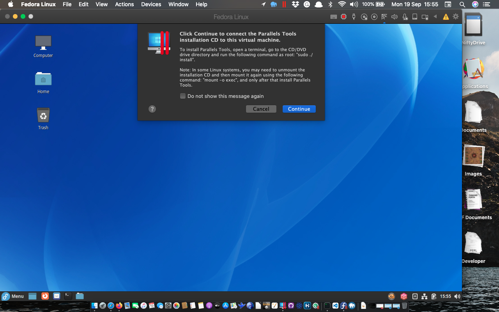
