+++
title = "Fedora 37 Installation"
date = 2022-09-20T10:32:24Z
lastmod = 2022-09-20T10:32:24Z
author = "Kayte Studio"
categories = ["Unix / Linux"]
tags = ["codermag archive"]
originalUrl = "https://codermag.gleentech.com/2022/09/20/fedora-37-installation/"
+++

Hello readers.

Today, we are going to install Fedora 37 beta under Parallels. I am using Parallels since 2015. Now, I build my VMs under it.

First, you must get the iso netinstall from getfedora.

<https://getfedora.org/en/workstation/download/>

Then, open Parallels and create a new VM.

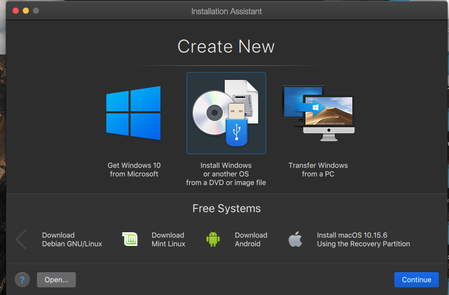 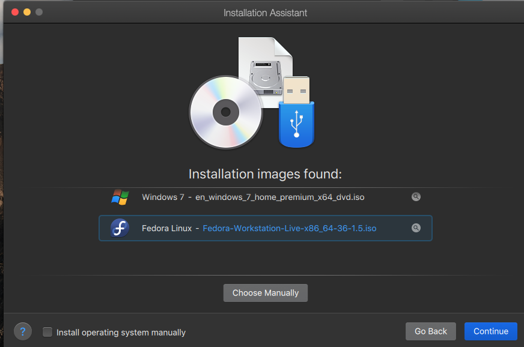 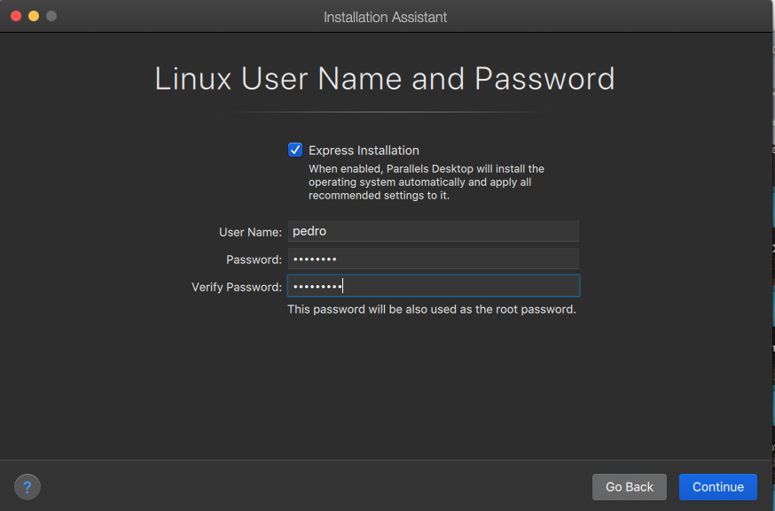 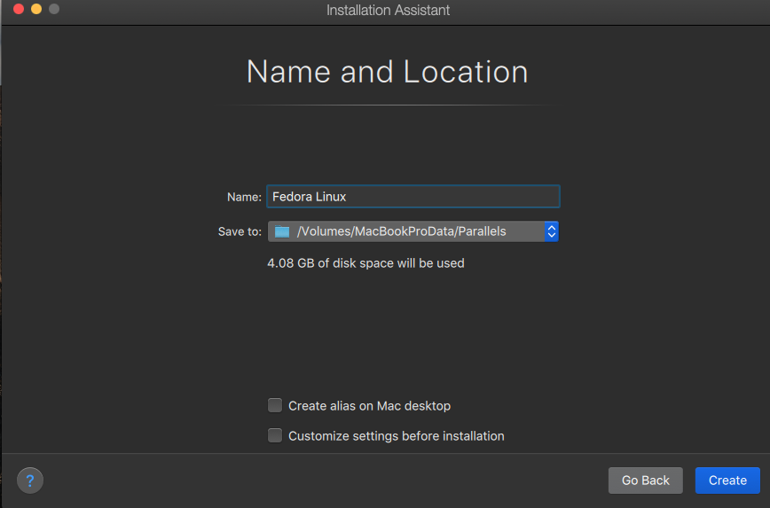 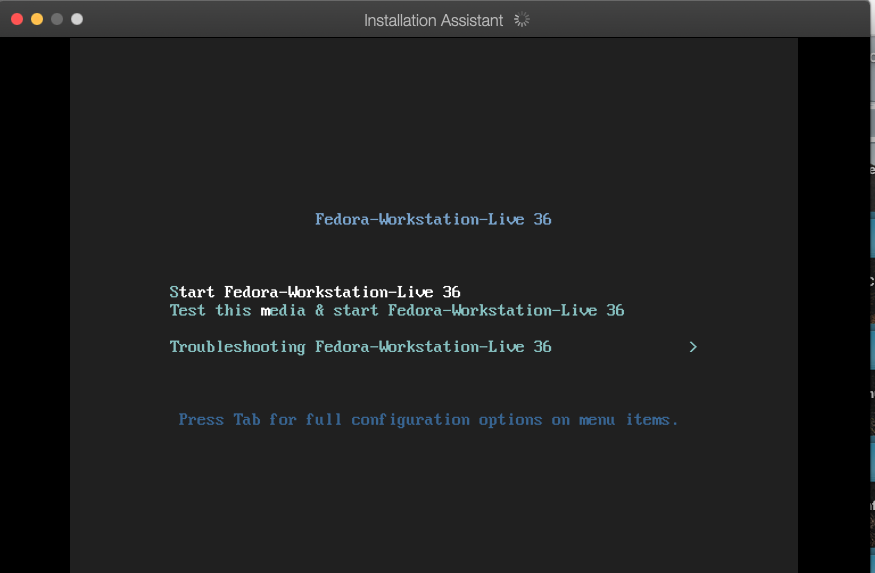 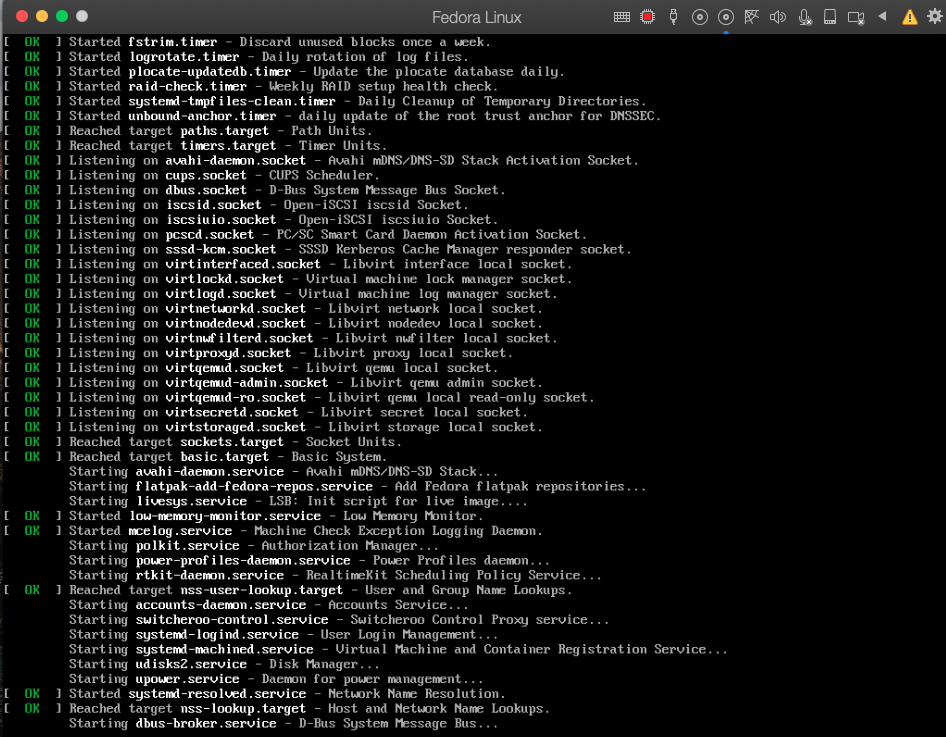 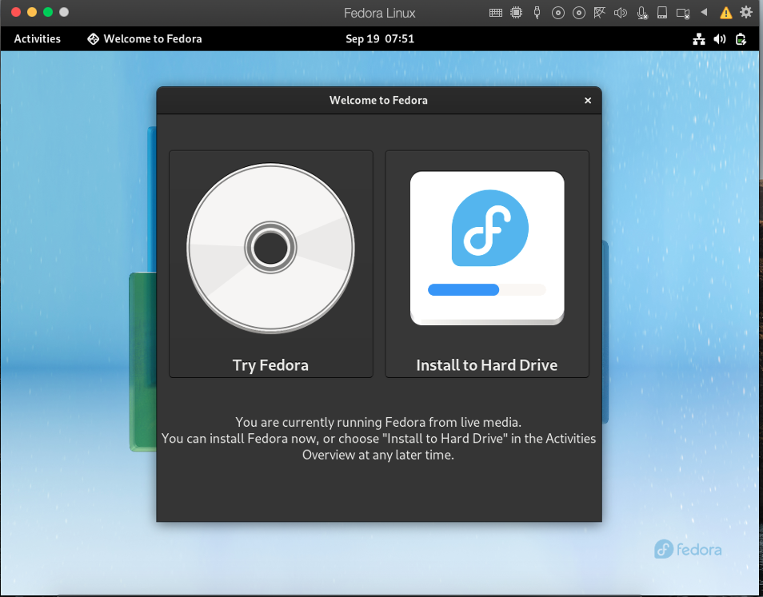

After testing the live iso I needed to redo the netinstall from 37 Beta

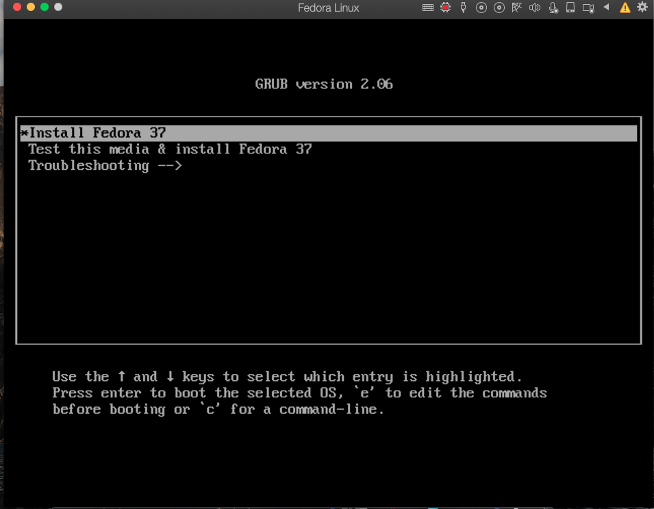 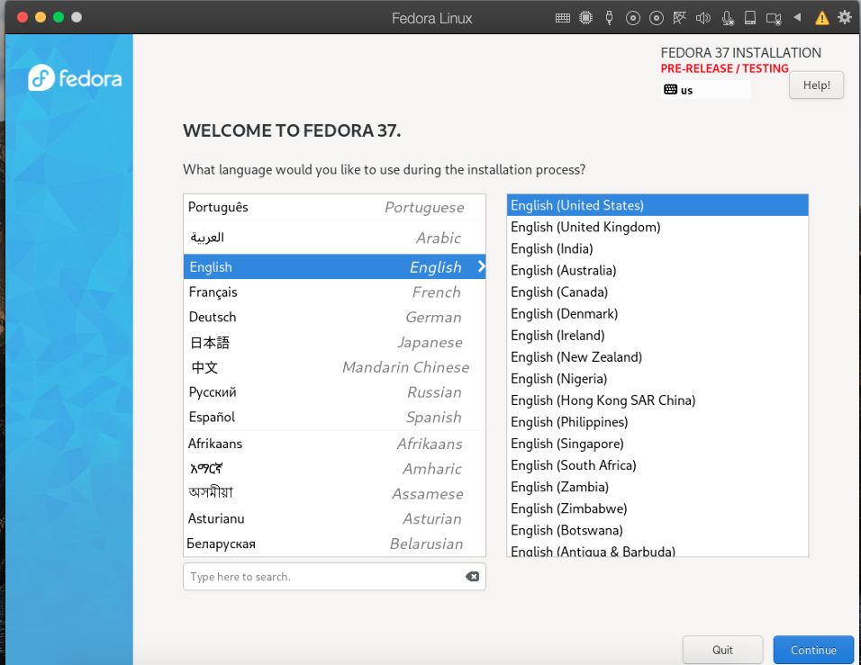 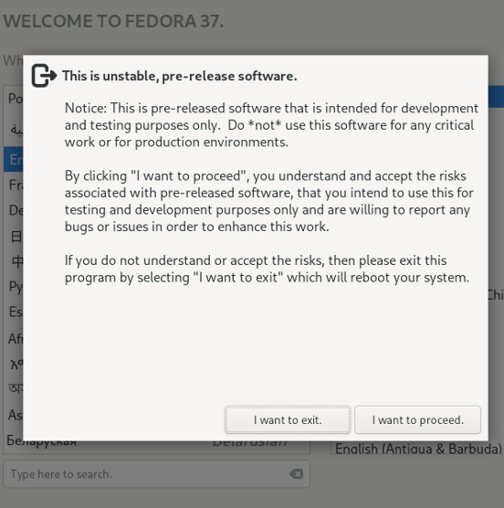 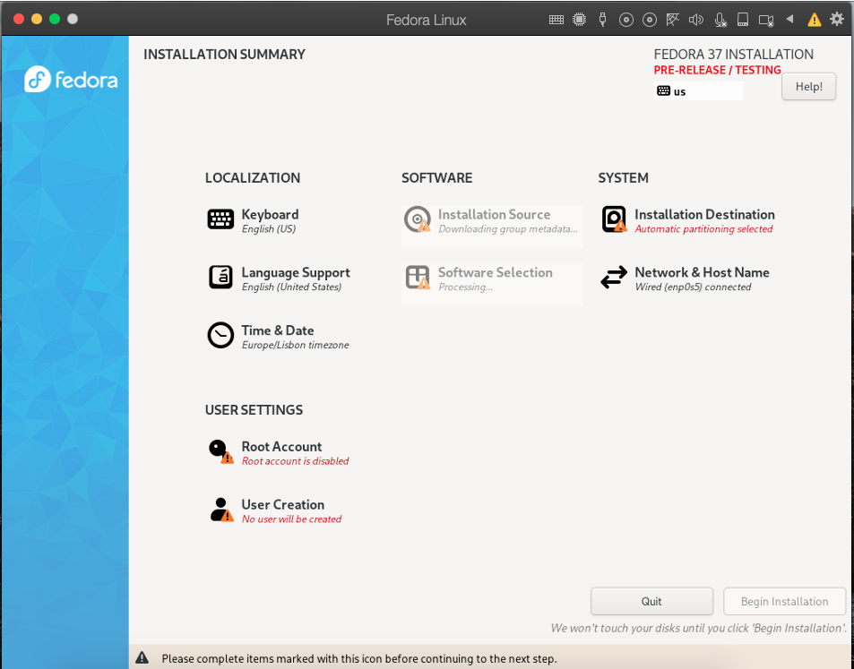 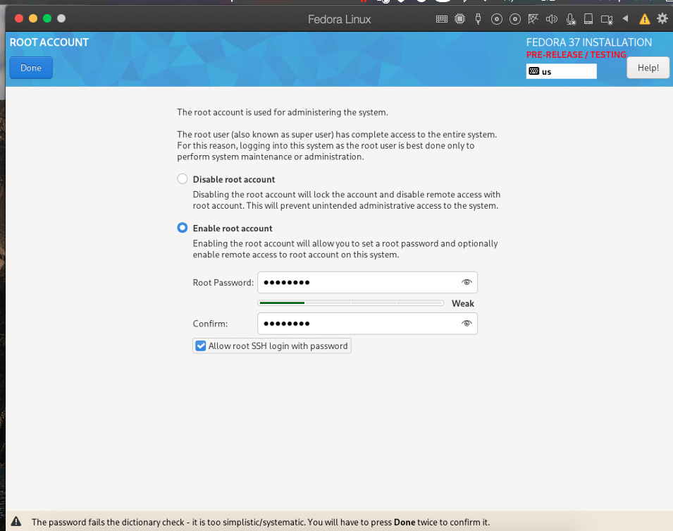 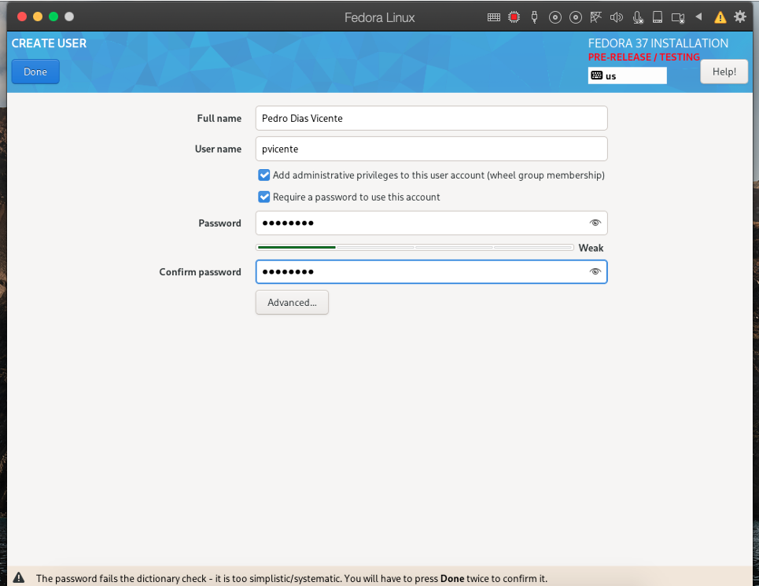 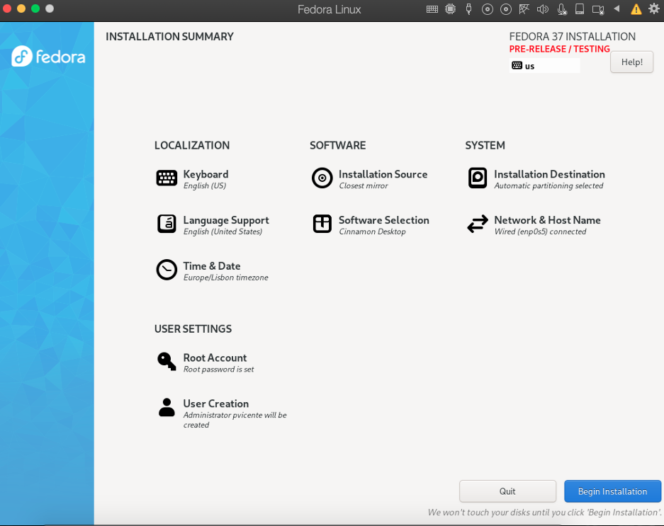

Click Begin

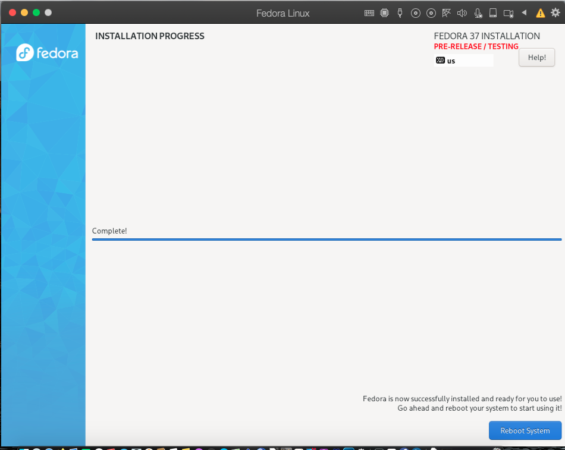 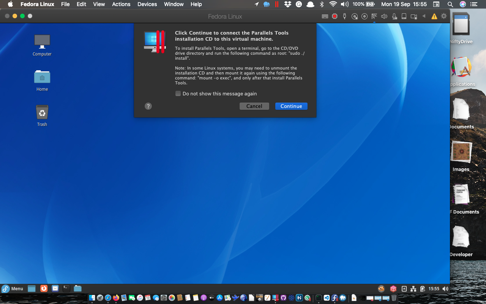
