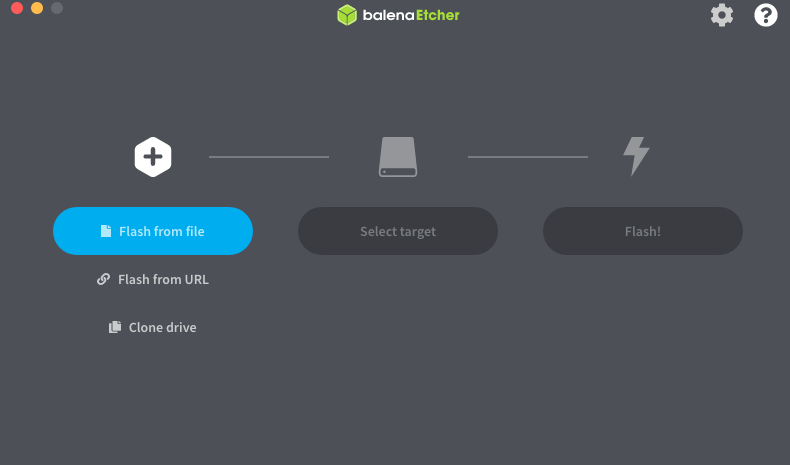
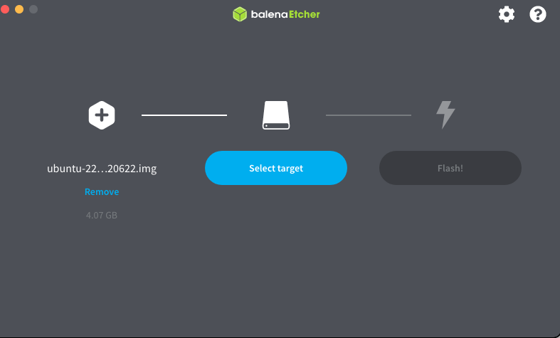
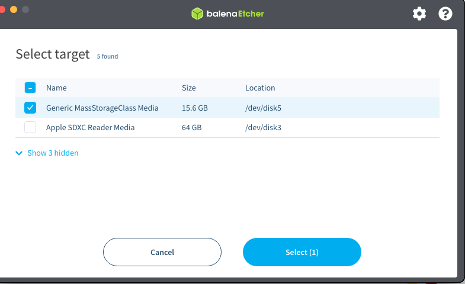
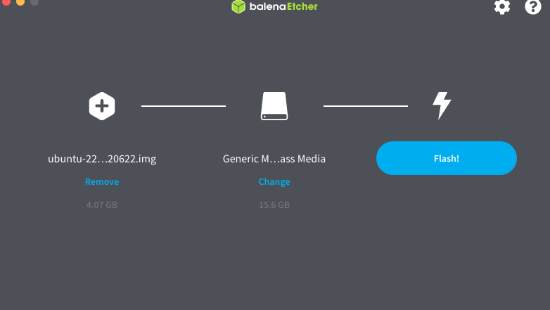
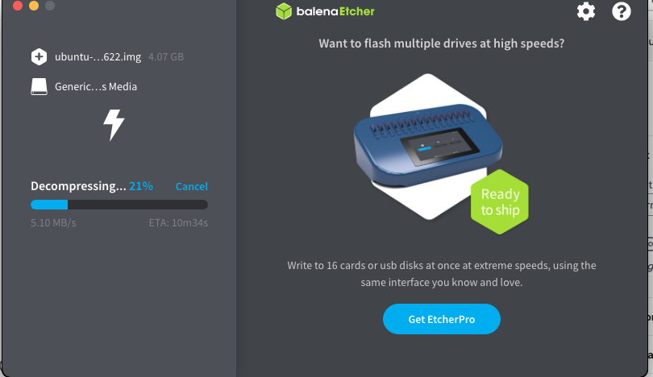

+++
title = "Flashear odroid con emmc"
date = 2023-05-10T14:41:07Z
lastmod = 2023-05-10T14:41:07Z
author = "Kayte Studio"
categories = ["macOS"]
tags = ["codermag archive"]
originalUrl = "https://codermag.gleentech.com/2023/05/10/flashear-odroid-con-emmc/"
+++

Hola Lectores,

<https://wiki.odroid.com/odroid-n2/os_images/ubuntu/20220629>

<https://east.us.odroid.in/ubuntu_22.04lts/N2/ubuntu-22.04-4.9-minimal-odroid-n2-20220622.img.xz>

Instalar en macOS balena etcher.

Ahora, colgar la imagen en la carpeta Downloads.

Elegir "target".

 

Por fin, flashear. Tenemos que introducir la llave antes del flashing.

Para terminar, tenemos una mensaje diciendo todo bien.
