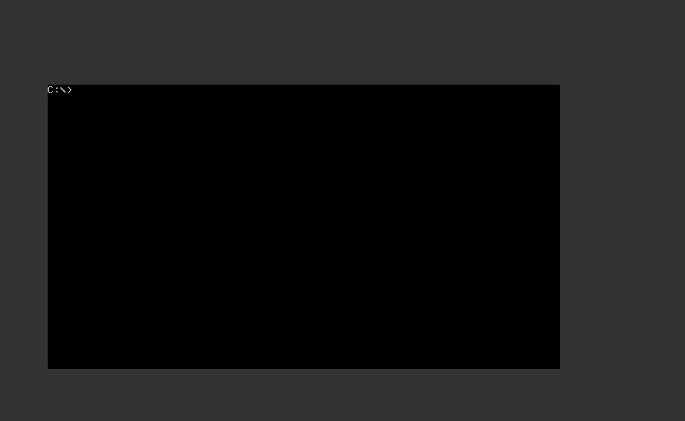
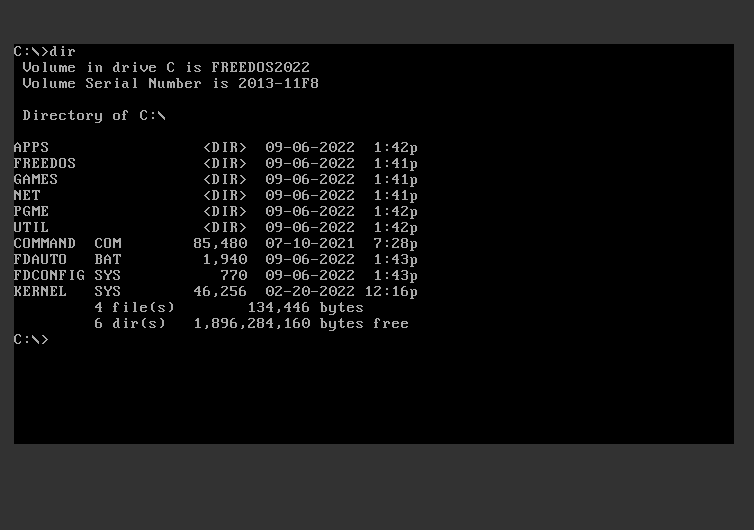
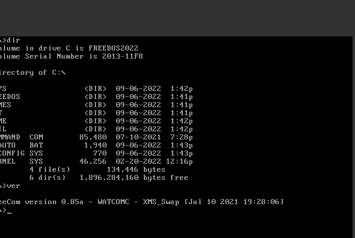
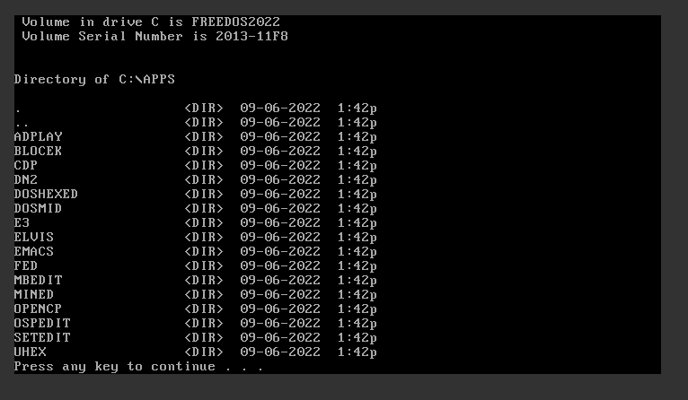
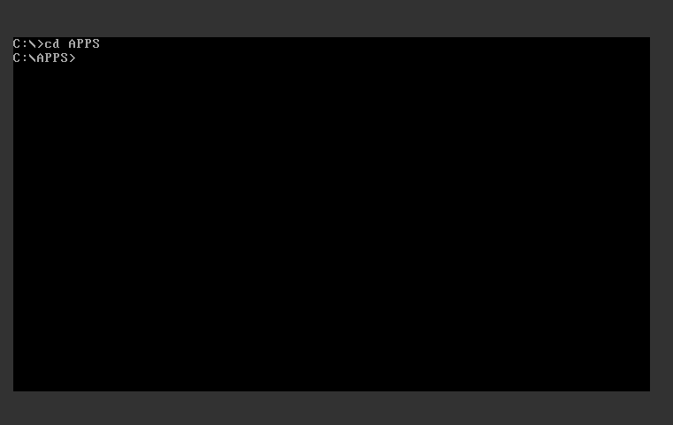
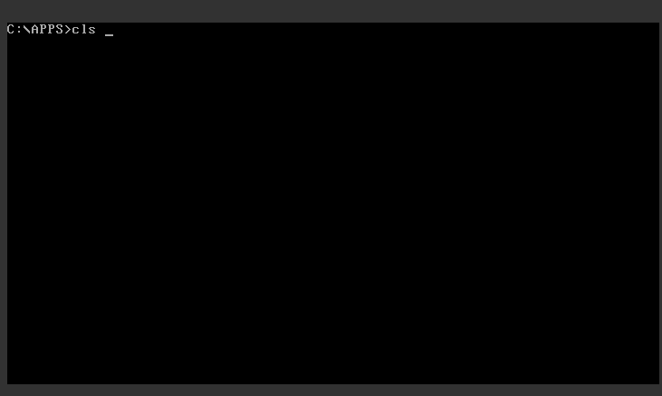

+++
title = "FreeDOS basic tutorial"
date = 2023-03-05T12:08:42Z
lastmod = 2023-03-05T12:08:42Z
author = "Kayte Studio"
categories = ["embedded", "macOS", "os2"]
tags = ["codermag archive"]
originalUrl = "https://codermag.gleentech.com/2023/03/05/freedos-basic-tutorial/"
+++

Hello readers,

Today, we will learn the basics of FreeDOS, compatible with MS-DOS 6.22.

The features we learned before can be found in the previous articles about qemu with FreeDOS. We are going to work with qemu and VirtualBox machines.

The command prompt is a very essential need, without it, you can't learn how to the shattered knowledge can be earned.

Now, we are going to learn how to use dir command, this command is very useful to list a certain directory.

Now we are going to see ver command, with this command we can see the version of the system itself.

Now, we will see the dir /s APPS, this command will list a certain directory inside.

Now, we are going to learn how to change the directory with the cd command. Every task to switch directories, we use this command.

Finally, the clear screen, the cls command.

