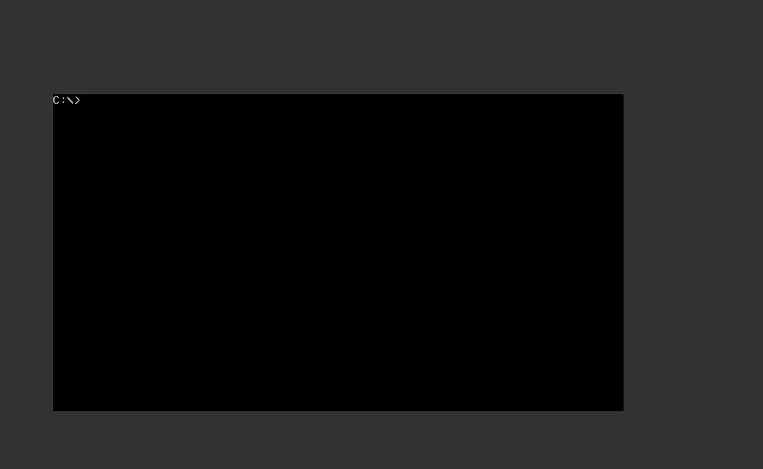
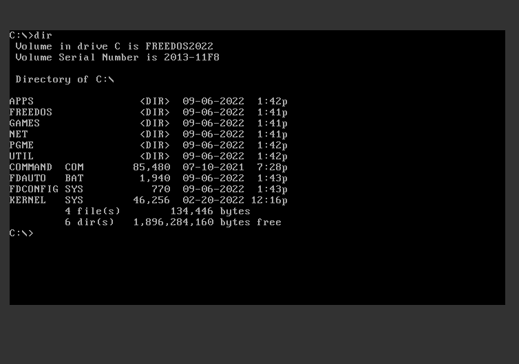
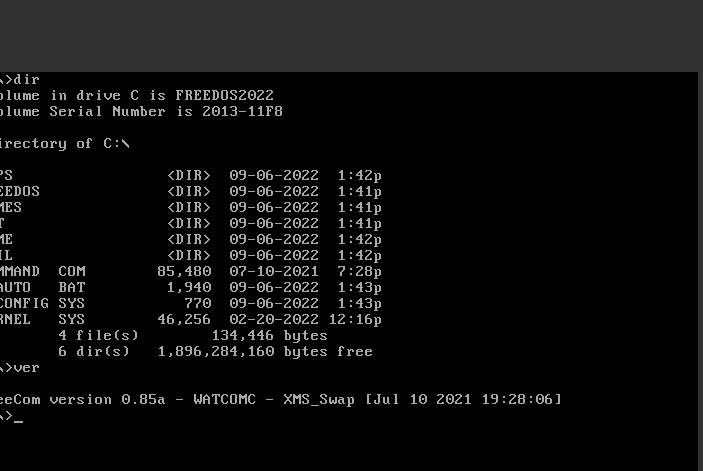
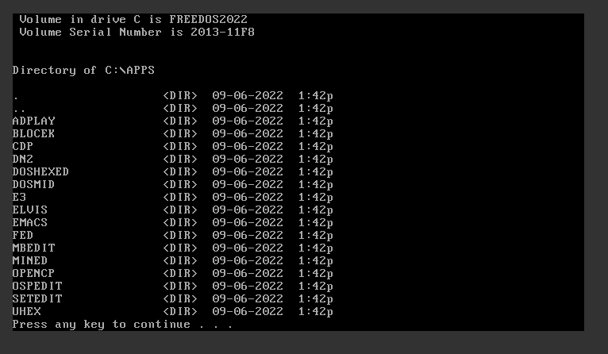
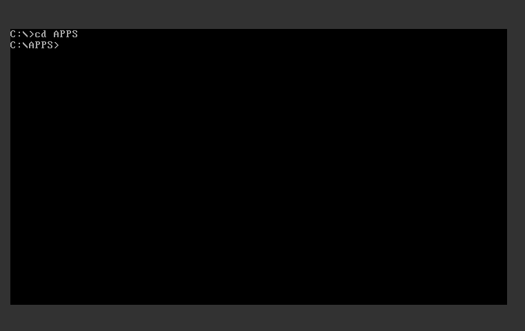
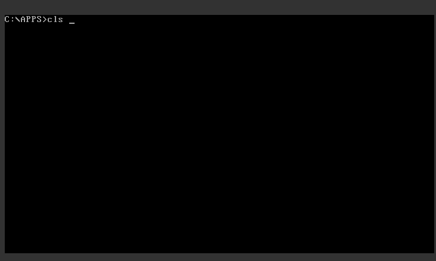

+++
title = "FreeDOS comandos (en Castellano)"
date = 2023-03-25T16:08:49Z
lastmod = 2023-03-25T16:08:49Z
author = "Kayte Studio"
categories = ["macOS", "os2"]
tags = ["codermag archive"]
originalUrl = "https://codermag.gleentech.com/2023/03/25/freedos-comandos-en-castellano/"
+++

Hola todos!

Hoy, vosotros iran leer sobre FreeDOS, compatíble con MS-DOS 6.22.

Las funciones que aprendimos antes se pueden encontrar en los artículos anteriores sobre qemu con FreeDOS. Vamos a trabajar con máquinas qemu y VirtualBox.

El símbolo del sistema es una necesidad muy esencial, sin él, no puede aprender cómo se puede obtener el conocimiento.



Ahora, vamos a aprender cómo usar el comando dir, este comando es muy útil para listar un directorio.



``` wp-block-preformatted
Ahora vamos a ver el comando ver, con este comando podemos ver la versión del sistema en sí.
```



Ahora, veremos el directorio /s APPS, este comando listará un cierto directorio dentro.



Ahora, vamos a aprender cómo cambiar el directorio con el comando cd. Tenemos una tarea para cambiar de directorio, usamos este comando.



``` wp-block-preformatted
Finalmente, la pantalla clara, el comando cls.
```


