+++
title = "FreeDOS with C #2"
date = 2022-09-06T09:36:00Z
lastmod = 2022-09-06T09:36:00Z
author = "Kayte Studio"
categories = ["embedded"]
tags = ["codermag archive"]
originalUrl = "https://codermag.gleentech.com/2022/09/06/freedos-with-c-2/"
+++

Today, we are going to learn how to install FreeDOS in a Virtualbox installment.

For this purpose you should have it on your computer, the VB already installed.

Over the next steps, you will be able to learn how to install FreeDOS.

You must download the iso from freedos.org, when it is done, you should unzip it. You will get an iso inside the folder. You must, you should point to the directory of the iso inside the Virtualbox.

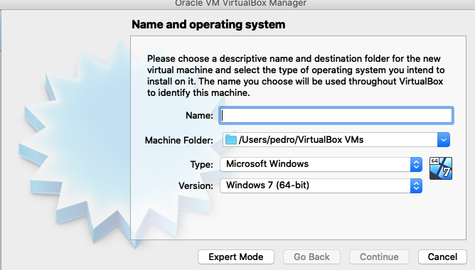 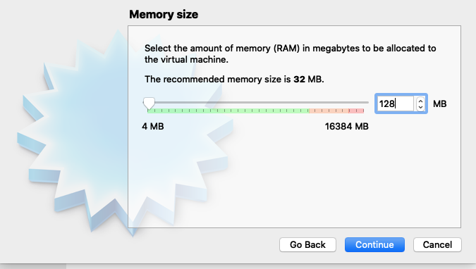 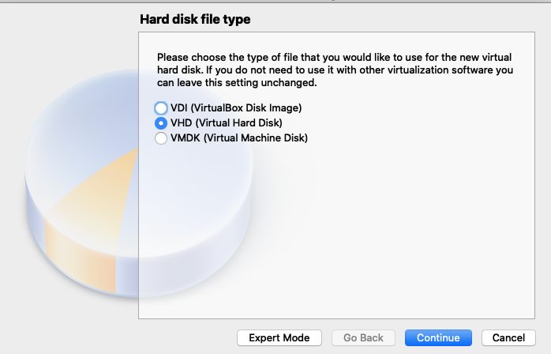 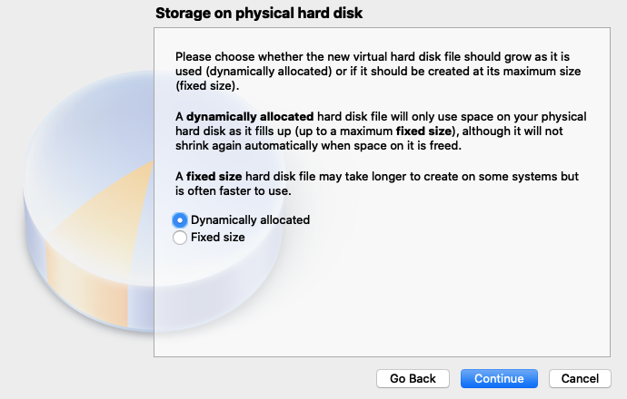 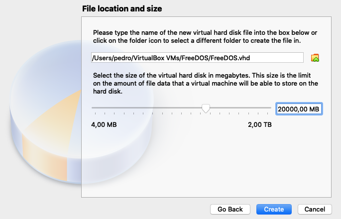 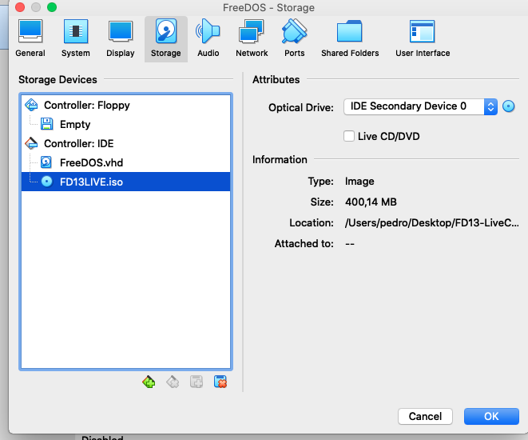 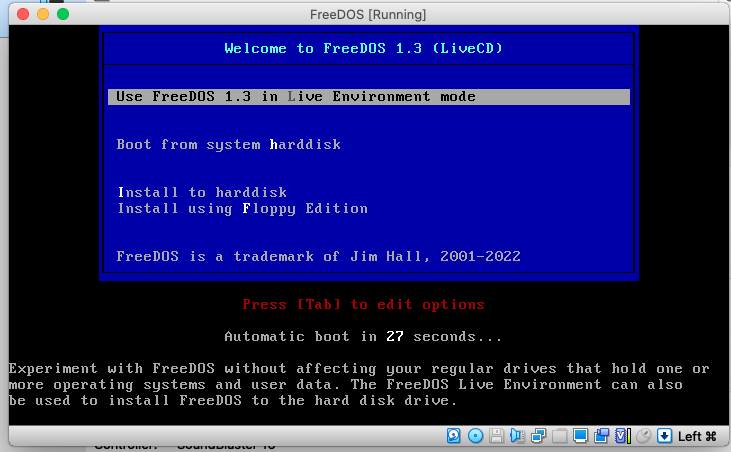 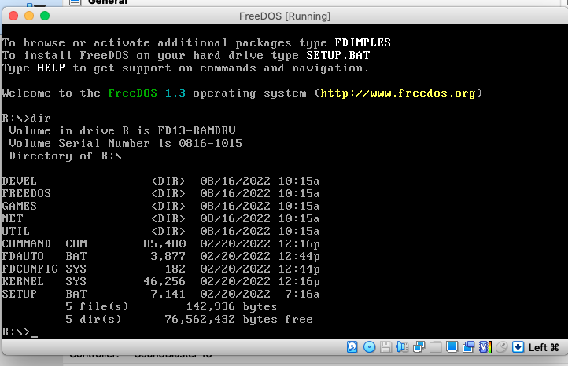 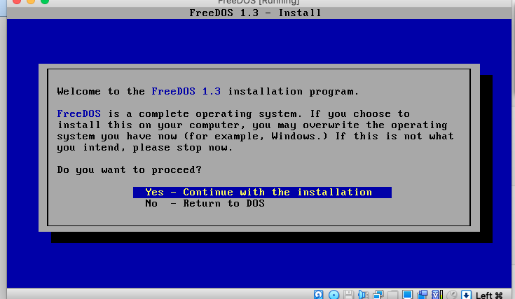 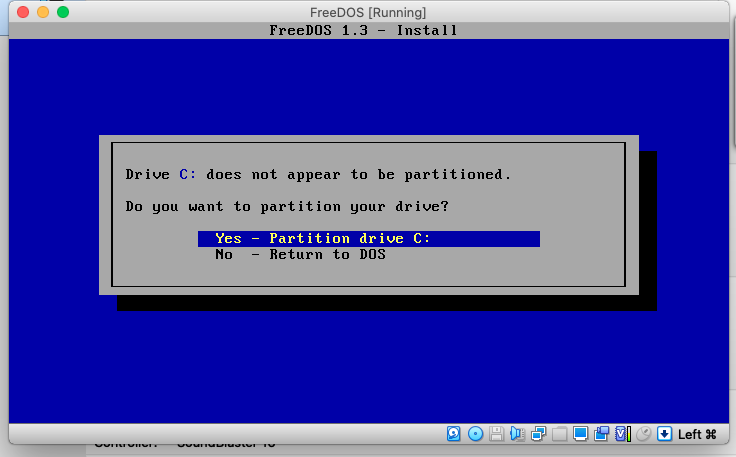 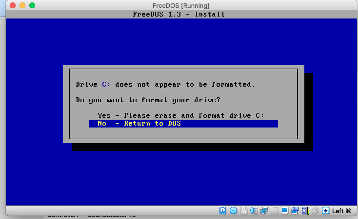 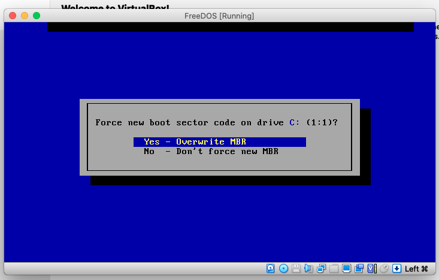 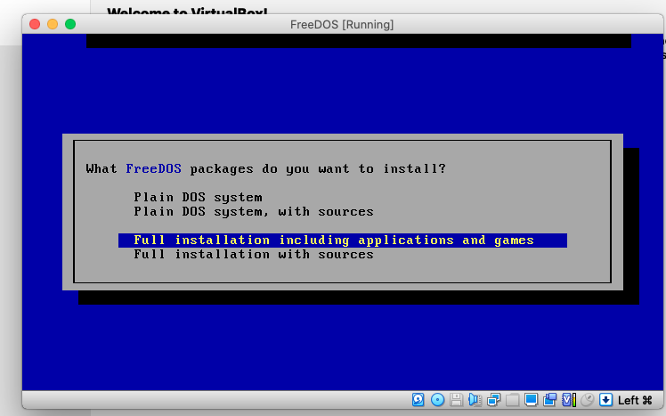

Now, we have an operating system running on VirtualBox. I used the VB 6.x
