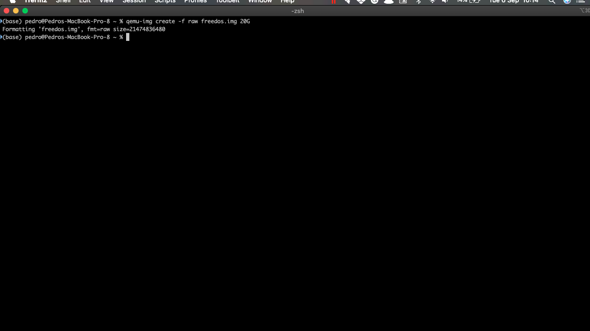
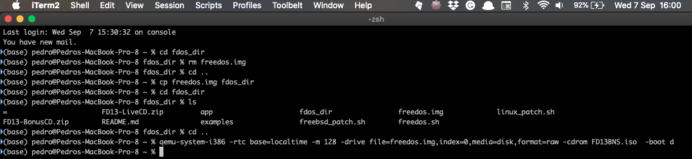
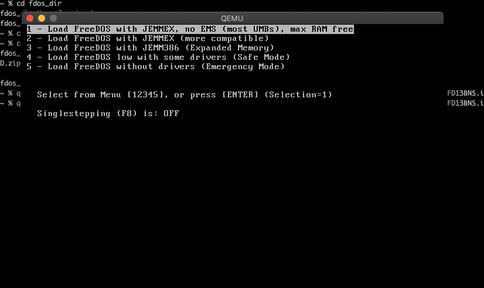
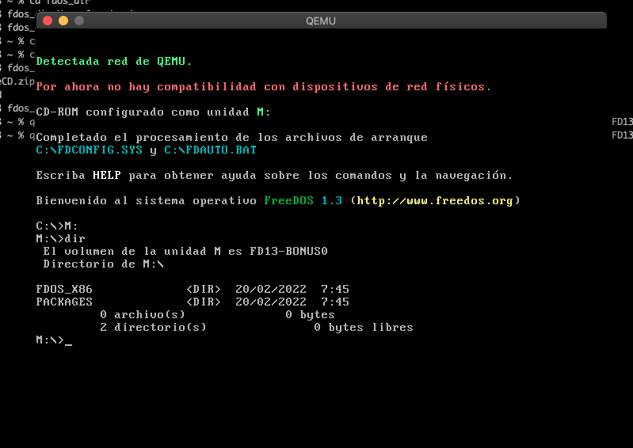
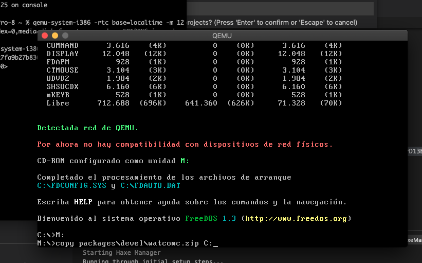
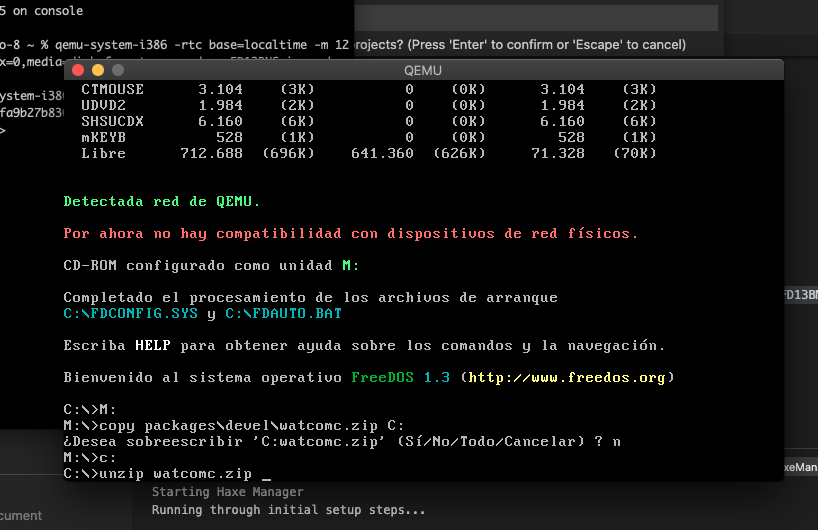
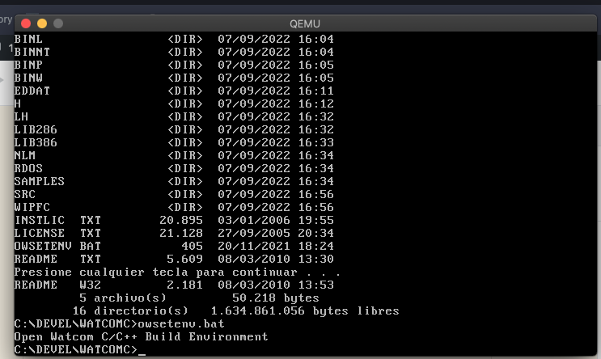

+++
title = "FreeDOS with C #3"
date = 2022-09-13T08:36:00Z
lastmod = 2022-09-13T08:36:00Z
author = "Kayte Studio"
categories = ["embedded"]
tags = ["codermag archive"]
originalUrl = "https://codermag.gleentech.com/2022/09/13/freedos-with-c-3/"
+++

Hello dear readers, today we will teach and approach how to make an installment for FreeDOS under qemu.

Our following steps will be under macOS 10.15; Here you will find useful techniques to code on the new operating systems. We decided to teach C with and under FreeDOS. FreeDOS is an operating system very good to learn how to code and have the skills to get better.

``` wp-block-code
 /bin/bash -c "$(curl -fsSL https://raw.githubusercontent.com/Homebrew/install/HEAD/install.sh)"
```

Then:

``` wp-block-code
brew doctor
```

Then:

``` wp-block-code
brew install qemu
```

Now, we have installed the qemu on our system. Let's see how we can install.

``` wp-block-code
qemu-img create -f raw freedos.img 20G
```



``` wp-block-code
qemu-system-i386 -rtc base=localtime -hda freedos.img -cdrom FD13LIVE.iso -boot d
```

You can always use my working-in-progress script as userland.

https://github.com/vic3t3chn0/opendos-layer

For last, you can see the installment over step over step with screenshots.

  

qemu-system-i386 -rtc base=localtime -m 128 -drive file=freedos.img,index=0,media=disk,format=raw -cdrom FD13BNS.iso -boot d

 

``` wp-block-code
M:

copy packages\devel\watcomc.zip C:
C:
unzip watcomc.zip
```

In the end, you will have the compiler installed.

``` wp-block-code
cd devel\watcomc
dir

owsetenv
```



In the next topic, we will approach how to code or start to code on Watcom c for dos.
