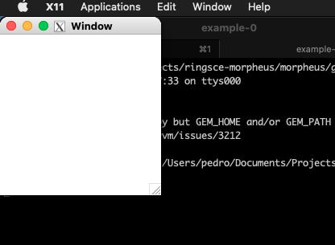

+++
title = "gtk con XQuartz"
date = 2023-10-05T14:53:55Z
lastmod = 2023-10-07T09:13:54Z
author = "Kayte Studio"
categories = ["macOS"]
tags = ["codermag archive"]
originalUrl = "https://codermag.gleentech.com/2023/10/05/gtk-con-xquartz/"
+++

Hola Electores,

Otra vez con mas un tutorial sobre macOS, hoy tenemos como trabajar con gtk en Big Sur.

Para compilación:

``` bash
gcc `pkg-config --cflags gtk+-3.0` -o example-0 mainwindow.cc `pkg-config --libs gtk+-3.0`
```

Pero primer, abrir mí gtk gist:

<https://gist.github.com/vic3t3chn0/2e082126a7f89330f04cf2b10ba6e8c2>

Pero, podemos testear con esto:

``` c
#include <gtk/gtk.h>

static void
activate (GtkApplication* app,
          gpointer        user_data)
{
  GtkWidget *window;

  window = gtk_application_window_new (app);
  gtk_window_set_title (GTK_WINDOW (window), "Window");
  gtk_window_set_default_size (GTK_WINDOW (window), 200, 200);
  gtk_widget_show_all (window);
}

int
main (int    argc,
      char **argv)
{
  GtkApplication *app;
  int status;

  app = gtk_application_new ("org.gtk.example", G_APPLICATION_FLAGS_NONE);
  g_signal_connect (app, "activate", G_CALLBACK (activate), NULL);
  status = g_application_run (G_APPLICATION (app), argc, argv);
  g_object_unref (app);

  return status;
}
```

Por fin:

``` bash
 gcc `pkg-config --cflags gtk+-3.0` -o example-0 mainwindow.cc `pkg-config --libs gtk+-3.0`
```


