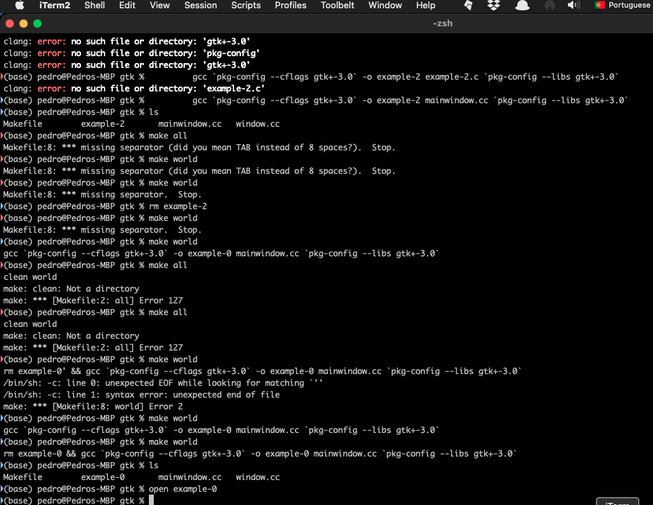
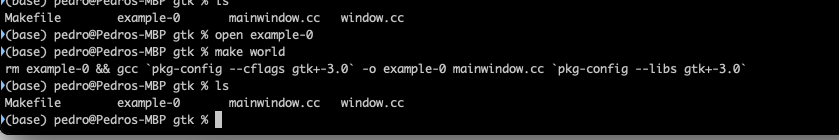
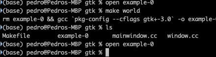
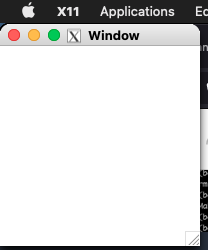

+++
title = "GTK para XQuartz con make"
date = 2023-10-07T09:29:38Z
lastmod = 2023-10-07T09:30:30Z
author = "Kayte Studio"
categories = ["macOS"]
tags = ["codermag archive"]
originalUrl = "https://codermag.gleentech.com/2023/10/07/gtk-para-xquartz-con-make/"
+++

Hola lectores,

Hoy, tenemos una cosa más, como hacer compilación con make en tú Apple.

Como ha visto antes, tenemos esto comando:

``` bash
gcc `pkg-config --cflags gtk+-3.0` -o example-0 mainwindow.cc `pkg-config --libs gtk+-3.0`
```

<https://gist.github.com/vic3t3chn0/313707f0372c6b89ac598181716060b4>

Para empezar, creamos un fichero con tu terminal llamado Makefile, tenemos también un gist:

``` bash
all:
    world

#clean:
#   rm example-0
# Para despues / for after for libs
world:
    rm example-0 && gcc `pkg-config --cflags gtk+-3.0` -o example-0 mainwindow.cc `pkg-config --libs gtk+-3.0`
```

Ahora tenemos el mismo codigo fuente del aticulo de gtk con XQuartz.

``` c
#include <gtk/gtk.h>

static void
activate (GtkApplication* app,
          gpointer        user_data)
{
  GtkWidget *window;

  window = gtk_application_window_new (app);
  gtk_window_set_title (GTK_WINDOW (window), "Window");
  gtk_window_set_default_size (GTK_WINDOW (window), 200, 200);
  gtk_widget_show_all (window);
}

int
main (int    argc,
      char **argv)
{
  GtkApplication *app;
  int status;

  app = gtk_application_new ("org.gtk.example", G_APPLICATION_FLAGS_NONE);
  g_signal_connect (app, "activate", G_CALLBACK (activate), NULL);
  status = g_application_run (G_APPLICATION (app), argc, argv);
  g_object_unref (app);

  return status;
}
```

Ahora, tenemos todo listo para empezar. Ahora tenemos que llamar el terminal y ir para su directorio donde están el codigo fuente.

Para nosotros tenemos en ~/Documents/Projects. Ahora podemos ver en la pantalla tú directorio



Ahora tenemos que escribir make world:



Por fin, correr tú executable en la pantalla:

 
