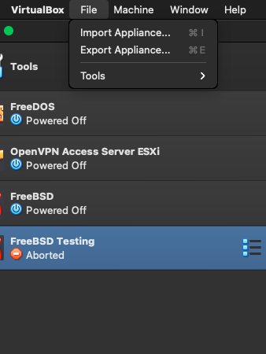
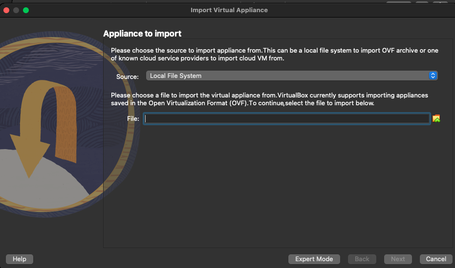
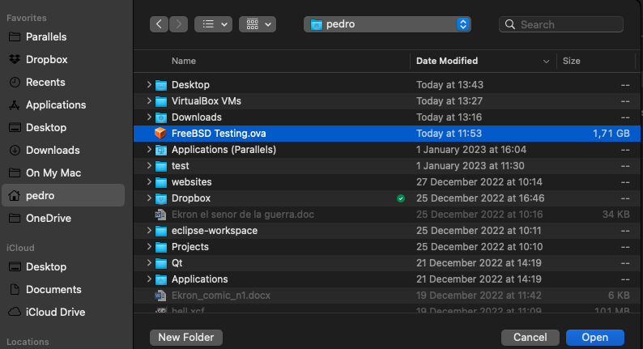
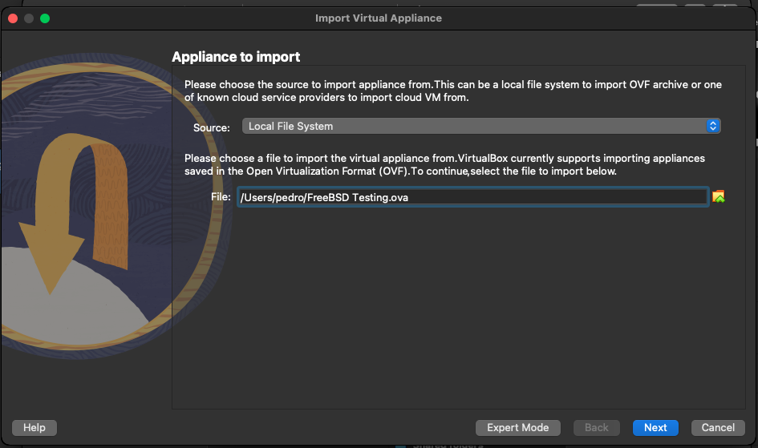
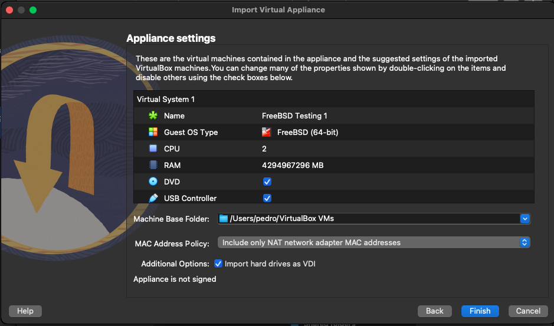
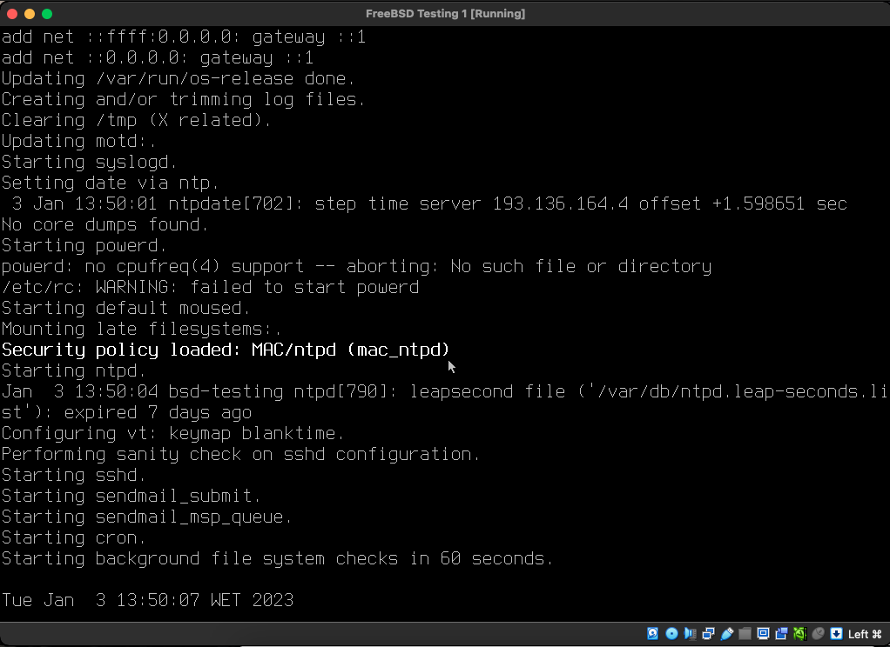

+++
title = "how to build an ova for VB #2"
date = 2023-01-03T14:00:13Z
lastmod = 2023-01-03T14:00:13Z
author = "Kayte Studio"
categories = ["macOS"]
tags = ["codermag archive"]
originalUrl = "https://codermag.gleentech.com/2023/01/03/how-to-build-an-ova-for-vb-2/"
+++

Hello readers,

Today, we are going to deliver an export appliance with VB7. We have this VM software besides parallels 17.

Choose File, Import Appliance

Now, you will see the menu.

Choose the file from the root HOME folder as I did before.

You chose your file ova for FreeBSD. Click on Next

You will see a Menu like this one. In the end, click Finish.

Then finish. Wait a few minutes. After those minutes you can boot it.

