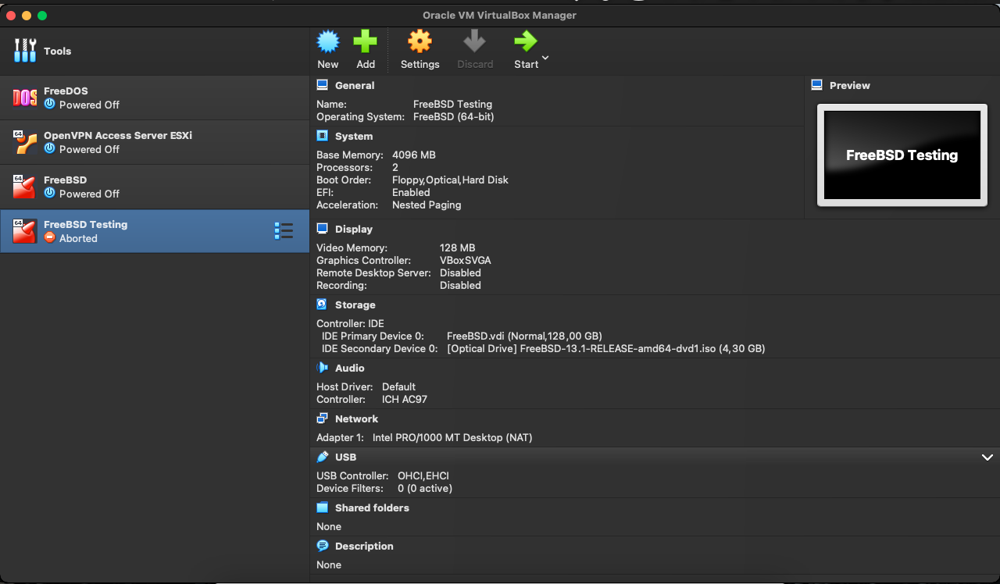
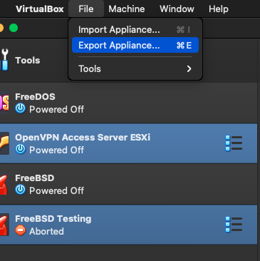
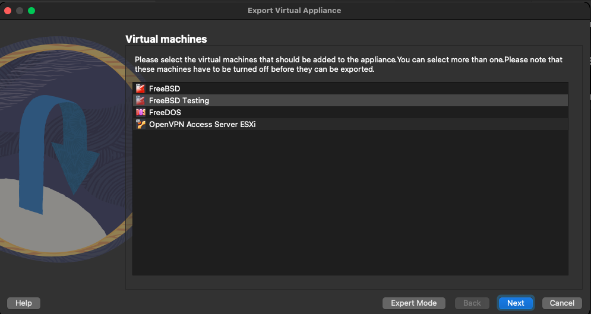
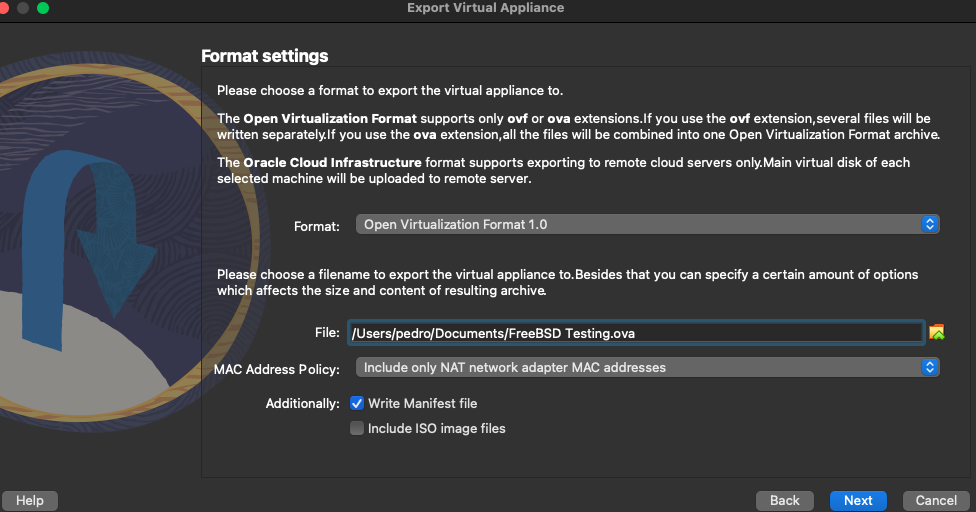
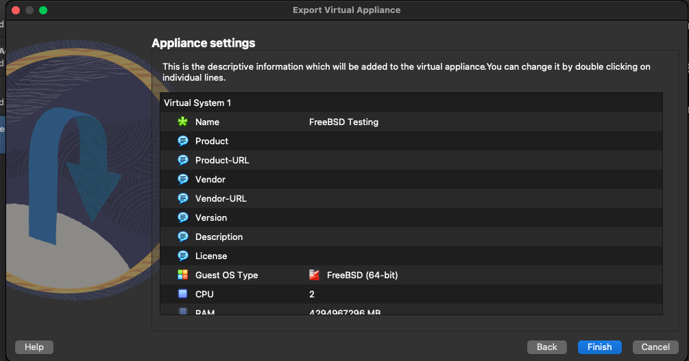
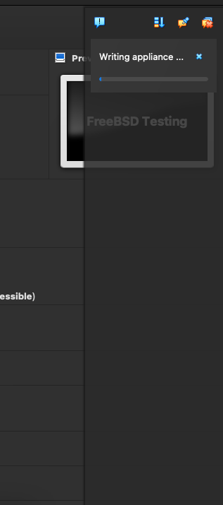
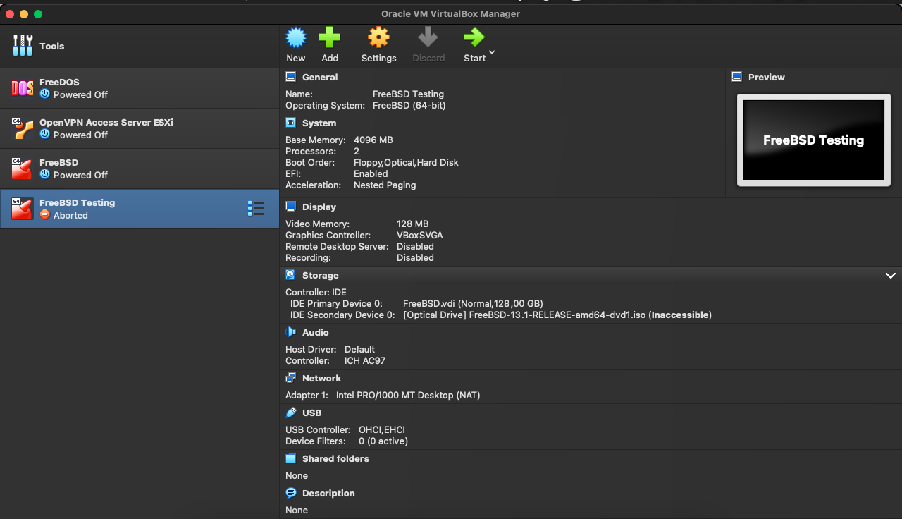

+++
title = "How to build an ova on macOS VB"
date = 2023-01-03T12:37:15Z
lastmod = 2023-01-03T12:37:15Z
author = "Kayte Studio"
categories = ["macOS"]
tags = ["codermag archive"]
originalUrl = "https://codermag.gleentech.com/2023/01/03/how-to-build-an-ova-on-macos-vb/"
+++

Hello readers and followers,

Today, we are going to learn how to build an ova from a FreeBSD 13 Virtual Machine.

We are going to learn how to export an OVA on VB latest version. This version is the last one.

As we see, we are going to work with the testing FreeBSD image.

Choose export appliance.

Then, choose Testing machine and click on next.

 

Now leave it as it is.

Now, click on finish.

As we see is exporting the appliance. Take time.

 

We will cover the import appliance in the next article.
