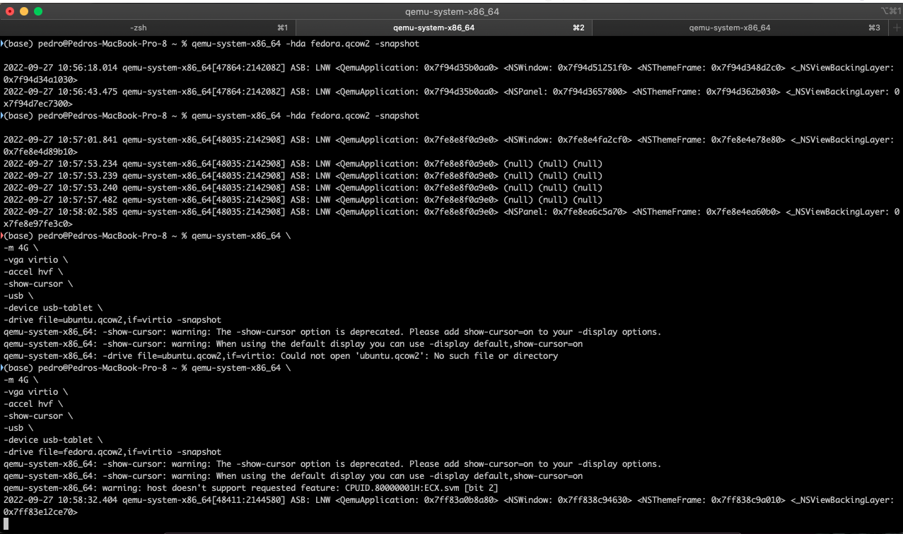
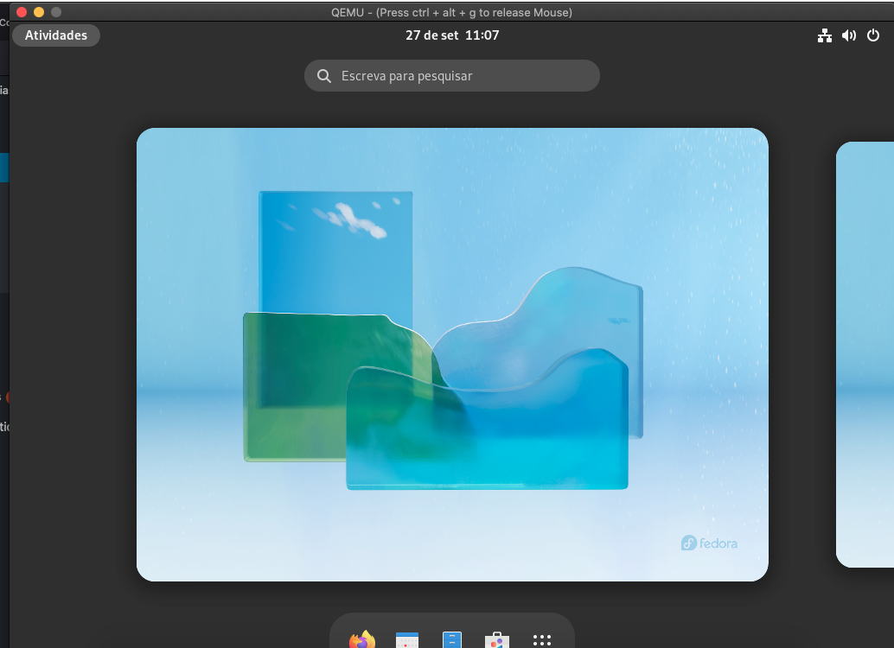
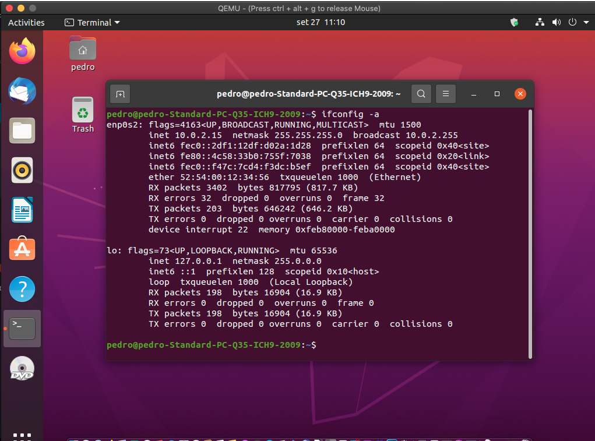

+++
title = "How to create a qemu snapshot"
date = 2022-09-27T10:15:41Z
lastmod = 2022-09-27T10:15:41Z
author = "Kayte Studio"
categories = ["embedded", "Unix / Linux"]
tags = ["codermag archive"]
originalUrl = "https://codermag.gleentech.com/2022/09/27/how-to-create-a-qemu-snapshot/"
+++

Hello readers,

Today, we will learn how to make a snapshot of your qemu images under macOS.

First, you must run terminal or iterm2. Then follow my instructions.

qemu-system-x86_64 \\\
-m 4G \\\
-vga virtio \\\
-cdrom Fedora-Workstation-Live-x86_64-36-1.5.iso \\\
-accel hvf \\\
-show-cursor \\\
-usb \\\
-device usb-tablet \\\
-drive file=fedora.qcow2,if=virtio

qemu-system-x86_64 \\\
-m 4G \\\
-vga virtio \\\
-accel hvf \\\
-show-cursor \\\
-usb \\\
-device usb-tablet \\\
-drive file=fedora.qcow2,if=virtio -snapshot

These first commands will be to run and install the fedora 36 on your qemu machine.

In the final line with -snapshot, you can run snapshots on the fly.

 

You can also boot and install on the cloud ubuntu 20.04 LTS. Now, I am going to show to do that.

\#!/bin/bash -e

``` bash
qemu-img create -f qcow2 ubuntu.img 60G
curl -L -o ubuntu-20.04.5-desktop-amd64.iso https://releases.ubuntu.com/20.04/ubuntu-20.04.5-desktop-amd64.iso
```

qemu-system-x86_64 \\\
-m 4G \\\
-vga virtio \\\
-cdrom ubuntu-20.04.5-desktop-amd64.iso \\\
-accel hvf \\\
-show-cursor \\\
-usb \\\
-device usb-tablet \\\
-drive file=ubuntu.img,if=virtio

qemu-system-x86_64 \\\
-m 4G \\\
-vga virtio \\\
-accel hvf \\\
-show-cursor \\\
-usb \\\
-device usb-tablet \\\
-drive file=ubuntu.img,if=virtio -snapshot

You must break the lines for each step on the ubuntu 20.04 LTS cloud image. Remember, qemu is very good for testing emulators. With this article, I want to teach how to build emulators Linux for cloud computing or testing structures.



In the next article, I will teach how to code and manage coding under the emulator connected to the terminal from macOS.
