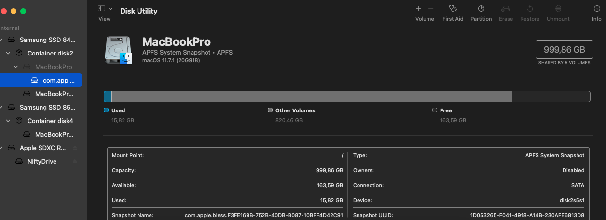
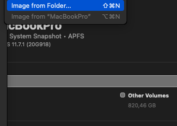
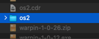
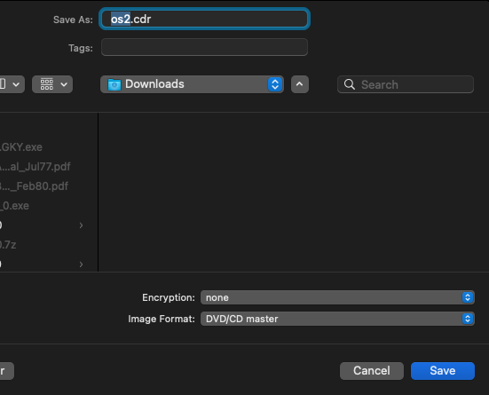

+++
title = "how to create an iso image on macOS"
date = 2023-02-15T16:30:51Z
lastmod = 2023-02-15T16:30:51Z
author = "Kayte Studio"
categories = ["macOS"]
tags = ["codermag archive"]
originalUrl = "https://codermag.gleentech.com/2023/02/15/how-to-create-an-iso-image-on-macos/"
+++

Hello readers,

Today, we are going to learn how to make an iso image on macOS.

First of all, call the disk utility.



Then go to file. New as image.

  

Now finally, on the terminal type the following command.

``` bash
cd Downloads
hdiutil makehybrid -iso -joliet -o -FILENAME.iso FILENAME.cdr
```
