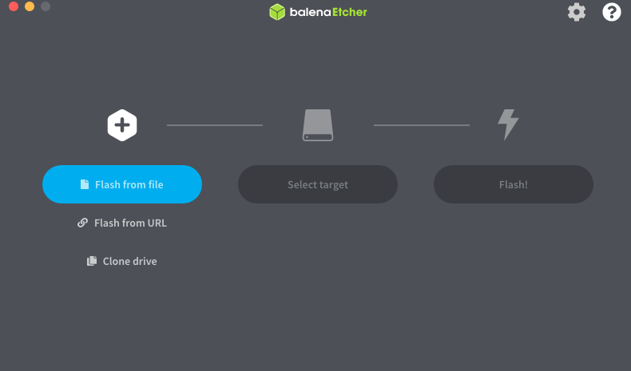
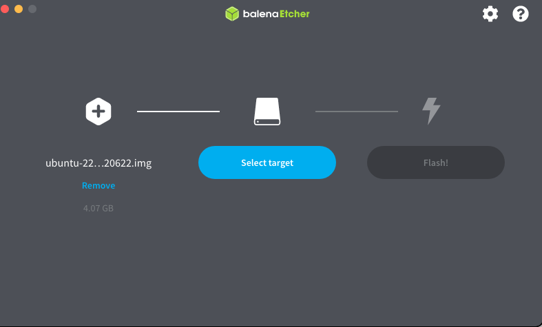
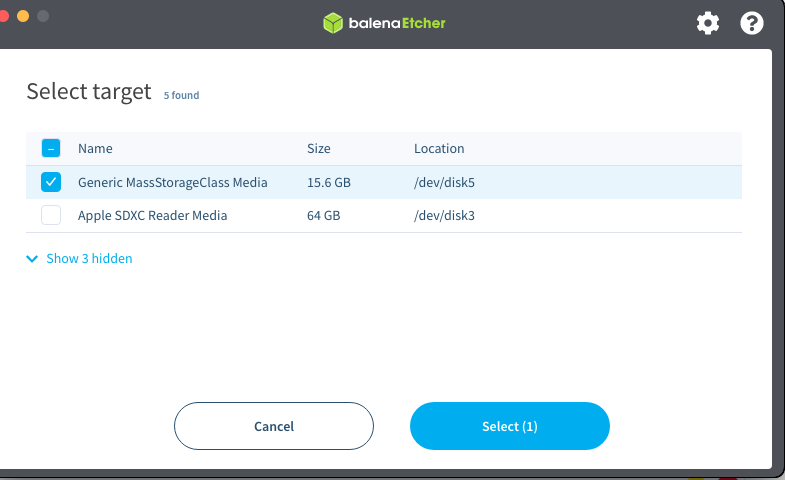
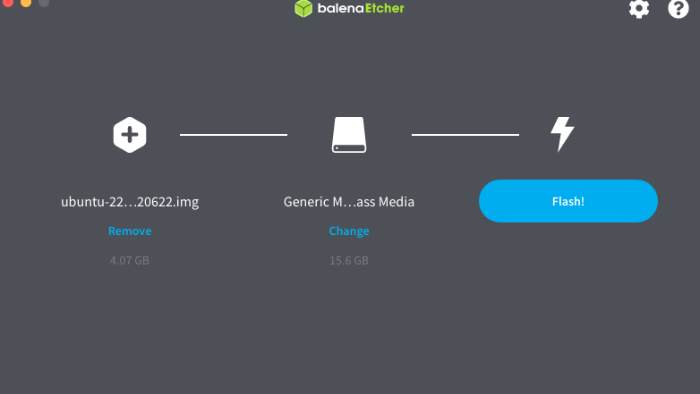
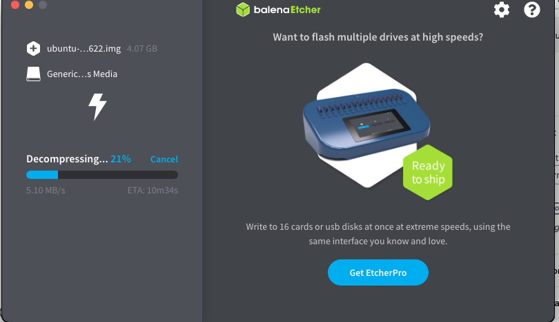

+++
title = "how to flash odroid on an emmc flasher"
date = 2023-02-15T16:54:05Z
lastmod = 2023-02-15T16:54:05Z
author = "Kayte Studio"
categories = ["macOS"]
tags = ["codermag archive"]
originalUrl = "https://codermag.gleentech.com/2023/02/15/how-to-flash-odroid-on-an-emmc-flasher/"
+++

Hello readers,

<https://wiki.odroid.com/odroid-n2/os_images/ubuntu/20220629>

<https://east.us.odroid.in/ubuntu_22.04lts/N2/ubuntu-22.04-4.9-minimal-odroid-n2-20220622.img.xz>

Install on macOS balena etcher.

Now, choose the image file from Downloads folder.

Now, select target.

 

Finally, we can flash them. It will ask for our password before flashing.

In the end, it will say well done.
