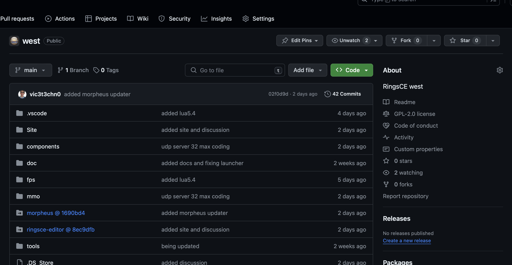
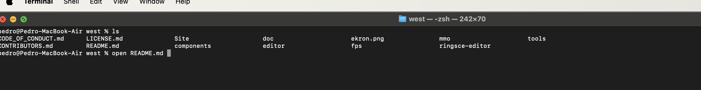
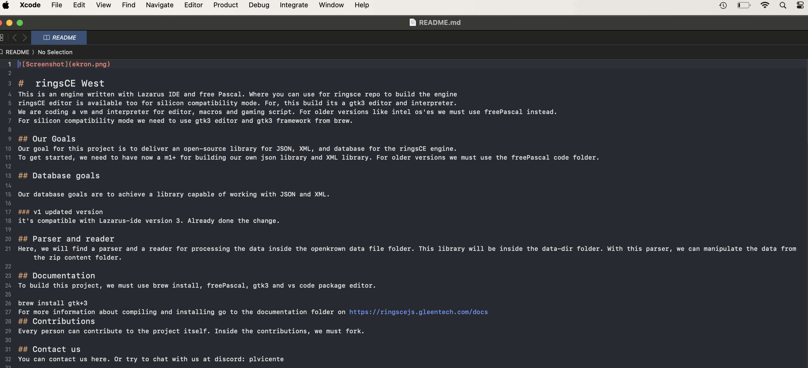
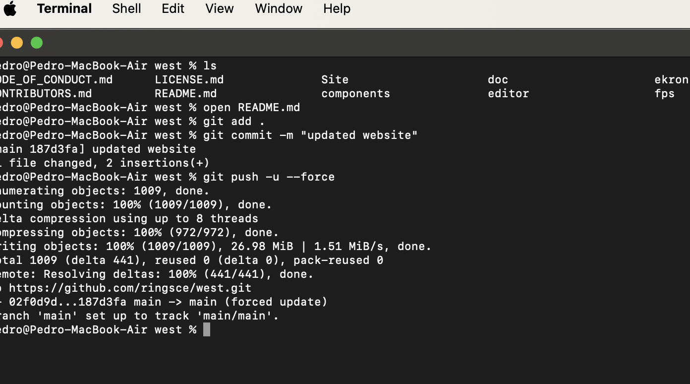
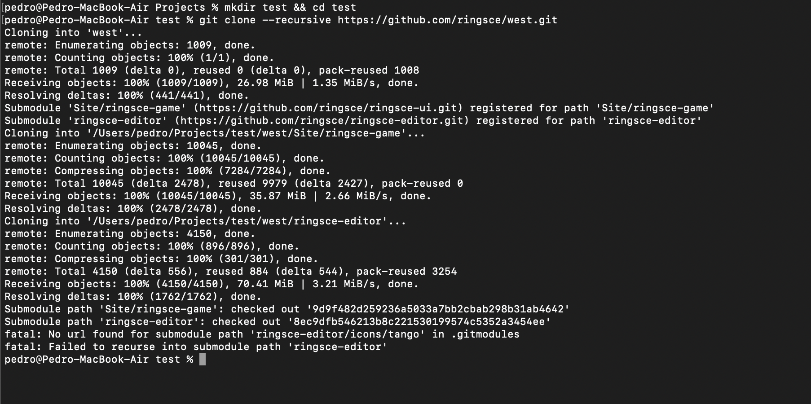

+++
title = "How to use git"
date = 2024-01-18T08:44:41Z
lastmod = 2024-01-18T08:50:42Z
author = "Kayte Studio"
categories = ["macOS"]
tags = ["codermag archive"]
originalUrl = "https://codermag.gleentech.com/2024/01/18/how-to-use-git/"
+++

Today, we are going to learn how to use git submodules on any kind of project.

We are going to git on an already open repo. We are going to learn 4 commands with git.

First of all clone a repo, we are going to clone ringsce repo for now.

``` wp-block-code
git clone https://github.com/ringsce/west.git
```



Now, open the README.md:

``` wp-block-code
open README.md
```

 

``` wp-block-code
type this on README.md

## Site
MMO Sign up  website
```

``` wp-block-code
git add .
git commit -m "added Website for sign up
git push -u --force
```

After, these changes we can see on our git fork the changes already made.



For last, we are going to learn recursive:

``` wp-block-code
mkdir test && cd test
git clone --recursive https://github.com/ringsce/west.git
```


