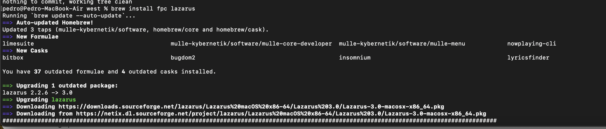
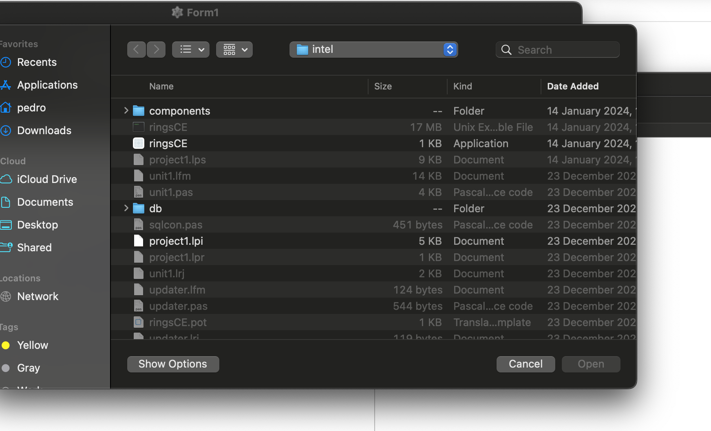
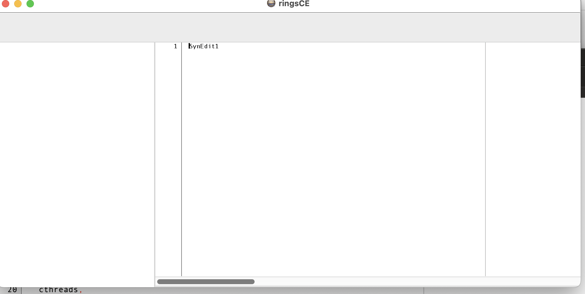

+++
title = "How to use lazarus ide on macOS"
date = 2024-01-25T09:55:25Z
lastmod = 2024-01-25T09:55:26Z
author = "Kayte Studio"
categories = ["macOS"]
tags = ["codermag archive"]
originalUrl = "https://codermag.gleentech.com/2024/01/25/how-to-use-lazarus-ide-on-macos/"
+++

Hello readers,

Today, we are going to learn how to use lazarus ide for command line on macOS.

``` wp-block-code
/bin/bash -c "$(curl -fsSL https://raw.githubusercontent.com/Homebrew/install/HEAD/install.sh)"
```

First, you must install brew.sh then do

``` wp-block-code
brew install fpc lazarus
```



For us, it's an upgrade not a true installment.

``` wp-block-code
git clone --recursive https://github.com/ringsce/west.git
```

After cloning, open the project inside ringsce-editor intel, then open project1.lpi



``` wp-block-code
compile
run without debugging
```



Next time we are going to learn how to make modules for ringsCE platform.
