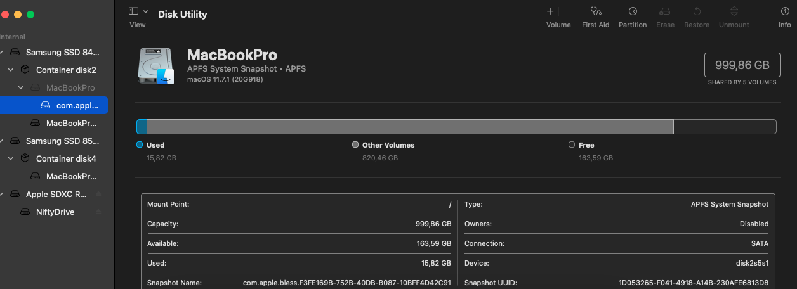
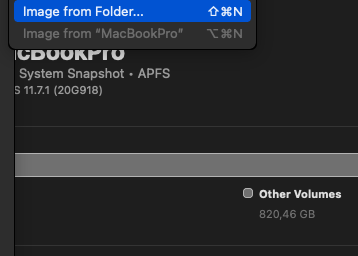
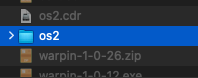
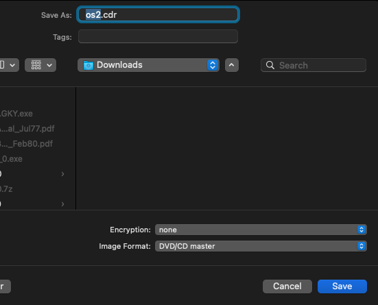

+++
title = "imagen iso en macOS"
date = 2023-04-30T10:56:10Z
lastmod = 2023-04-30T10:56:10Z
author = "Kayte Studio"
categories = ["macOS"]
tags = ["codermag archive"]
originalUrl = "https://codermag.gleentech.com/2023/04/30/imagen-iso-en-macos/"
+++

Hola lectores,

Hoy, como hacer una imagen iso en macOS.

Primer, llamar el disk utility.



Después, clicar en el File. New as image.

  

Por fin, en el terminal hacer el proximo comando en la cli.

``` bash
cd Downloads
hdiutil makehybrid -iso -joliet -o -FILENAME.iso FILENAME.cdr
```
