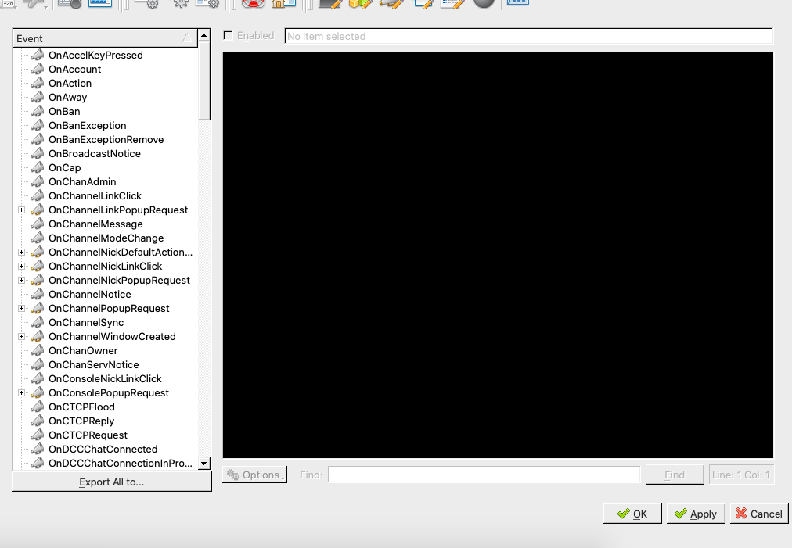
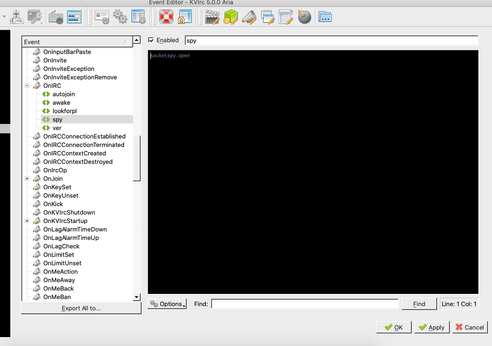

+++
title = "IRC scripting"
date = 2022-06-22T15:39:35Z
lastmod = 2022-06-22T15:39:35Z
author = "Kayte Studio"
categories = ["Unix / Linux"]
tags = ["codermag archive"]
originalUrl = "https://codermag.gleentech.com/2022/06/22/irc-scripting/"
+++

Hello, it's coder by gleentech again. Today we are going to talk about kvirc IRC scripting.

The following code is the script itself.

``` bash
alias(j){ join $0-; };
j  #plv
echo This is me
event (OnIRC, enable)
{
    echo Auto-spying my channels...
    action.enable
}

event (OnIRC, ver)
{
    echo Auto Knowing version...
    about.kvirc
}


event (OnIRC, hosting)
{
    echo Auto-spying my channels...
    ahost
}

event (OnIRC, spy)
{
    echo Auto-spying my channels...
    socketspy.open
}


event(OnIRC,autojoin)
{
    echo Auto-joining my preferred channels...
    j #plv
}

event(OnIRC,lookforplv)
{
    echo Looking for plvicente...
    whois plvicente
}

event (OnIRC, awake)
{
    echo Away off my channels...
    away I fell asleep... Don't wake me up
}

event (OnIRC, banning)
{
    echo banning  on my channels...
    ban $0
}
```

First of all, we must do two things before seeing the script.

``` bash
/bin/bash -c "$(curl -fsSL https://raw.githubusercontent.com/Homebrew/install/HEAD/install.sh)"
```

``` bash
brew install kvirc
```

Now we have our IRC client to code our script.

We must open the kvirc on the macOS. Then link to your favorite network server.

I am going to show how to use the script on ptnet the Portuguese network. We can use this on any network. Now, we have the script on our side.

We must go to the events tab and choose onIRC event. Click on the right side and create a new event default.



Rename the default event name to spy on onIRC events. Then copy the onIRC spy event to the file you just created. The apply and close.



For instance, this spy function will log your status and everything you do on the IRC server network.

You can copy the event clicks to your side to see how we can use IRC scripting. I write first a kvs file before copy the functions and events or even aliases.
