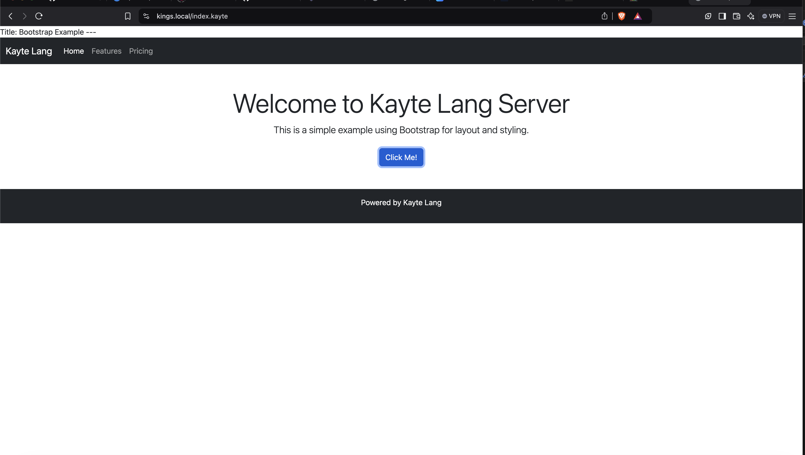

+++
title = "Kayte Lang for apache2"
date = 2024-12-07T11:46:59Z
lastmod = 2024-12-07T11:46:59Z
author = "Kayte Studio"
categories = ["Labs", "macOS"]
tags = ["codermag archive"]
originalUrl = "https://codermag.gleentech.com/2024/12/07/kayte-lang-for-apache2/"
+++

### Kayte Lang: Now Fully Compatible with Apache2

We are thrilled to announce that **Kayte Lang**, our innovative programming language designed for versatility and performance, is now fully compatible with **Apache2** web servers. This milestone makes Kayte Lang even more accessible for web developers and enthusiasts who want to harness its power in server-side applications.

#### Why Apache2 Compatibility Matters

Apache2 is one of the most widely used and trusted web servers globally. By enabling Kayte Lang to run seamlessly in an Apache2 environment, we empower developers to:

- **Expand Their Toolkit**: Integrate Kayte Lang’s unique features into existing web applications.
- **Leverage Apache2’s Robust Features**: Combine Kayte Lang’s speed and simplicity with Apache2’s proven performance, scalability, and security.
- **Deploy Quickly**: Use `.kayte` files alongside `.php` files without additional setup or tools.

#### How It Works

Kayte Lang files (`.kayte`) are processed as PHP files, allowing them to leverage the full power of PHP while retaining Kayte Lang's syntax and benefits. Here’s how the integration works:

1.  **Apache2 Configuration**: `.kayte` files are set up to be handled by the PHP interpreter in Apache2. This ensures smooth execution of Kayte Lang scripts.
2.  **Native Syntax Support**: Developers write in `.kayte` files just as they would in `.php` files, with Kayte Lang’s unique features.
3.  **Seamless Deployment**: Upload `.kayte` files to your web server, and they will execute like standard PHP files—no special runtime required.

#### Getting Started

To start using Kayte Lang with Apache2:

1.  **Install Apache2**: Ensure you have Apache2 and the PHP module installed on your server.
2.  **Configure Apache2 for Kayte Lang**: Modify the Apache configuration to recognize `.kayte` files.
3.  **Write and Deploy**: Create `.kayte` files and upload them to your server.

For a detailed guide on setting up Apache2 for Kayte Lang, check our documentation [here](#).

#### Key Features of Kayte Lang on Apache2

- **High Compatibility**: Works alongside existing PHP applications.
- **Performance-Oriented**: Designed for efficiency in server-side operations.
- **Extensibility**: Easily integrates with databases, APIs, and modern web technologies.
- **Lightweight and Intuitive**: Perfect for both small scripts and complex server-side logic.

#### What’s Next

The integration of Kayte Lang with Apache2 is just the beginning. Our roadmap includes:

- **Native Support for More Servers**: Including Nginx and IIS.
- **Enhanced Debugging Tools**: To simplify development workflows.
- **Kayte Framework**: A lightweight framework tailored for rapid application development in Kayte Lang.

#### Join the Kayte Lang Community

We are excited to see what you’ll create with Kayte Lang and Apache2! Share your projects, feedback, and ideas with the growing community of Kayte Lang developers.

Visit [Kayte Lang's official website](https://github.com/ringsce/kayte-lang) to learn more, access resources, and download the latest version.

Let’s redefine server-side development together with Kayte Lang!

------------------------------------------------------------------------

