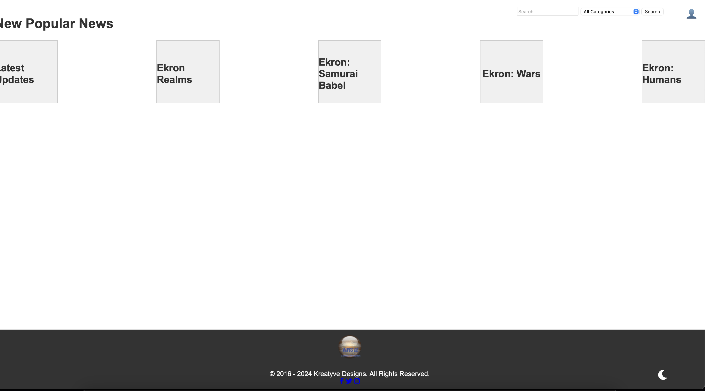
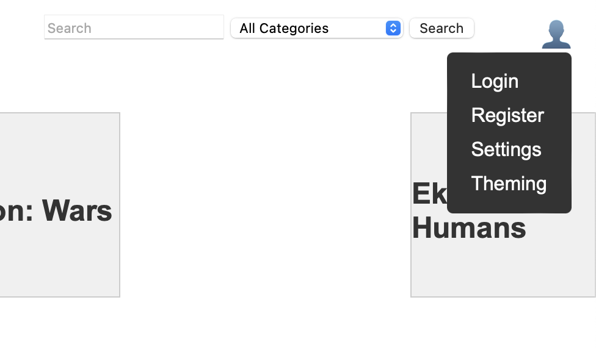

+++
title = "kings app"
date = 2024-05-03T08:21:46Z
lastmod = 2024-05-03T08:22:09Z
author = "Kayte Studio"
categories = ["macOS"]
tags = ["codermag archive"]
originalUrl = "https://codermag.gleentech.com/2024/05/03/kings-app/"
+++

Hello,

Today we are going to talk about kings app framework for ringsCE mirror websites, with this source code you can make mirrors or even forks from the orginal code.

``` bash
git clone https://github.com/ringsce/kings.git
```

Open the folder with vs code on your mac:

``` bash
cd kings && code .
```

Then boot the folder with ssl for testing local on your mamp pro:

 
