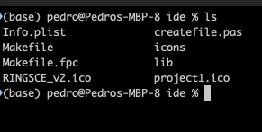
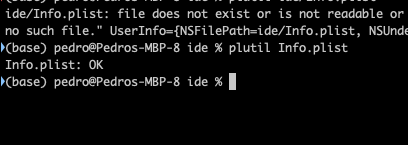

+++
title = "macOS check plist"
date = 2023-08-11T15:43:50Z
lastmod = 2023-08-11T15:50:39Z
author = "Kayte Studio"
categories = ["macOS"]
tags = ["codermag archive"]
originalUrl = "https://codermag.gleentech.com/2023/08/11/macos-check-plist/"
+++

Hello, today we are going to learn how to check plist file on the terminal

- type on the terminal:
- plutil Info.plist

 
