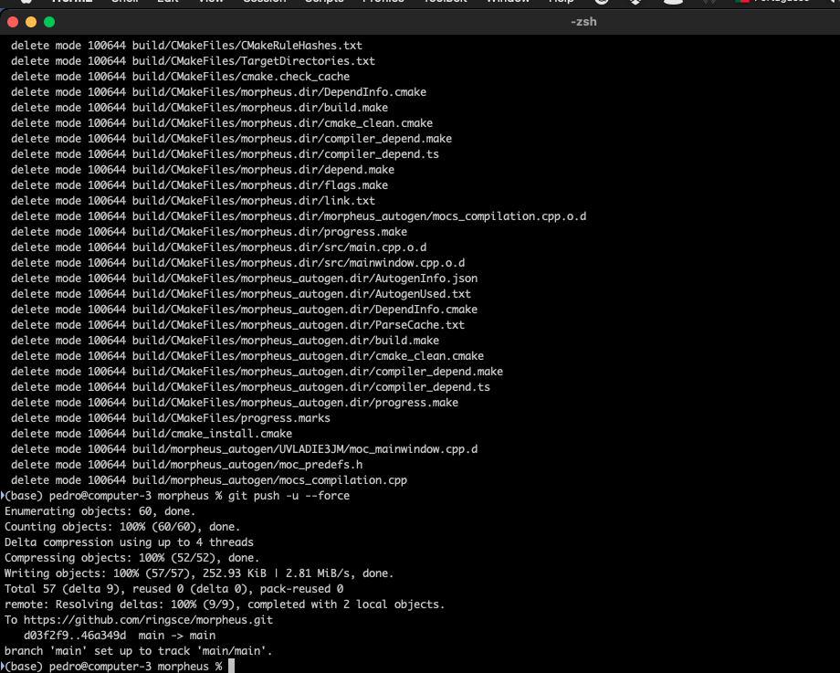
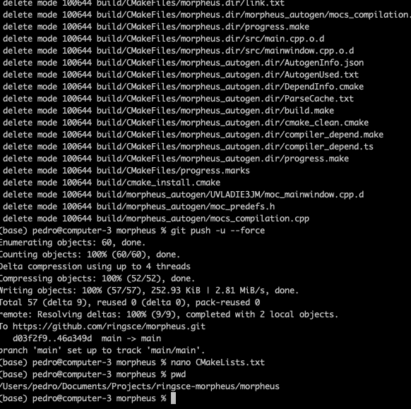
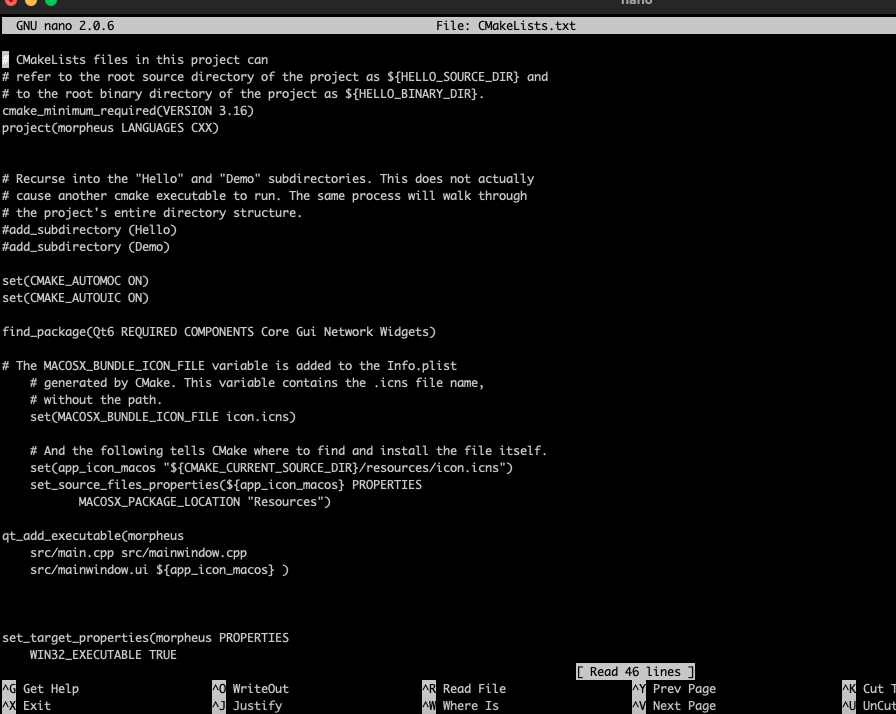
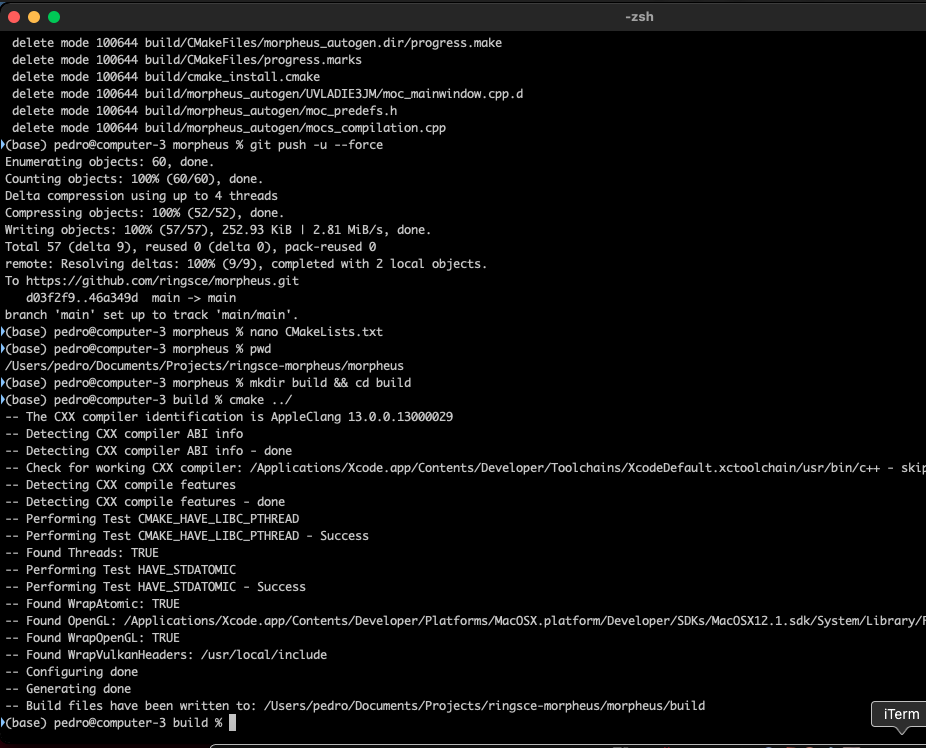
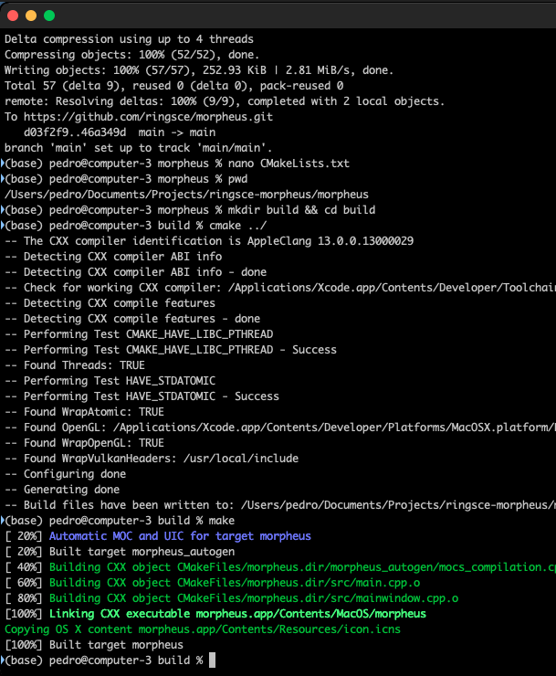
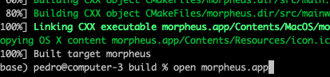
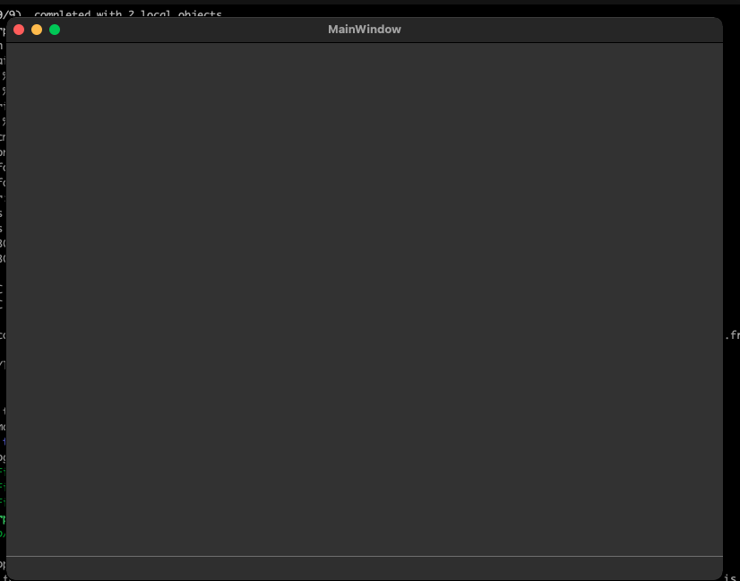

+++
title = "macOS con C++"
date = 2023-09-13T08:55:59Z
lastmod = 2023-10-01T10:37:38Z
author = "Kayte Studio"
categories = ["macOS"]
tags = ["codermag archive"]
originalUrl = "https://codermag.gleentech.com/2023/09/13/macos-con-c/"
+++

Hola Lectores,

Hoy, ustedes a van aprender como hacer una compilación de neon network para macOS big sur. Nosotros tenemos big sur como el sistema actual para desenrollar.

Primero, llamar un terminal como iterm2:

Segundo tener un fichero de cmake como esto y un directorio como esto:

 

Tercero, en el terminal hacer esto:

-\> mkdir build && cd build

-\> cmake ../

-\> make

Después puedes compilar la aplicación.

Ahora por fin pulsar "Enter" con el comando make

  

Contenido para estudiar:

> [Index](https://ringscejs.gleentech.com/)

<https://github.com/ringsce/morpheus>
