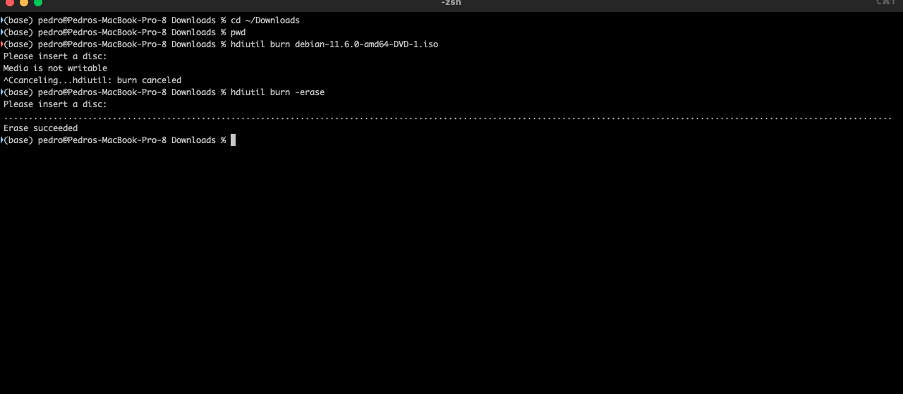
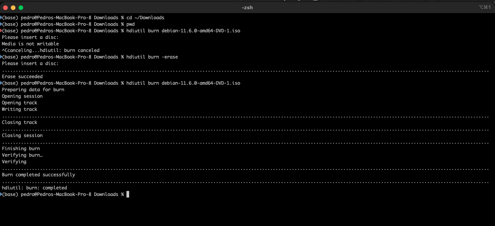

+++
title = "macOS disk utility  (en Castellano)"
date = 2023-03-26T09:48:00Z
lastmod = 2023-03-26T09:48:00Z
author = "Kayte Studio"
categories = ["macOS"]
tags = ["codermag archive"]
originalUrl = "https://codermag.gleentech.com/2023/03/26/macos-disk-utility-en-castellano/"
+++

Hola todos!

Hoy, aprenderemos cómo usar el modo de terminal de la utilidad de disco para grabar DVD-RW o DVD-R.

Esta herramienta es muy útil para los administradores de sistemas.

En primer lugar, aprenderemos a borrar un dvd-rw.

``` bash
hdiutil burn -erase
```



Ahora, veremos cómo grabar un dvd-rw.

``` bash
hdiutil burn name_of_.iso
```



Elegí grabar como ejemplo la iso de Debian, debian.org, la última compilación iso.
