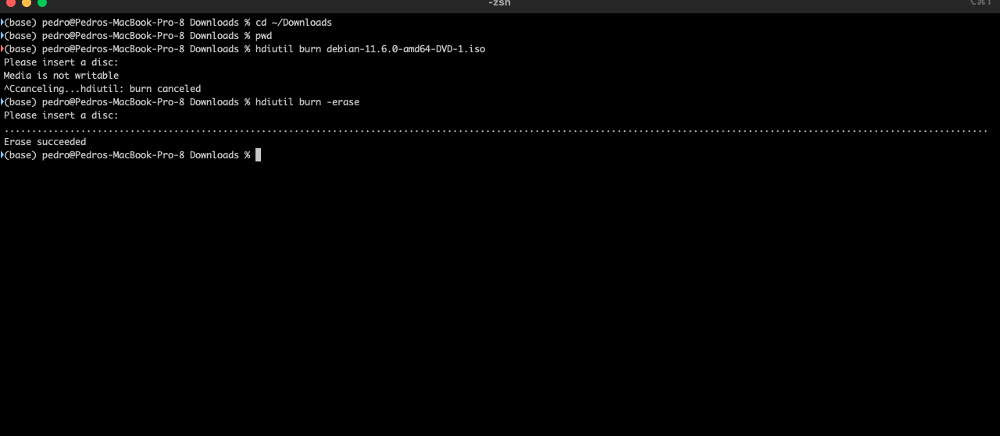
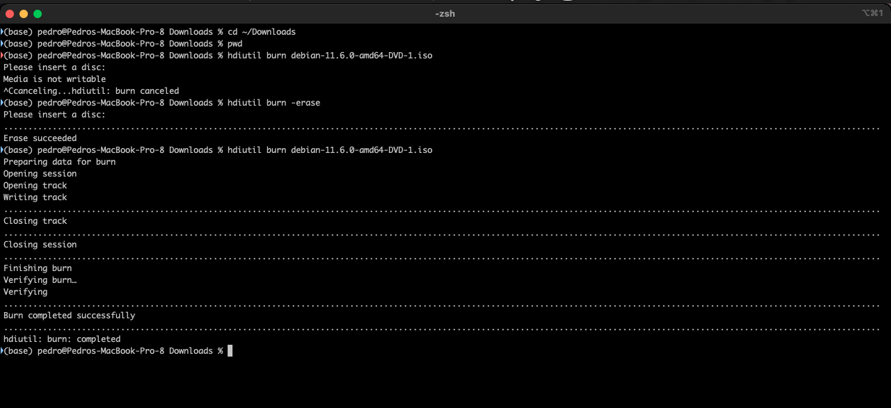

+++
title = "macOS disk utility terminal"
date = 2023-02-24T13:37:08Z
lastmod = 2023-02-24T13:37:08Z
author = "Kayte Studio"
categories = ["macOS"]
tags = ["codermag archive"]
originalUrl = "https://codermag.gleentech.com/2023/02/24/macos-disk-utility-terminal/"
+++

Today, we will learn how to use disk utility terminal mode for recording dvd-rw or dvd-r.

This tool is very useful for system administrators.

First of all, we will learn how to erase dvd-rw.

``` bash
hdiutil burn -erase
```



Now, we will see how to record a dvd-rw.

``` bash
hdiutil burn name_of_.iso
```



I chose to record as an example the iso from Debian, debian.org, the latest iso build.
