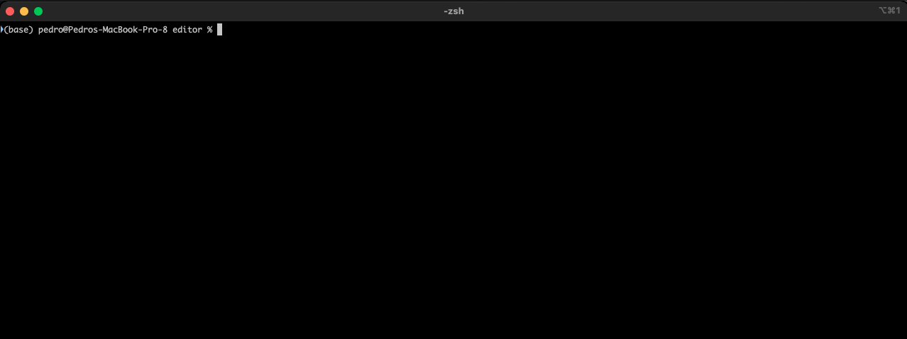
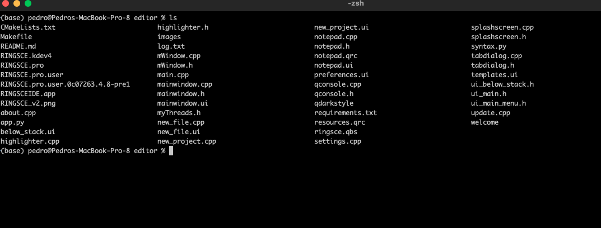
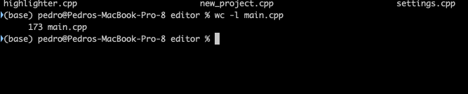
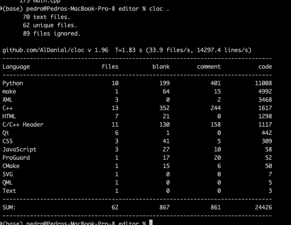

+++
title = "macOS dos comandos utiles"
date = 2023-04-30T11:05:20Z
lastmod = 2023-04-30T11:05:20Z
author = "Kayte Studio"
categories = ["macOS"]
tags = ["codermag archive"]
originalUrl = "https://codermag.gleentech.com/2023/04/30/macos-dos-comandos-utiles/"
+++

Hola lectores,

Hoy, hacemos dos comandos para obtener lineas.

Primero, abrir la ventana del terminal.

Elija un archivo propio, uno en un directorio, puede ser un archivo c ++ en una carpeta de proyecto c ++.

Ahora, vamos a elegir main.cpp

Como ves, puedes ver 173 líneas. Si muestra más o menos.

Ahora escribe cloc . y después tendran una ventana detallada como la mía.

