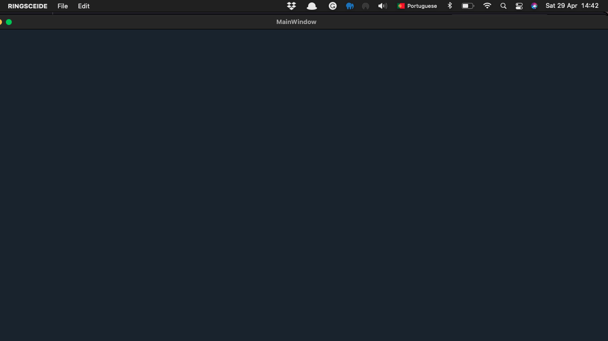
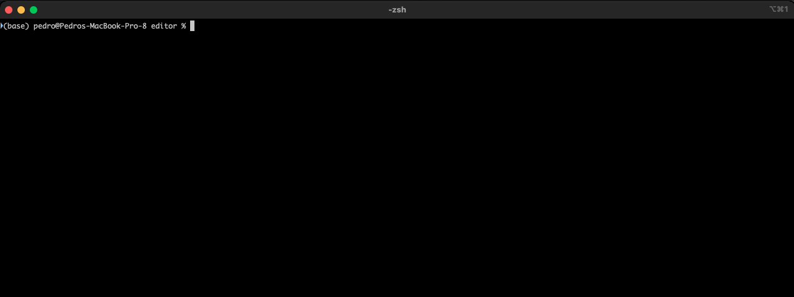
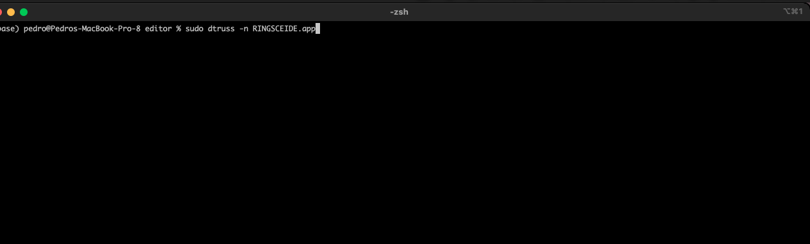
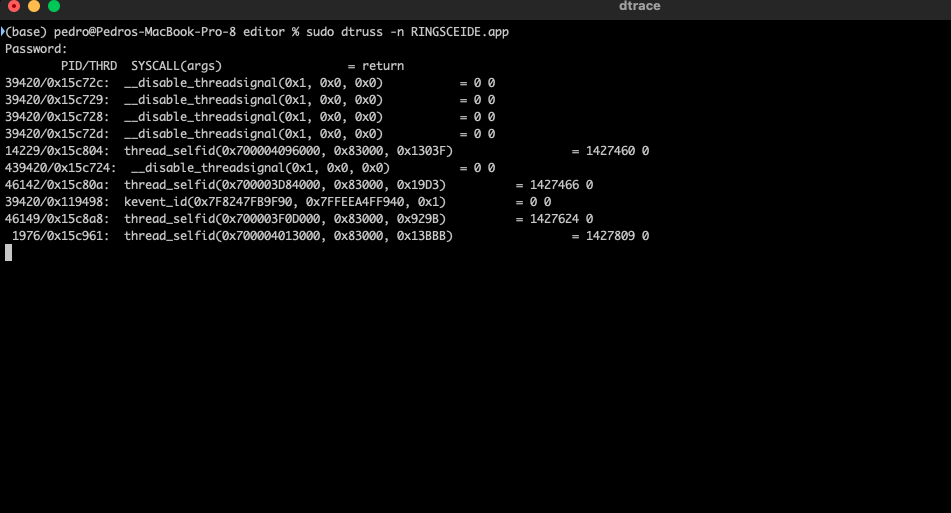
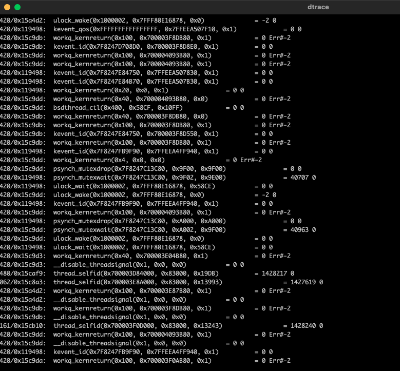

+++
title = "macOS dtruss"
date = 2023-04-29T13:51:41Z
lastmod = 2023-04-29T13:51:41Z
author = "Kayte Studio"
categories = ["macOS"]
tags = ["codermag archive"]
originalUrl = "https://codermag.gleentech.com/2023/04/29/macos-dtruss/"
+++

Hello readers,

Today, we deliver a new technique under a macOS environment. This technique is called dtruss.

First of all, install Xcode and xcode-select. Then, open a terminal window.

    

We used this dtruss as sudo to check segment fault on our freeware application proof of concept.
