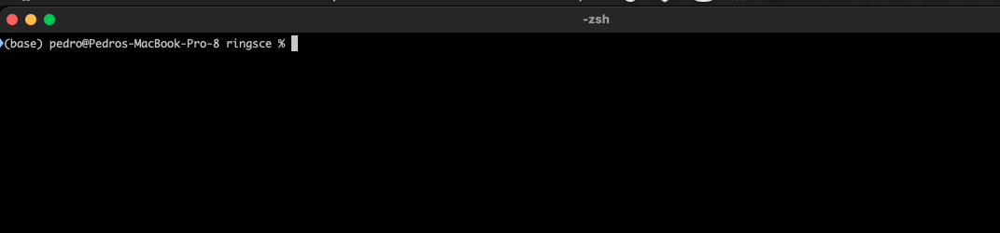
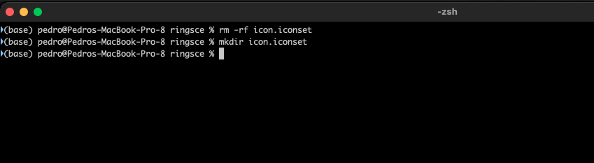
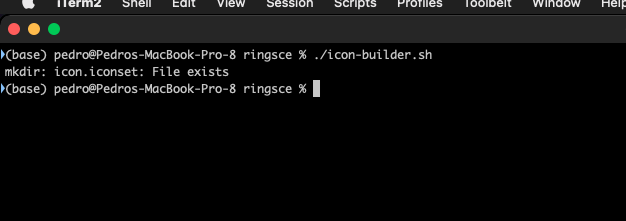
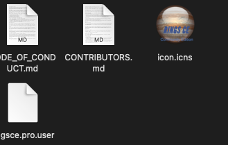

+++
title = "macOS icns setup (en Castellano)"
date = 2023-04-01T08:38:12Z
lastmod = 2023-04-01T08:38:12Z
author = "Kayte Studio"
categories = ["macOS"]
tags = ["codermag archive"]
originalUrl = "https://codermag.gleentech.com/2023/04/01/macos-icns-setup-en-castellano/"
+++

Hola lectores,

Hoy vamos a aprender cómo crear un archivo de icono icns.

Primero:



``` wp-block-preformatted
Vamos a crear una carpeta de conjunto de iconos:
```



``` wp-block-preformatted
Ahora, usemos un script de código para trabajar, es una correción que encontré:
```

mkdir icon.iconset

output_path=~/Projects/ringsce/icon.iconset

\# the convert command comes from imagemagick\
for size in 16 32 64 128 256; do\
half="\$((\$size / 2))"\
convert RINGSCE_V2.png -resize x\$size \$output_path/icon\_\${size}x\${size}.png\
convert RINGSCE_V2.png -resize x\$size \$output_path/icon\_\${half}x\${half}@2x.png\
done

iconutil -c icns \$output_path

``` wp-block-preformatted
Ahora, vamos a ejecutar este script.
```

 
