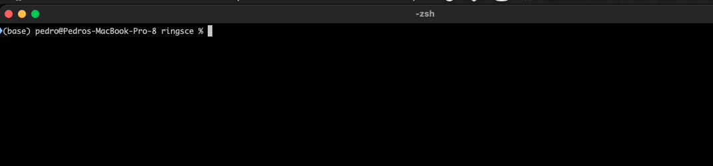
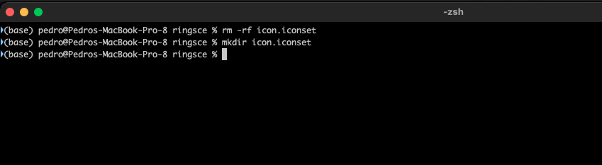
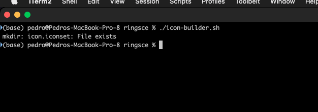
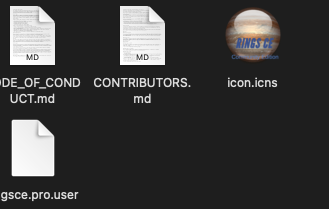

+++
title = "macOS icns setup"
date = 2023-04-01T08:32:14Z
lastmod = 2023-04-01T08:32:14Z
author = "Kayte Studio"
categories = ["macOS"]
tags = ["codermag archive"]
originalUrl = "https://codermag.gleentech.com/2023/04/01/macos-icns-setup/"
+++

Hello readers and followers,

Today we are going to learn how to build an icns icon file.

First:

Let's create an iconset folder:

Now, let's use a code script to work on, it's a gist that I found:

mkdir icon.iconset

output_path=~/Projects/ringsce/icon.iconset

\# the convert command comes from imagemagick\
for size in 16 32 64 128 256; do\
half="\$((\$size / 2))"\
convert RINGSCE_V2.png -resize x\$size \$output_path/icon\_\${size}x\${size}.png\
convert RINGSCE_V2.png -resize x\$size \$output_path/icon\_\${half}x\${half}@2x.png\
done

iconutil -c icns \$output_path

Now, we are going to run this script. We are going to improve that.

 
