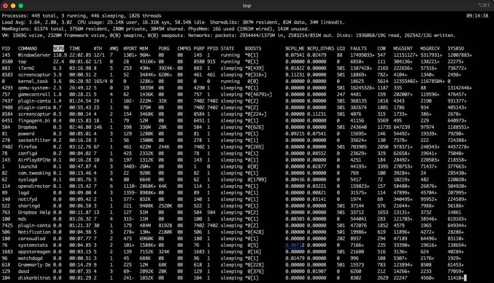
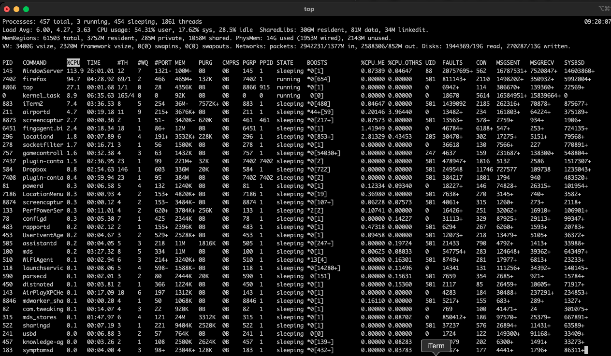

+++
title = "macOS kill services"
date = 2023-02-24T09:21:29Z
lastmod = 2023-02-24T09:21:29Z
author = "Kayte Studio"
categories = ["macOS"]
tags = ["codermag archive"]
originalUrl = "https://codermag.gleentech.com/2023/02/24/macos-kill-services/"
+++

Hello readers,

Today, we are going to deliver one more topic about cli. On this article, we are going to learn how to kill services under terminal application.

As we see, it's empty for now the terminal, or iTerm2.

Now, we are going to call a command from the operating system called top.

We are going to kill on the terminal the service called qemu. With the pid as 4293.

Press q (to exit)

Press Return carrier ( Enter)

Now, go back to the top command to see if the service has gone.

As we see there's nothing now.

Press q again ( exit command)
