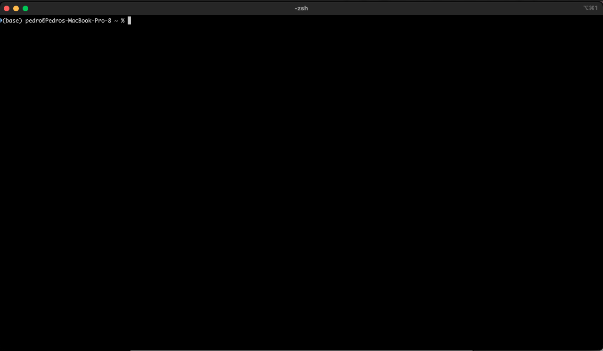
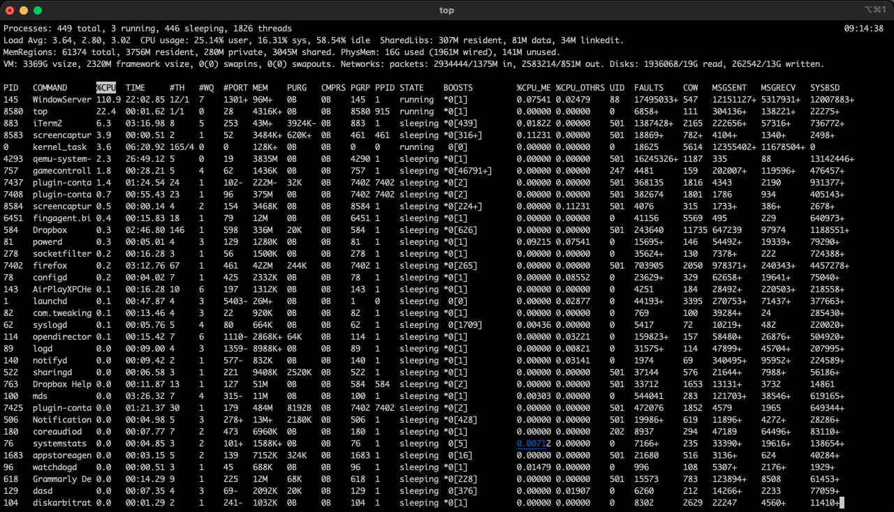
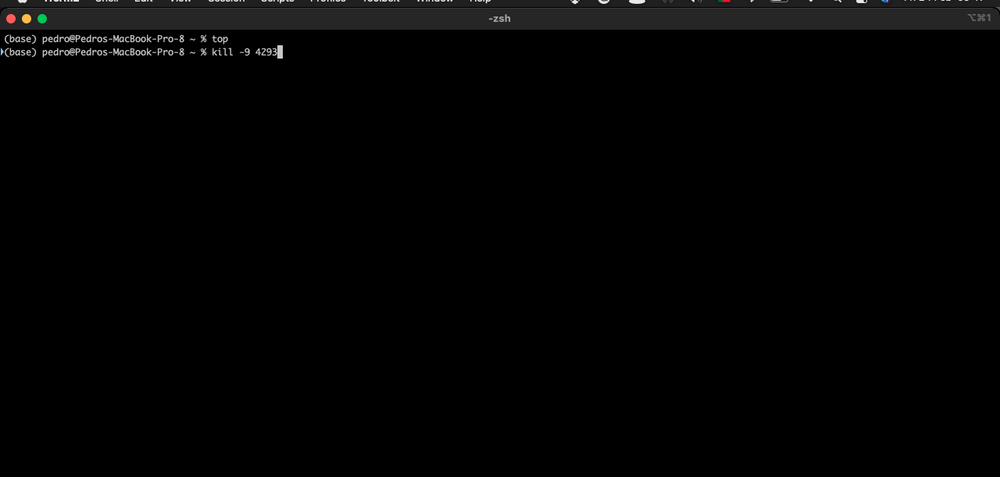
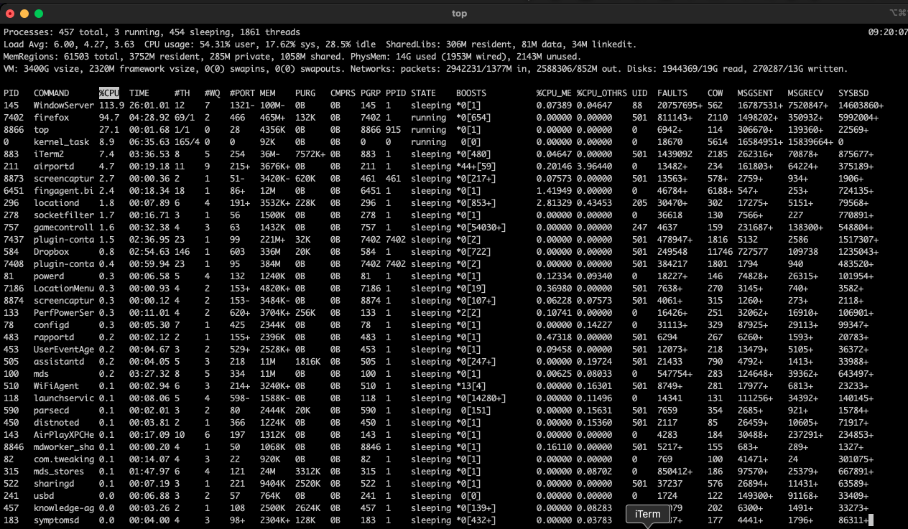

+++
title = "macOS kill servicios (en Castellano)"
date = 2023-03-28T08:54:20Z
lastmod = 2023-03-28T08:54:20Z
author = "Kayte Studio"
categories = ["macOS"]
tags = ["codermag archive"]
originalUrl = "https://codermag.gleentech.com/2023/03/28/macos-kill-servicios-en-castellano/"
+++

Hola lectores,

Hoy, vamos a entregar más un tema sobre cli. En este artículo, vamos a aprender cómo eliminar servicios en la aplicación de terminal.

Como vemos, está vacía por ahora el terminal, o iTerm2.

Ahora, vamos a llamar a un comando del sistema operativo llamado top.

Vamos a matar en la terminal el servicio llamado qemu, con el pid como 4293.

Press q (to exit)

Press Return carrier ( Enter)

Ahora, regrese al comando top para ver si el servicio se ha ido.

Como vemos no hay nada ahora.

Press q again ( exit command)
