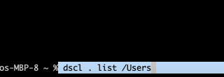
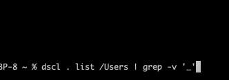
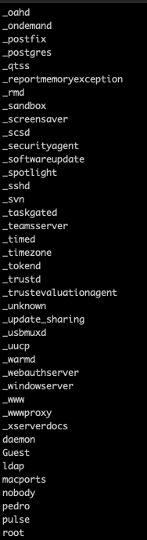
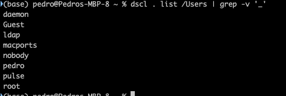

+++
title = "macOS terminal passwords and users"
date = 2023-08-05T18:05:09Z
lastmod = 2023-08-11T15:41:54Z
author = "Kayte Studio"
categories = ["macOS"]
tags = ["codermag archive"]
originalUrl = "https://codermag.gleentech.com/2023/08/05/macos-terminal-passwords-and-users/"
+++

Hello readers,

Today, we will learn how to use a terminal for users and passwords.

Type password to change passwords.

- passwd

To list a User on Mac

- dscl . list /Users

To list only users

- `dscl . list /Users | grep -v '_'`

Results

Users All

Only User

