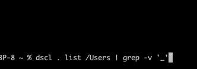
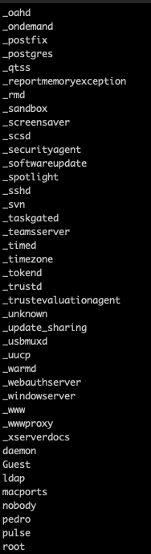
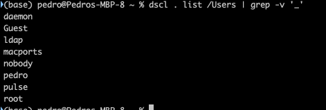

+++
title = "macOS terminal"
date = 2023-09-13T08:36:07Z
lastmod = 2023-09-13T08:36:26Z
author = "Kayte Studio"
categories = ["macOS"]
tags = ["codermag archive"]
originalUrl = "https://codermag.gleentech.com/2023/09/13/macos-terminal/"
+++

# macOS terminal llaves y users

Hola Lectores,

Hoy, ustedes a van aprender como hacer un terminal para gestión de llaves.

Empezamos por escribir password para cambiar de llave.

- passwd

Cómo listar un cliente en macOS:

- dscl . list /Users

&nbsp;

- `dscl . list /Users | grep -v '_'`

Resultados:

Listar todos clientes

Solo user

