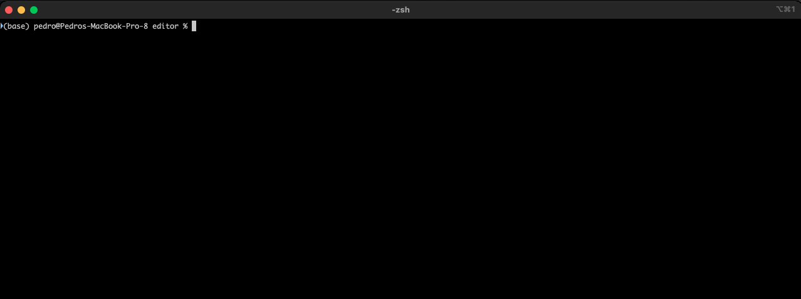
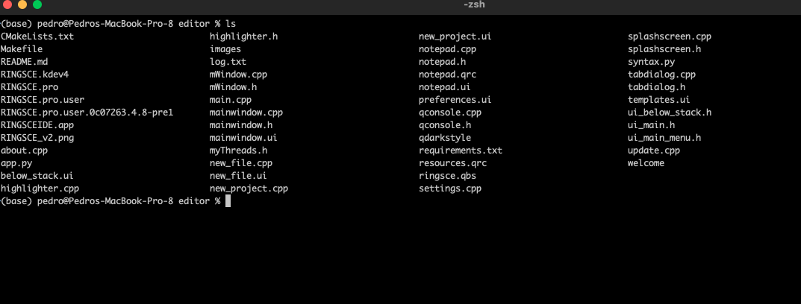
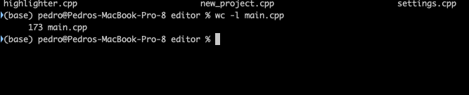
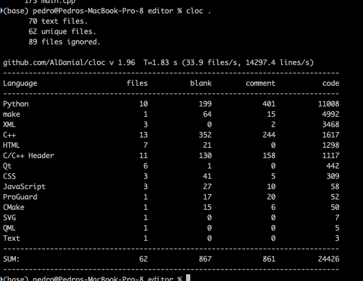

+++
title = "macOS two useful commands"
date = 2023-04-29T14:21:35Z
lastmod = 2023-04-29T14:21:35Z
author = "Kayte Studio"
categories = ["macOS"]
tags = ["codermag archive"]
originalUrl = "https://codermag.gleentech.com/2023/04/29/macos-two-useful-commands/"
+++

Hello readers,

Today, we are going to learn how to use two commands to count coding file lines.

First of all, open a terminal window.

Choose a file of your own, one on a directory, can be a c++ file under a c++ project folder.

Now, we are going to choose main.cpp

As you see, you can see 173 lines. If it shows less or greater good.

Now, type cloc . then you will see a detailed image like mine.

