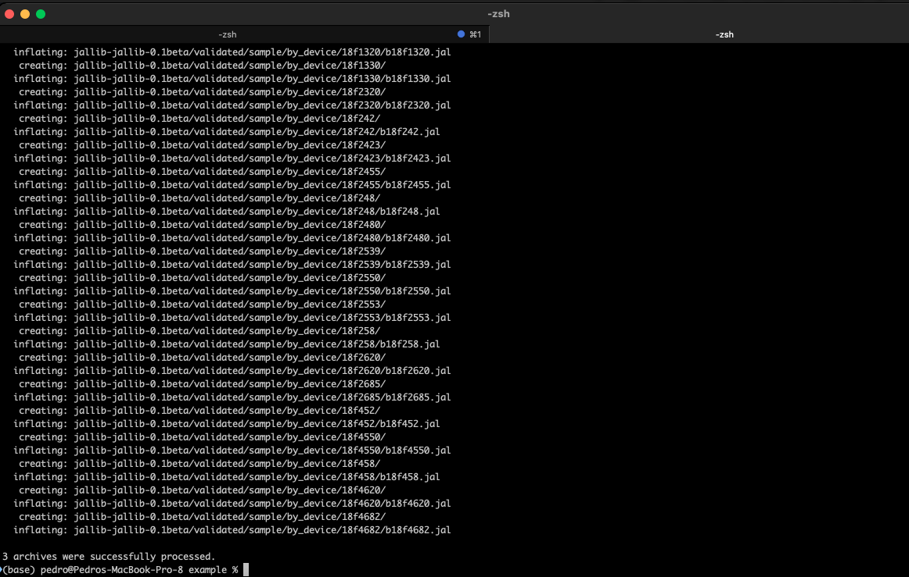
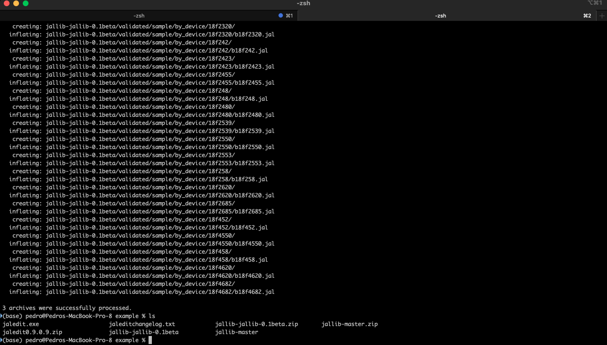
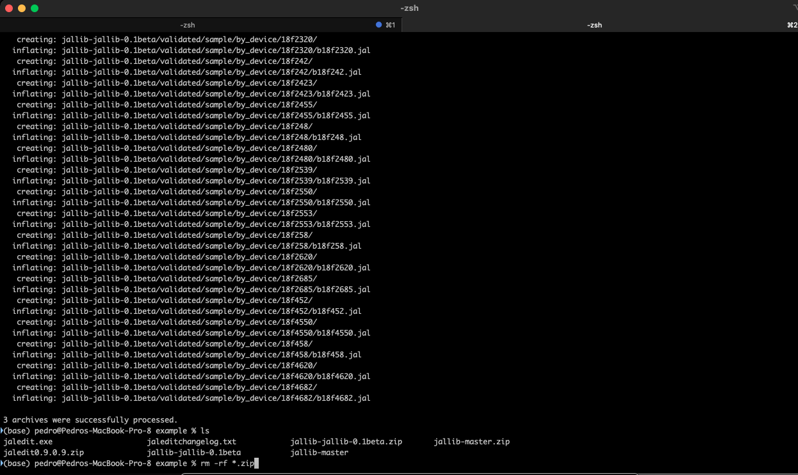
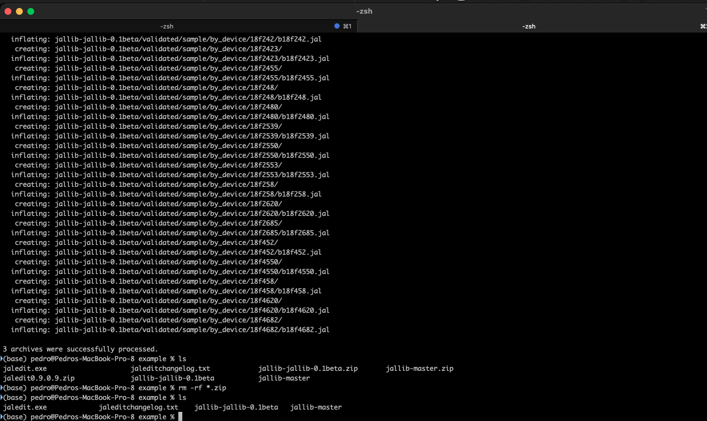

+++
title = "macOS unzip files on terminal"
date = 2023-01-17T09:43:01Z
lastmod = 2023-01-17T09:43:01Z
author = "Kayte Studio"
categories = ["macOS"]
tags = ["codermag archive"]
originalUrl = "https://codermag.gleentech.com/2023/01/17/macos-unzip-files-on-terminal/"
+++

Hello readers,

Today, we will learn how to unzip files on terminal or iTerm2.

On this example, I got a few zip files from the internet, we will show how to unzip a library zip file.

I used a folder called example for the instance workaround.

      

How I done this workaround. I made these few steps on my iTerm2 second tab session.

``` bash
cd Downloads
mkdir example
pwd
mv example1.zip example
mv example2.zip example
mv example3.zip example
cd example
unzip \.zip
ls
rm -rf *.zip
ls
```

You need always to move the zip files into a directory to get this work.

I chose Downloads folder to be easier to manage the example.

I gave you the code inline to manage and the screenshots to become easier.

Now, as you see we can always do those commands on the terminal or iTerm2 to unzip files.
