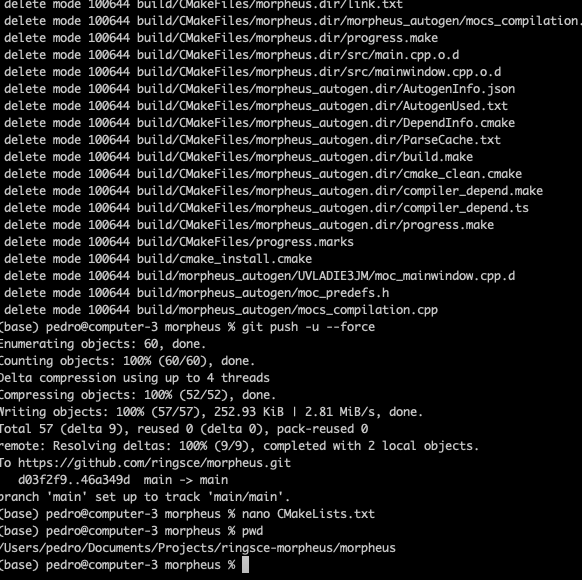
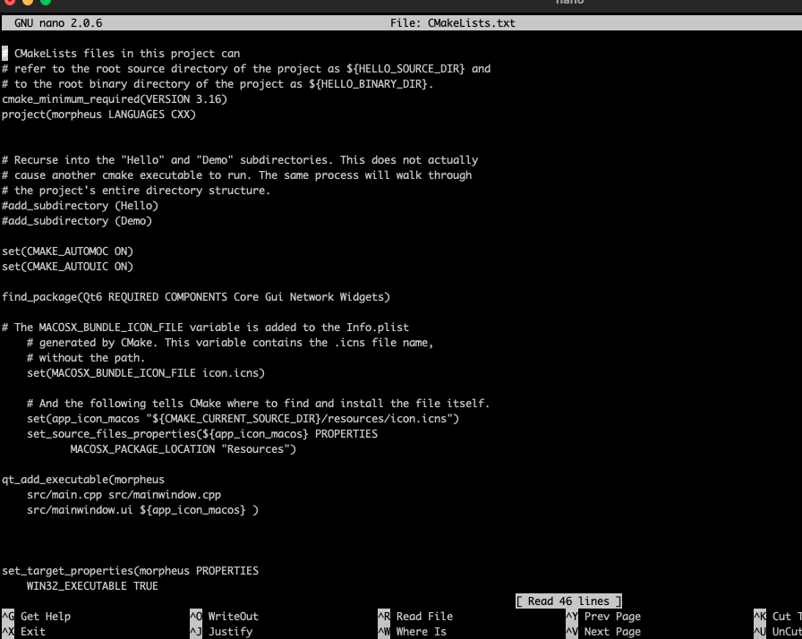
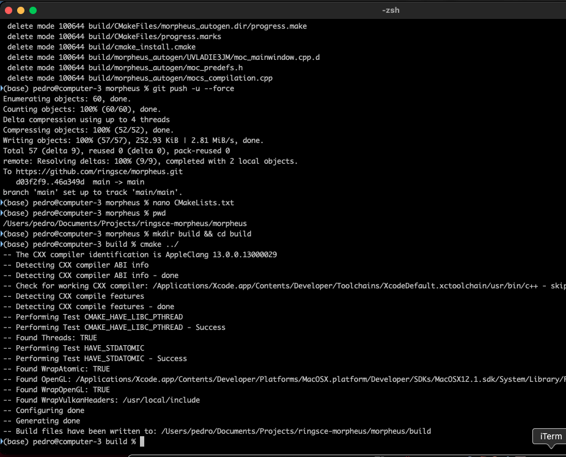
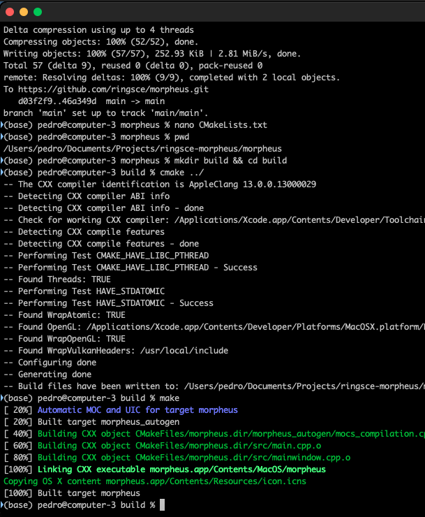
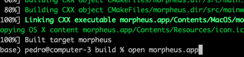
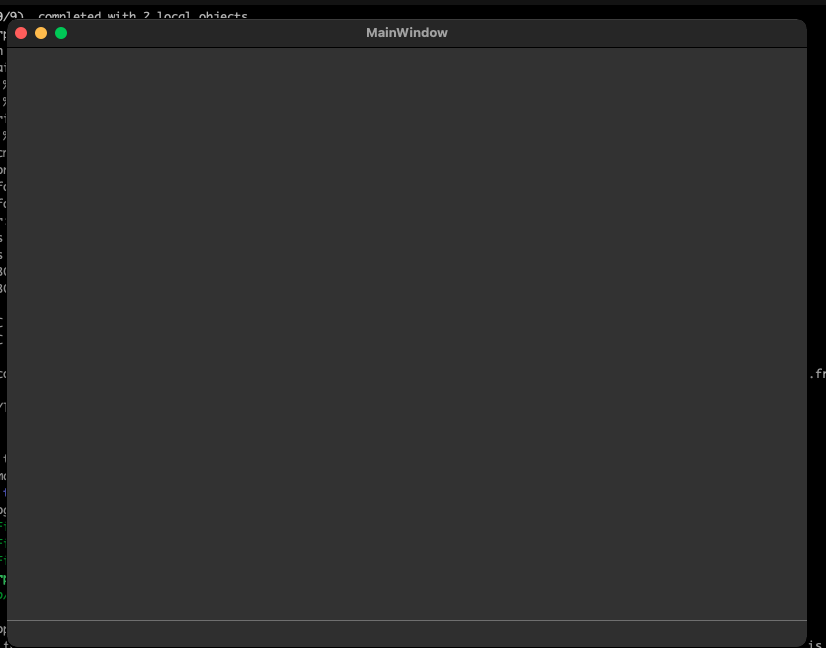

+++
title = "macOS with C++"
date = 2023-10-02T08:58:47Z
lastmod = 2023-10-02T08:58:48Z
author = "Kayte Studio"
categories = ["macOS"]
tags = ["codermag archive"]
originalUrl = "https://codermag.gleentech.com/2023/10/02/macos-with-c/"
+++

Hello Readers,

Today, we are going to learn how to make a compilation for neon network for Big Sur. We here we use big sur for development.

First, run iTerm2 or terminal application:



You must have a directory and a cmake like this one:

 

Next, on terminal do this:

``` bash
mkdir build && cd build
cmake ../
make
```

After setting up all of this run make.


Press “Enter” with command make

  
